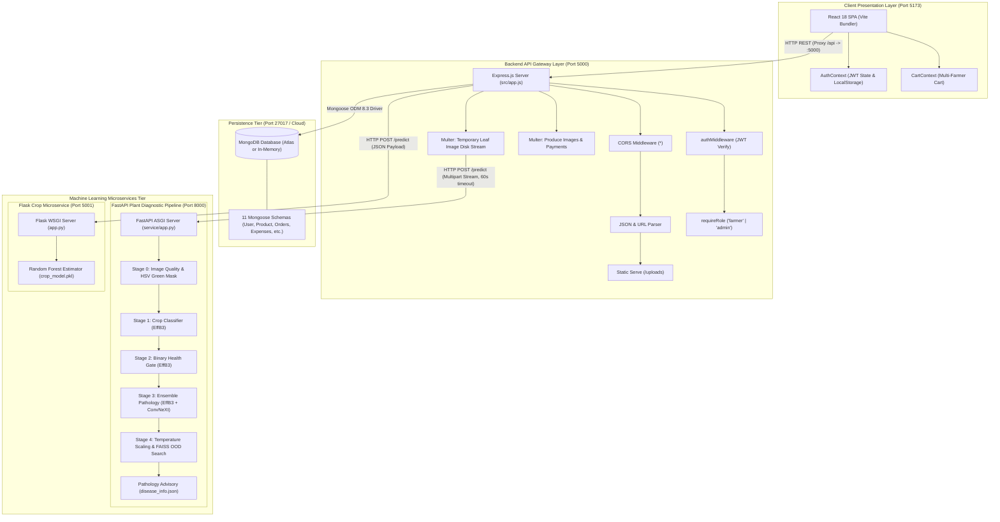
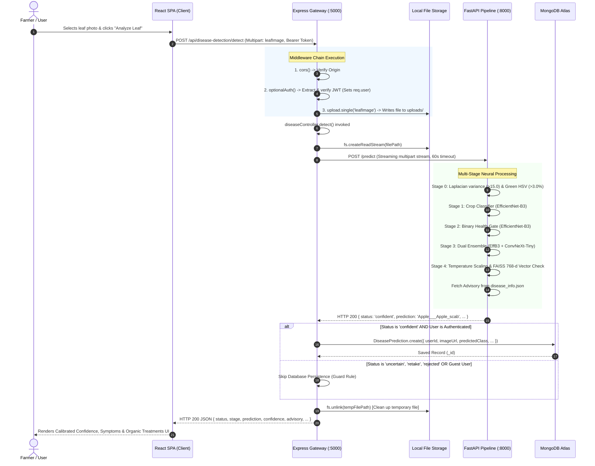
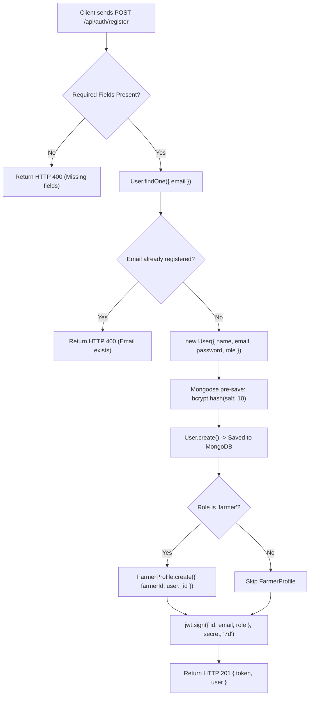
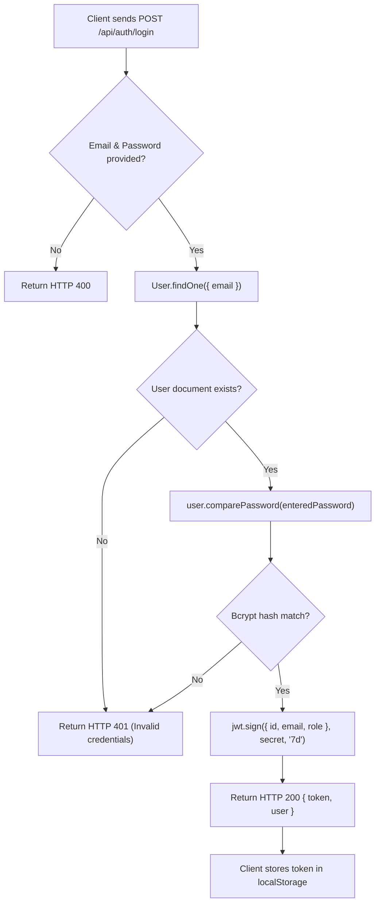
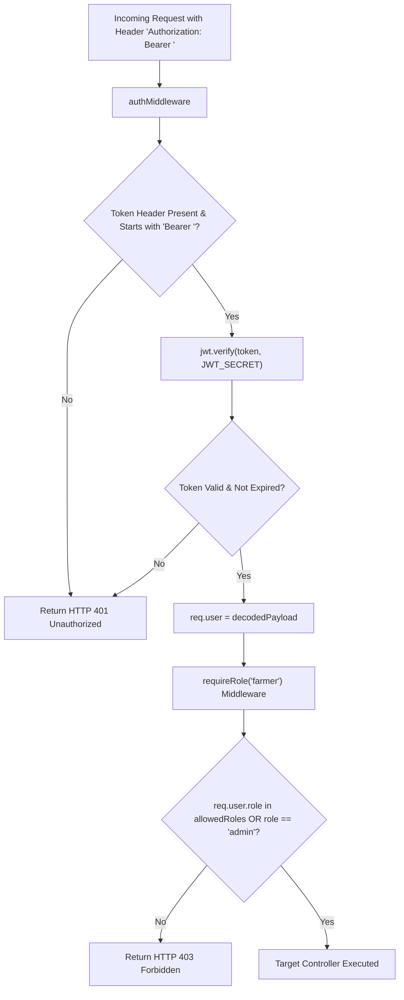
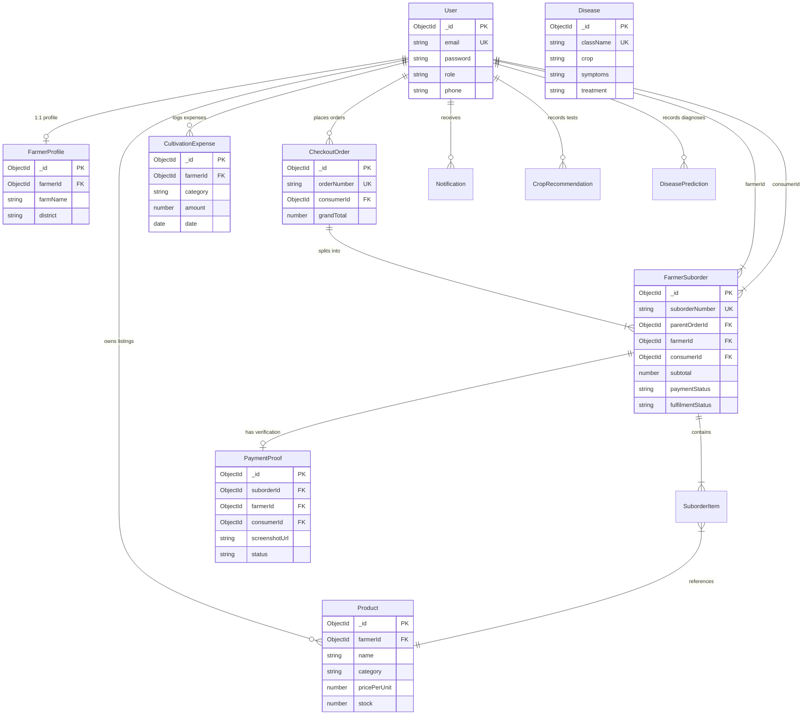

# 🌾 Smart Agriculture Management System
## Full-Stack Architecture, Production Engineering & Technical Interview Preparation Handbook

> **Project Identity:** Smart Agriculture Management System (*Smart Agriculture Assistant / Farm-to-Consumer Platform*)  
> **Repository Scope:** Multi-Service Full-Stack Application (React 18 SPA + Node.js/Express API Gateway + Python FastAPI Plant Disease Diagnostic Pipeline + Python Flask Crop Recommendation Microservice + MongoDB Database)  
> **Target Audience:** Technical Interviewers, System Architects, Senior Software Engineers, and Viva Examination Panels  
> **Last Verified Audit Date:** November 2026

---

## 📑 Table of Contents

- [1. Automatic Project Discovery & System Inventory](#1-automatic-project-discovery--system-inventory)
  - [1.1 Mission, Domain & Problem Solved](#11-mission-domain--problem-solved)
  - [1.2 Codebase Folder Architecture (Depth 3)](#12-codebase-folder-architecture-depth-3)
  - [1.3 Lines of Code (LOC) & Language Breakdown](#13-lines-of-code-loc--language-breakdown)
  - [1.4 Runtime Environments & Complete Dependency Inventory](#14-runtime-environments--complete-dependency-inventory)
  - [1.5 Machine Learning Models & Artifacts Inventory](#15-machine-learning-models--artifacts-inventory)
- [2. Complete System Architecture & Service Interconnects](#2-complete-system-architecture--service-interconnects)
  - [2.1 High-Level Architecture Diagram](#21-high-level-architecture-diagram)
  - [2.2 Technology Stack Justifications (The "Why")](#22-technology-stack-justifications-the-why)
  - [2.3 Microservice Communication & Protocol Matrix](#23-microservice-communication--protocol-matrix)
  - [2.4 End-to-End Request-Response Lifecycle Flowchart](#24-end-to-end-request-response-lifecycle-flowchart)
- [3. Complete API Documentation (43 Endpoints)](#3-complete-api-documentation-43-endpoints)
  - [3.1 Master API Routing Table](#31-master-api-routing-table)
  - [3.2 Route Module Breakdown & Endpoint Counts](#32-route-module-breakdown--endpoint-counts)
  - [3.3 Comprehensive Endpoint Deep Dive (All 43 Routes)](#33-comprehensive-endpoint-deep-dive-all-43-routes)
- [4. Middleware Architecture Deep Dive](#4-middleware-architecture-deep-dive)
  - [4.1 Master Middleware Specification Table](#41-master-middleware-specification-table)
  - [4.2 Theoretical Foundations: `req`, `res`, `next()` & Chaining](#42-theoretical-foundations-req-res-next--chaining)
  - [4.3 In-Depth Analysis of Every Implemented Middleware](#43-in-depth-analysis-of-every-implemented-middleware)
  - [4.4 Step-by-Step Request Walkthrough in the Pipeline](#44-step-by-step-request-walkthrough-in-the-pipeline)
- [5. Authentication, Authorization & Security Architecture](#5-authentication-authorization--security-architecture)
  - [5.1 Cryptographic Password Hashing (Bcrypt)](#51-cryptographic-password-hashing-bcrypt)
  - [5.2 Stateless Token Authentication (JWT Lifecycle)](#52-stateless-token-authentication-jwt-lifecycle)
  - [5.3 Role-Based Access Control (RBAC) & Ownership Verification](#53-role-based-access-control-rbac--ownership-verification)
  - [5.4 Authentication & Authorization Flowcharts](#54-authentication--authorization-flowcharts)
  - [5.5 Key Interview Concept Comparisons](#55-key-interview-concept-comparisons)
  - [5.6 Honest Security Audit & Vulnerability Analysis](#56-honest-security-audit--vulnerability-analysis)
- [6. Database Architecture & Mongoose Deep Dive](#6-database-architecture--mongoose-deep-dive)
  - [6.1 Master Database Models Table (11 Schemas)](#61-master-database-models-table-11-schemas)
  - [6.2 Complete Model Specifications](#62-complete-model-specifications)
  - [6.3 System Entity-Relationship (ER) Diagram](#63-system-entity-relationship-er-diagram)
  - [6.4 Advanced Database Concepts in the Codebase](#64-advanced-database-concepts-in-the-codebase)
- [7. Feature-Wise Implementation Walkthrough](#7-feature-wise-implementation-walkthrough)
  - [7.1 User Management & Role Switching](#71-user-management--role-switching)
  - [7.2 AI Crop Recommendation System](#72-ai-crop-recommendation-system)
  - [7.3 Staged Plant Disease Diagnostic Pipeline](#73-staged-plant-disease-diagnostic-pipeline)
  - [7.4 Geolocation & Nearby Agricultural Services Map](#74-geolocation--nearby-agricultural-services-map)
  - [7.5 Direct Produce Marketplace Catalog](#75-direct-produce-marketplace-catalog)
  - [7.6 Multi-Farmer Cart & Atomic Split Checkout](#76-multi-farmer-cart--atomic-split-checkout)
  - [7.7 Simulated Payment Verification & Review Workflow](#77-simulated-payment-verification--review-workflow)
  - [7.8 Suborder Fulfillment Pipeline & Stock Restoration](#78-suborder-fulfillment-pipeline--stock-restoration)
  - [7.9 Farmer Business Suite: Inventory CRUD](#79-farmer-business-suite-inventory-crud)
  - [7.10 Cultivation Expense Accounting & Real-Time P&L Engine](#710-cultivation-expense-accounting--real-time-pl-engine)
  - [7.11 In-App Contextual Notification Engine](#711-in-app-contextual-notification-engine)
- [8. HTTP Status Codes & Error Handling Architecture](#8-http-status-codes--error-handling-architecture)
  - [8.1 Master HTTP Status Codes Reference Table](#81-master-http-status-codes-reference-table)
  - [8.2 Error Handling Patterns & Upstream Status Translation](#82-error-handling-patterns--upstream-status-translation)
  - [8.3 Real Production Error Response Formats](#83-real-production-error-response-formats)
- [9. Core Technical Concepts Illustrated in Code](#9-core-technical-concepts-illustrated-in-code)
- [10. Critical Code Implementations Line-by-Line](#10-critical-code-implementations-line-by-line)
- [11. Technical Interview Question Bank (100 Questions & Answers)](#11-technical-interview-question-bank-100-questions--answers)
  - [Level 1: Basic Fundamentals (25 Questions)](#level-1-basic-fundamentals-25-questions)
  - [Level 2: Intermediate Implementation (30 Questions)](#level-2-intermediate-implementation-30-questions)
  - [Level 3: Project-Specific Architecture (30 Questions)](#level-3-project-specific-architecture-30-questions)
  - [Level 4: Advanced System Design & Scale (15 Questions)](#level-4-advanced-system-design--scale-15-questions)
- [12. Real-World Production Interview Scenarios](#12-real-world-production-interview-scenarios)
- [13. Quick Revision Cheat Sheet & Interview Day Summary](#13-quick-revision-cheat-sheet--interview-day-summary)
- [14. Installation, Configuration & Startup Guide](#14-installation-configuration--startup-guide)
- [15. Strict Accuracy Register & Truthful System Limitations](#15-strict-accuracy-register--truthful-system-limitations)

---

# 1. Automatic Project Discovery & System Inventory

### 1.1 Mission, Domain & Problem Solved

The **Smart Agriculture Management System** is a unified full-stack agricultural operating platform engineered to address two critical systemic challenges in modern agriculture:

1. **Information Asymmetry in Agronomy (Precision Diagnostics):** Smallholder farmers often lack affordable, timely access to agricultural extension officers and plant pathologists. This leads to improper crop selection and unchecked pathogen outbreaks. The platform bridges this gap by offering:
   - **Soil-to-Crop Recommendation:** Evaluating 7 agro-climatic parameters ($N, P, K$, temperature, humidity, soil pH, rainfall) against a trained machine learning model.
   - **Multi-Stage Plant Pathology Diagnosis:** A calibrated deep learning computer vision pipeline capable of detecting 116 crop conditions, filtering non-leaf anomalies, and outputting evidence-backed treatment and organic remedies.
2. **Supply Chain Disintermediation (Direct Farm-to-Consumer Commerce):** Traditional agricultural supply chains force farmers to sell to intermediaries at low margins while consumers pay inflated retail prices. The platform deploys a decentralized marketplace featuring:
   - Multi-grower cart aggregation and atomic suborder splitting.
   - Transparent UPI payment verification via manual screenshot review.
   - Granular cultivation cost accounting and real-time Profit & Loss (P&L) financial ledger analytics.

---

### 1.2 Codebase Folder Architecture (Depth 3)

The repository follows a decoupled multi-service monorepo structure:

```text
Smart Agriculture Mangement/
├── client/                               # React 18 Single-Page Application (Vite Dev Server)
│   ├── index.html                        # Application HTML5 entrypoint
│   ├── package.json                      # Client dependencies, scripts & devDependencies
│   ├── vite.config.js                    # Vite bundler config with Express reverse-proxy
│   ├── tailwind.config.js                # Tailwind CSS theme configuration (custom agri- palette)
│   ├── public/                           # Static assets & icons
│   └── src/
│       ├── main.jsx                      # React DOM root bootstrapping
│       ├── App.jsx                       # Master React Router route table & auth guard wrappers
│       ├── index.css                     # Global styles & Tailwind utility directives
│       ├── components/                   # Reusable UI widgets (Navbar, ProtectedRoute)
│       ├── context/                      # Global Context providers (AuthContext, CartContext)
│       └── pages/                        # 21 application page views (Marketplace, Disease, Crop, etc.)
│
├── server/                               # Node.js + Express REST API Gateway (Port 5000)
│   ├── package.json                      # Server dependencies & operational scripts
│   ├── .env.example                      # Environment variable specification template
│   ├── uploads/                          # Local filesystem storage for multipart uploads
│   │   ├── payments/                     # Consumer payment screenshot proofs
│   │   └── products/                     # Farmer produce listing photography
│   └── src/
│       ├── app.js                        # Express server entrypoint, middleware chain & mounting
│       ├── config/                       # Database connectivity (db.js with Atlas & memory fallback)
│       ├── controllers/                  # 10 business logic request controllers
│       ├── middleware/                   # JWT auth, RBAC role guard, Multer file uploaders
│       ├── models/                       # 11 Mongoose schema definitions
│       ├── routes/                       # 9 Express route definitions
│       ├── scripts/                      # Database reset, seeding & E2E integration test scripts
│       └── services/                     # Microservice HTTP adapters (mlCropAdapter, mlDiseaseAdapter)
│
├── ml-services/                          # Dedicated Python Machine Learning Microservices
│   ├── crop-recommendation/              # Flask Microservice (Port 5001)
│   │   ├── app.py                        # Flask server running Random Forest inference
│   │   ├── crop_model.pkl                # Trained Scikit-Learn estimator artifact (2.70 MB)
│   │   └── requirements.txt              # Flask, scikit-learn, joblib, numpy dependencies
│   │
│   ├── plant-pipeline/                   # FastAPI Staged Diagnostic Microservice (Port 8000)
│   │   ├── requirements-serve.txt        # FastAPI, PyTorch CPU, Timm, FAISS, OpenCV dependencies
│   │   ├── artifacts/                    # Checkpoints, FAISS vector index, calibration parameters
│   │   ├── common/                       # Calibration math, image transforms, quality heuristics
│   │   └── service/                      # FastAPI app.py & pipeline execution runner
│   │
│   └── plant-pipeline-training/          # Offline training configs and provenance specifications
│
├── about-project/                        # Centralized documentation, specifications, audits & evidence
│   ├── documentation/                    # 12-chapter academic project reports & full documentation
│   ├── presentations-and-papers/        # Presentation slide decks (.pptx) and research report PDFs
│   ├── technical-audit-records/          # 12 static codebase audits, schemas, and API contracts
│   ├── evaluation-and-evidence/          # Evaluation benchmarks, metrics, and test datasets
│   └── README.md                         # Documentation index and directory guide
│
├── start.sh                              # Bash orchestration script starting all 3 background services
└── README.md                             # Root technical handbook & interview revision guide
```

---

### 1.3 Lines of Code (LOC) & Language Breakdown

*Measured via static filesystem analysis excluding dependencies (`node_modules`, `venv`), build caches, and binaries:*

| Module / Folder | Primary Languages | File Count | Exact Lines of Code | Key Responsibilities |
|---|---|:---:|:---:|---|
| `client/` | JavaScript (React JSX), CSS, HTML, JSON | 35 | **11,242** | UI/UX components, state containers, GIS maps, responsive layouts |
| `server/` | JavaScript (Node.js ES6+), JSON | 43 | **7,351** | API routing, JWT auth, business validation, Mongoose models, proxies |
| `ml-services/` | Python 3, YAML, JSON, Markdown | 27 | **2,676** | Model serving, PyTorch inference, FAISS vector search, Flask API |
| `about-project/` | Markdown, Python, JSON, CSV | 40 | **2,816** | Centralized documentation, technical audits, and evaluation benchmarks |
| `Root scripts` | Shell (`start.sh`) | 1 | **37** | Background service startup orchestration |
| **Total Codebase** | **Multi-Stack** | **106** | **24,122** | **Full clean system repository** |

---

### 1.4 Runtime Environments & Complete Dependency Inventory

#### Environment Prerequisites
- **Node.js:** `v18.x` or higher with `npm`
- **Python:** `3.10.x` to `3.12.x` with `pip` and `venv`
- **Database:** MongoDB 6.0+ (Local, Atlas cloud URI, or automated in-memory fallback)

#### Backend Gateway Dependencies (`server/package.json`)
```json
{
  "dependencies": {
    "axios": "^1.6.8",                  // Upstream HTTP client for ML microservices
    "bcryptjs": "^2.4.3",                // Blowfish cryptographic password hashing
    "cors": "^2.8.5",                    // Cross-Origin Resource Sharing middleware
    "csv-parser": "^3.0.0",              // Streaming CSV parser for disease data imports
    "dotenv": "^16.4.5",                 // Environment variable resolution from .env
    "express": "^4.19.2",                // High-performance HTTP application framework
    "form-data": "^4.0.0",               // Multipart form-data streaming to Python services
    "jsonwebtoken": "^9.0.2",            // Signed HMAC-SHA256 JWT generation and verification
    "mongodb-memory-server": "^9.2.0",   // Zero-config in-memory MongoDB instance for offline runs
    "mongoose": "^8.3.1",                // Asynchronous MongoDB Object-Document Mapper (ODM)
    "multer": "^1.4.5-lts.1"             // Multipart streaming disk storage for file uploads
  },
  "devDependencies": {
    "nodemon": "^3.1.0"                  // File-watcher development server daemon
  }
}
```

#### Frontend Client Dependencies (`client/package.json`)
```json
{
  "dependencies": {
    "axios": "^1.6.8",                  // HTTP client configured with JWT bearer interceptors
    "leaflet": "^1.9.4",                 // Interactive OpenStreetMap geospatial mapping engine
    "lucide-react": "^0.370.0",          // Modern accessible SVG icon library
    "react": "^18.2.0",                  // Declarative component UI library (Virtual DOM)
    "react-dom": "^18.2.0",              // React DOM renderer
    "react-leaflet": "^4.2.1",           // React bindings for Leaflet map elements
    "react-router-dom": "^6.23.0"        // Client-side declarative routing and history management
  },
  "devDependencies": {
    "@vitejs/plugin-react": "^4.2.1",    // Babel/Fast-Refresh plugin for Vite
    "autoprefixer": "^10.4.19",          // CSS vendor prefixer
    "postcss": "^8.4.38",                // CSS transformation tooling
    "tailwindcss": "^3.4.3",             // Utility-first atomic styling framework
    "vite": "^5.2.0"                     // Next-generation ES-module development and build server
  }
}
```

#### Plant Disease Pipeline Inference Dependencies (`ml-services/plant-pipeline/requirements-serve.txt`)
```text
fastapi==0.141.1                  # High-performance asynchronous ASGI web framework
uvicorn==0.54.0                   # Lightning-fast ASGI web server implementation
python-multipart==0.0.32          # Streaming multipart parser for image payloads
torch==2.13.0+cpu                 # PyTorch deep learning tensor runtime (CPU optimized)
torchvision==0.28.0+cpu           # Computer vision transforms, models & operations
timm==1.0.30                      # PyTorch Image Models (EfficientNet-B3, ConvNeXt-Tiny)
faiss-cpu==1.15.1                 # Facebook AI Similarity Search library (L2 vector distance)
opencv-python-headless==5.0.0.93  # Computer vision library for Laplacian blur & HSV masking
pandas==3.1.0                     # Tabular metadata frame manipulation
numpy==2.5.2                      # High-performance N-dimensional array processing
pillow==10.2.0                    # Image decoding, sanitization & decompression safety checks
```

#### Crop Recommendation Service Dependencies (`ml-services/crop-recommendation/requirements.txt`)
```text
flask                             # Lightweight WSGI microservice web framework
scikit-learn                      # Machine learning algorithms (Random Forest classifier)
joblib                            # High-throughput Python object serialization/deserialization
numpy                             # Numerical array structures for feature vectors
```

---

### 1.5 Machine Learning Models & Artifacts Inventory

The plant disease detection system employs a **calibrated multi-stage pipeline** designed to prevent false alarms, reject non-leaf photographs, and achieve high diagnostic precision across **116 crop conditions**:

| Artifact Filename | Exact File Size | Primary Model Architecture | Role in Inference Pipeline |
|---|:---:|---|---|
| `crop_effb3.pt` | **43.52 MB** (43,516,431 B) | EfficientNet-B3 | Multi-class Crop Classifier: Identifies plant species (Apple, Tomato, Grape, etc.) |
| `health_effb3.pt` | **43.32 MB** (43,320,343 B) | EfficientNet-B3 | Binary Gate Classifier: Determines if the leaf is Healthy ($0$) vs Diseased ($1$) |
| `disease_effb3.pt` | **44.03 MB** (44,025,371 B) | EfficientNet-B3 | Primary Multi-Class Pathology Classifier across 116 disease classes |
| `disease_convnext_tiny.pt` | **111.70 MB** (111,700,507 B) | ConvNeXt-Tiny | Secondary Ensemble Classifier & 768-dimensional Feature Embedding Extractor |
| `embeddings.faiss` | **131.03 MB** (131,026,989 B) | FAISS Index (IndexFlatL2) | Vector Similarity Database holding **42,652** 768-d reference leaf embeddings |
| `calibration.json` | **2.53 KB** (2,532 B) | Temperature Scaling Matrix | Logit scaling temperatures ($T$) and class confidence decision thresholds |
| `reference_meta.csv` | **7.53 MB** (7,525,595 B) | CSV Metadata Registry | Class names, disease identifiers, and splits for the 42,652 indexed vectors |
| `disease_info.json` | **78.90 KB** (78,905 B) | Knowledge Base JSON | Curated pathology descriptions, chemical treatments, and organic remedies |
| `crop_model.pkl` | **2.70 MB** (2,699,545 B) | Random Forest Estimator | Supervised multi-class crop predictor evaluated on 7 agro-climatic inputs |

---

# 2. Complete System Architecture & Service Interconnects

### 2.1 High-Level Architecture Diagram



---

### 2.2 Technology Stack Justifications (The "Why")

In technical architecture interviews, explaining *why* a technology was selected over alternatives is essential:

#### 1. Why React 18 + Vite instead of Traditional Multi-Page Applications (MPA) or Next.js?
- **Single Page Application (SPA) Reactivity:** Direct farm-to-consumer trading requires responsive, stateful client interactions (e.g., dynamic cart quantity recalculations, live fulfillment order status tracking, interactive Leaflet map dragging) without full-page reloads.
- **Vite Build Performance:** Vite leverages native ES Modules (ESM) in the browser during development. This provides sub-millisecond Hot Module Replacement (HMR) and avoids Webpack's slow multi-second bundling overhead.
- **Decoupled Architecture:** Using a pure client SPA cleanly separates UI presentation logic from the Express API gateway, allowing independent horizontal scaling and deployment (e.g., hosting the frontend on a CDN like Vercel/Netlify while running the API server on AWS EC2 or Docker).

#### 2. Why Node.js & Express for the Central API Gateway?
- **Asynchronous Non-Blocking I/O (Event Loop):** Agricultural operations involve frequent I/O-bound tasks: querying MongoDB for marketplace inventory, streaming multipart file uploads to disk, and dispatching upstream HTTP requests to Python ML services. Node's single-threaded event loop handles high-concurrency I/O with minimal RAM overhead compared to thread-per-request architectures (e.g., Java Spring or traditional Apache/PHP).
- **Unified JSON Ecosystem:** Using JavaScript across both the frontend and backend eliminates impedance mismatches in JSON data structures, validation logic, and date serializations.
- **Express Middleware Flexibility:** Express provides an unopinionated, lightweight pipeline architecture ideal for composing modular security layers (CORS, JWT verification, RBAC role gating, Multer file filtering) in a predictable execution order.

#### 3. Why Python FastAPI for Plant Disease Detection instead of Serving Inside Node.js?
- **Native Tensor Computation Support:** Modern deep learning models (PyTorch, Timm) and vector similarity libraries (FAISS) are written in C++ with native first-class Python bindings. Running multi-stage convolutional neural networks directly in Node.js via TensorFlow.js lacks hardware acceleration, custom model architecture support, and vector search scalability.
- **Asynchronous High Concurrency (FastAPI + ASGI):** FastAPI is built on top of Starlette and Pydantic, executing on the asynchronous ASGI server Uvicorn. It yields near-C throughput while automatically validating input types and handling streaming binary image uploads.

#### 4. Why Flask for the Crop Recommendation Service?
- **Micro-Footprint Simplicity:** The crop recommendation task is a lightweight, tabular inference service evaluating a single Scikit-Learn Random Forest pickle artifact (`crop_model.pkl`). Flask provides a minimal WSGI interface without the overhead of heavy framework abstractions.

#### 5. Why MongoDB with Mongoose ODM?
- **Polymorphic Agricultural Data Structures:** Agricultural products, multi-farmer suborders, and disease pathology advisories vary in schema complexity (e.g., a pesticide expense receipt vs. an organic compost certification; a simple delivery address vs. a nested payment verification snapshot). MongoDB's flexible BSON document model represents these hierarchical relationships without costly multi-table SQL joins.
- **Mongoose Schema Governance:** While MongoDB is schema-less, enterprise applications require strict business boundaries. Mongoose provides schema validation, required fields, enum enforcement, pre-save cryptographic hooks, and virtual populate references while preserving document database flexibility.

#### 6. Why FAISS (Facebook AI Similarity Search) for Out-of-Distribution (OOD) Detection?
- **Mitigating Deep Learning Hallucination:** Standard softmax classifiers output a high-confidence prediction even when shown an out-of-distribution image (e.g., a photograph of a shoe, dog, or car). The system passes image embeddings (768-dimensional vectors from ConvNeXt-Tiny) through FAISS to calculate exact Euclidean (L2) distances against 42,652 verified leaf vectors. If the nearest reference distance exceeds the calibrated threshold, the image is marked `rejected` or `uncertain`, preventing catastrophic diagnostic errors.

---

### 2.3 Microservice Communication & Protocol Matrix

The platform functions as a distributed microservice network communicating over standard HTTP/1.1 protocols:

| Source Component | Target Component | Protocol & Method | Transport Format | Timeout Config | Business Purpose |
|---|---|:---:|:---:|:---:|---|
| **Client Browser** | **Vite Dev Proxy** | HTTP `:5173` | JSON / Multipart | Standard Browser | Proxies `/api/*` requests to Node backend at `http://localhost:5000` |
| **Vite / Client** | **Node.js Express** | HTTP `:5000` | JSON / Form-Data | 30,000 ms | Dispatches authentication, marketplace, and diagnostic API calls |
| **Node.js Server** | **MongoDB Database** | TCP / BSON Protocol | Binary Wire Protocol | 30,000 ms (Connect) | Reads and writes application records via Mongoose ODM 8.3 |
| **Node.js Server** | **FastAPI Pipeline** | HTTP `POST :8000/predict` | `multipart/form-data` | **60,000 ms** (Axios) | Streams leaf image from Multer disk path for 4-stage neural diagnosis |
| **Node.js Server** | **Flask Crop ML** | HTTP `POST :5001/predict` | `application/json` | 10,000 ms (Axios) | Sends 7 soil/weather features to Random Forest model |

---

### 2.4 End-to-End Request-Response Lifecycle Flowchart

The following diagram illustrates the complete execution path when a user submits an agricultural leaf image for AI diagnosis:




---

# 3. Complete API Documentation (43 Endpoints)

### 3.1 Master API Routing Table

The backend exposes **43 unique API endpoints** categorized by their HTTP verb:
- **`GET` (18 Endpoints):** Data retrieval, public product catalog, analytics queries, order tracking.
- **`POST` (11 Endpoints):** Resource creation, authentication, checkout, leaf diagnosis, payment proof.
- **`PUT` (3 Endpoints):** Complete resource updates (user profile, farmer profile, product editing).
- **`PATCH` (5 Endpoints):** Partial state transitions (suborder status, product toggle, notification reads).
- **`DELETE` (6 Endpoints):** Resource removal (consultation history, products, expenses).

| No. | HTTP Method | Endpoint | Purpose | Authentication | Authorization / Role |
|:---:|:---:|---|---|:---:|:---:|
| 1 | `GET` | `/` | API Gateway Health & Identity Check | None | Public |
| 2 | `POST` | `/api/auth/register` | Register New User (Farmer / Consumer) | None | Public |
| 3 | `POST` | `/api/auth/login` | Authenticate User & Issue JWT Token | None | Public |
| 4 | `GET` | `/api/auth/me` | Fetch Current Authenticated User Session | Required | Any Authenticated |
| 5 | `PUT` | `/api/auth/profile` | Update User Name, Phone & Location | Required | Any Authenticated |
| 6 | `POST` | `/api/crop-recommendation/recommend` | Infer Optimal Crop from Soil/Climate Features | Optional | Public / Guest / User |
| 7 | `GET` | `/api/crop-recommendation/history` | List User's Past Soil Recommendation Tests | Required | Any Authenticated |
| 8 | `DELETE` | `/api/crop-recommendation/history/all` | Delete All Crop Recommendation History | Required | Any Authenticated |
| 9 | `DELETE` | `/api/crop-recommendation/history/:id` | Delete Single Crop Recommendation Record | Required | Any Authenticated |
| 10 | `POST` | `/api/disease-detection/detect` | Multi-Stage Leaf Pathology Diagnosis | Optional | Public / Guest / User |
| 11 | `GET` | `/api/disease-detection/history` | List User's Saved Confident Diagnoses | Required | Any Authenticated |
| 12 | `GET` | `/api/disease-detection/history/:id` | Get Single Saved Diagnosis Record Detail | Required | Any Authenticated |
| 13 | `DELETE` | `/api/disease-detection/history/all` | Delete All Disease Diagnosis History | Required | Any Authenticated |
| 14 | `DELETE` | `/api/disease-detection/history/:id` | Delete Single Disease Diagnosis Record | Required | Any Authenticated |
| 15 | `GET` | `/api/disease-detection/info` | List All 38 Legacy Pathology Disease Records | None | Public |
| 16 | `GET` | `/api/disease-detection/info/:className` | Get Pathology Profile for Specific Class Name | None | Public |
| 17 | `GET` | `/api/nearby` | Query Nearby Fertilizer / Seed / KVK Centers | Optional | Public / Guest / User |
| 18 | `GET` | `/api/marketplace/products` | Paginated Direct Produce Catalog with Filters | None | Public |
| 19 | `GET` | `/api/marketplace/products/:id` | Get Product Details & Farmer Storefront Info | None | Public |
| 20 | `GET` | `/api/marketplace/farmers` | List Verified Farmer Public Profiles | None | Public |
| 21 | `GET` | `/api/marketplace/farmers/:farmerId` | Get Specific Farmer Profile & Active Produce | None | Public |
| 22 | `GET` | `/api/marketplace/farmer/profile` | Get Logged-in Farmer's Profile Settings | Required | `farmer`, `admin` |
| 23 | `PUT` | `/api/marketplace/farmer/profile` | Update Farm Profile, Delivery Areas & Bio | Required | `farmer`, `admin` |
| 24 | `GET` | `/api/marketplace/farmer/products` | List All Produce Owned by Logged-in Farmer | Required | `farmer`, `admin` |
| 25 | `POST` | `/api/marketplace/farmer/products` | Create New Produce Listing with Images | Required | `farmer`, `admin` |
| 26 | `PUT` | `/api/marketplace/farmer/products/:id` | Update Produce Pricing, Stock & Metadata | Required | `farmer`, `admin` |
| 27 | `DELETE` | `/api/marketplace/farmer/products/:id` | Permanently Delete Farmer's Produce Listing | Required | `farmer`, `admin` |
| 28 | `PATCH` | `/api/marketplace/farmer/products/:id/toggle` | Toggle Product Active / Inactive Status | Required | `farmer`, `admin` |
| 29 | `POST` | `/api/marketplace/checkout` | Multi-Farmer Atomic Cart Checkout & Split | Required | Any Authenticated |
| 30 | `GET` | `/api/marketplace/consumer/orders` | List Master Checkout Orders for Consumer | Required | Any Authenticated |
| 31 | `GET` | `/api/marketplace/consumer/orders/:orderId` | Get Master Checkout & Suborder Detail Tree | Required | Any Authenticated |
| 32 | `POST` | `/api/marketplace/consumer/suborders/:suborderId/cancel` | Cancel Suborder & Restore Reserved Inventory | Required | Any Authenticated |
| 33 | `POST` | `/api/marketplace/payment/upload-proof` | Upload UPI Payment Screenshot for Suborder | Required | Any Authenticated |
| 34 | `POST` | `/api/marketplace/farmer/payment/review/:proofId` | Farmer Approves / Rejects Payment Proof | Required | `farmer`, `admin` |
| 35 | `GET` | `/api/marketplace/farmer/suborders` | Filter & Paginate Farmer's Incoming Suborders | Required | `farmer`, `admin` |
| 36 | `PATCH` | `/api/marketplace/farmer/suborders/:suborderId/status` | Advance Fulfillment State (ACCEPTED, DISPATCHED, etc.) | Required | `farmer`, `admin` |
| 37 | `GET` | `/api/marketplace/farmer/expenses` | List Farmer Cultivation Input Expenses | Required | `farmer`, `admin` |
| 38 | `POST` | `/api/marketplace/farmer/expenses` | Log Cultivation Expense with Receipt Image | Required | `farmer`, `admin` |
| 39 | `DELETE` | `/api/marketplace/farmer/expenses/:id` | Delete Cultivation Expense Entry | Required | `farmer`, `admin` |
| 40 | `GET` | `/api/marketplace/farmer/analytics` | Real-Time Financial Ledger & P&L Analytics | Required | `farmer`, `admin` |
| 41 | `GET` | `/api/marketplace/notifications` | Fetch User Notifications & Unread Count | Required | Any Authenticated |
| 42 | `PATCH` | `/api/marketplace/notifications/:id/read` | Mark Specific Notification as Read | Required | Any Authenticated |
| 43 | `PATCH` | `/api/marketplace/notifications/read-all` | Mark All User Notifications as Read | Required | Any Authenticated |

---

### 3.2 Route Module Breakdown & Endpoint Counts

| Route File | Base Path Mounted | Handled Domain | Total Routes |
|---|---|---|:---:|
| `server/src/app.js` | `/` | Root Gateway Probe | 1 |
| `server/src/routes/authRoutes.js` | `/api/auth` | User Identity, Registration, Login & Profile | 4 |
| `server/src/routes/cropRoutes.js` | `/api/crop-recommendation` | Soil-based Crop Prediction & User History | 4 |
| `server/src/routes/diseaseRoutes.js` | `/api/disease-detection` | Multi-Stage Leaf Pathology & History | 5 |
| `server/src/routes/diseaseInfoRoutes.js` | `/api/disease-detection/info` | Pathology Knowledge Base & Treatments | 2 |
| `server/src/routes/nearbyRoutes.js` | `/api/nearby` | Geospatial Agricultural Vendors & Facilities | 1 |
| `server/src/routes/marketplaceRoutes.js` | `/api/marketplace` | Public Catalog, Farmer Profiles, Cart, Checkout, Orders, Payments, Analytics, Expenses, Notifications | 26 |
| **Total Registered Routes** | | | **43** |

---

### 3.3 Comprehensive Endpoint Deep Dive (All 43 Routes)

Below is the complete technical documentation for all 43 registered API endpoints, organized into 13 functional modules.

```
================================================================================
MODULE 1: SYSTEM & GATEWAY PROBE
================================================================================
```

#### Route 1: `GET /`
- **Purpose:** Gateway health probe and platform identity verification.
- **Authentication:** None (Public).
- **Authorization:** None.
- **Middleware:** None.
- **Controller Reference:** Inline in `server/src/app.js:35-37`.
- **Request Parameters:** None.
- **Headers:** None.
- **Execution Flow:** Responds immediately with JSON confirming the service is online.
- **Database Operations:** None.
- **Success Status & Response:** `200 OK`
  ```json
  {
    "message": "🌱 Smart Agriculture Assistant API is running!"
  }
  ```

---

```
================================================================================
MODULE 2: AUTHENTICATION & USER PROFILE
================================================================================
```

#### Route 2: `POST /api/auth/register`
- **Purpose:** Creates a new user account (Farmer or Consumer) and issues an authentication JWT.
- **Authentication:** None (Public).
- **Authorization:** None.
- **Middleware:** `express.json()`.
- **Controller Reference:** `server/src/controllers/authController.js:20-60`.
- **Request Body (JSON):**
  ```json
  {
    "name": "Ramesh Kumar",
    "email": "user1@gmail.com",
    "password": "Farmer@12345",
    "phone": "+91 98480 11111",
    "role": "farmer",
    "location": {
      "city": "Hyderabad",
      "state": "Telangana",
      "lat": 17.3850,
      "lng": 78.4867
    }
  }
  ```
- **Validation Rules:**
  - `name`, `email`, `password` are required (`!name || !email || !password` -> `400`).
  - Checks if `email` already exists in MongoDB (`User.findOne({ email })` -> `400`).
- **Execution Flow:**
  1. Validates required fields.
  2. Queries `User` collection for existing email.
  3. Instantiates `new User({ name, email, password, phone, role, location })`.
  4. Triggers Mongoose pre-save hook: hashes password via `bcrypt.genSalt(10)` and `bcrypt.hash()`.
  5. If `role === 'farmer'`, automatically initializes a corresponding empty `FarmerProfile` document.
  6. Signs JWT payload `{ id, email, name, role }` with 7-day expiration.
- **Database Operations:**
  - `User.findOne({ email })`
  - `User.create(...)`
  - `FarmerProfile.create({ farmerId: user._id, farmName: ... })` (conditional)
- **Status Codes:** `201 Created`, `400 Bad Request`, `500 Internal Server Error`.
- **Success Response (`201 Created`):**
  ```json
  {
    "message": "User registered successfully",
    "token": "eyJhbGciOiJIUzI1NiIsInR5cCI6IkpXVCJ9...",
    "user": {
      "id": "6730...f01",
      "name": "Ramesh Kumar",
      "email": "user1@gmail.com",
      "role": "farmer",
      "phone": "+91 98480 11111",
      "location": { "city": "Hyderabad", "state": "Telangana", "lat": 17.385, "lng": 78.4867 }
    }
  }
  ```
- **Error Responses:**
  - `400 Bad Request`: `{"message": "Please provide all required fields"}` or `{"message": "User with this email already exists"}`.

---

#### Route 3: `POST /api/auth/login`
- **Purpose:** Authenticates user credentials and returns a signed 7-day JWT token.
- **Authentication:** None (Public).
- **Authorization:** None.
- **Middleware:** `express.json()`.
- **Controller Reference:** `server/src/controllers/authController.js:65-98`.
- **Request Body (JSON):**
  ```json
  {
    "email": "user1@gmail.com",
    "password": "Farmer@12345"
  }
  ```
- **Validation Rules:**
  - Checks `!email || !password` -> `400 Bad Request`.
- **Execution Flow:**
  1. Finds user document by `User.findOne({ email: email.toLowerCase() })`.
  2. If user not found, returns `401 Unauthorized` with generic message `"Invalid email or password"`.
  3. Executes `user.comparePassword(password)` (`bcrypt.compare`).
  4. If comparison fails, returns `401 Unauthorized`.
  5. Generates JWT signed with `JWT_SECRET` expiring in `'7d'`.
- **Database Operations:** `User.findOne({ email })`.
- **Status Codes:** `200 OK`, `400 Bad Request`, `401 Unauthorized`, `500 Internal Server Error`.
- **Success Response (`200 OK`):**
  ```json
  {
    "message": "Login successful",
    "token": "eyJhbGciOiJIUzI1NiIsInR5cCI6IkpXVCJ9...",
    "user": {
      "id": "6730...f01",
      "name": "Ramesh Kumar",
      "email": "user1@gmail.com",
      "role": "farmer",
      "phone": "+91 98480 11111",
      "location": { "city": "Hyderabad", "state": "Telangana" }
    }
  }
  ```

---

#### Route 4: `GET /api/auth/me`
- **Purpose:** Validates the client's current session token and returns full user profile data.
- **Authentication:** Required (`authMiddleware`).
- **Authorization:** Any authenticated user.
- **Middleware:** `authMiddleware`.
- **Controller Reference:** `server/src/controllers/authController.js:104-111`.
- **Headers:** `Authorization: Bearer <token>`.
- **Database Operations:** `User.findById(req.user.id).select('-password')`.
- **Status Codes:** `200 OK`, `401 Unauthorized`, `404 Not Found`.
- **Success Response (`200 OK`):**
  ```json
  {
    "user": {
      "_id": "6730...f01",
      "name": "Ramesh Kumar",
      "email": "user1@gmail.com",
      "role": "farmer",
      "phone": "+91 98480 11111",
      "location": { "city": "Hyderabad", "state": "Telangana", "lat": 17.385, "lng": 78.4867 },
      "createdAt": "2026-11-01T10:00:00.000Z"
    }
  }
  ```

---

#### Route 5: `PUT /api/auth/profile`
- **Purpose:** Updates mutable user account details (name, phone, location coordinates).
- **Authentication:** Required (`authMiddleware`).
- **Authorization:** Any authenticated user.
- **Middleware:** `authMiddleware`, `express.json()`.
- **Controller Reference:** `server/src/controllers/authController.js:117-142`.
- **Request Body (JSON):**
  ```json
  {
    "name": "Ramesh Kumar Updated",
    "phone": "+91 98480 99999",
    "location": {
      "city": "Secunderabad",
      "state": "Telangana",
      "lat": 17.4399,
      "lng": 78.4983
    }
  }
  ```
- **Database Operations:** `User.findByIdAndUpdate(req.user.id, { $set: ... }, { new: true }).select('-password')`.
- **Status Codes:** `200 OK`, `401 Unauthorized`, `404 Not Found`.
- **Success Response (`200 OK`):**
  ```json
  {
    "message": "Profile updated successfully",
    "user": {
      "_id": "6730...f01",
      "name": "Ramesh Kumar Updated",
      "phone": "+91 98480 99999",
      "location": { "city": "Secunderabad", "state": "Telangana", "lat": 17.4399, "lng": 78.4983 }
    }
  }
  ```

---

```
================================================================================
MODULE 3: CROP RECOMMENDATION & HISTORY
================================================================================
```

#### Route 6: `POST /api/crop-recommendation/recommend`
- **Purpose:** Evaluates 7 agro-climatic parameters against the Random Forest classifier (`crop_model.pkl`) and returns recommended crop.
- **Authentication:** Optional (`optionalAuth` sets `req.user` if token provided).
- **Authorization:** Public / Any User.
- **Middleware:** `optionalAuth`, `express.json()`.
- **Controller Reference:** `server/src/controllers/cropController.js:5-53`.
- **Request Body (JSON):**
  ```json
  {
    "N": 90.0,
    "P": 42.0,
    "K": 43.0,
    "temperature": 20.87,
    "humidity": 82.00,
    "ph": 6.50,
    "rainfall": 202.93
  }
  ```
- **Validation Rules:**
  - Checks if any of `N, P, K, temperature, humidity, ph, rainfall` is `undefined` (`400 Bad Request`).
  - Casts each property via `Number()`.
- **Execution Flow:**
  1. Checks if `process.env.USE_MOCK_ML === 'true'`. If so, generates simulated recommendation.
  2. Otherwise, dispatches HTTP POST via Axios to `ML_CROP_API_URL` (`http://127.0.0.1:5001/predict`) with JSON payload.
  3. Receives prediction `{ crop: 'rice', confidence: 0.9654 }`.
  4. If user is authenticated (`req.user.id`), saves record to `CropRecommendation` collection.
- **Database Operations:** `CropRecommendation.create(...)` (conditional on `req.user`).
- **Status Codes:** `200 OK`, `400 Bad Request`, `500 Internal Server Error`, `503 Service Unavailable`.
- **Success Response (`200 OK`):**
  ```json
  {
    "message": "Crop recommendation generated successfully",
    "recommendedCrop": "rice",
    "confidence": 0.9654,
    "recordId": "6730...c01",
    "input": {
      "N": 90,
      "P": 42,
      "K": 43,
      "temperature": 20.87,
      "humidity": 82,
      "ph": 6.5,
      "rainfall": 202.93
    }
  }
  ```

---

#### Route 7: `GET /api/crop-recommendation/history`
- **Purpose:** Retrieves chronologically sorted list of all soil recommendation consultations for the authenticated user.
- **Authentication:** Required (`authMiddleware`).
- **Authorization:** Any authenticated user.
- **Controller Reference:** `server/src/controllers/cropController.js:59-64`.
- **Database Operations:** `CropRecommendation.find({ userId: req.user.id }).sort({ createdAt: -1 })`.
- **Success Response (`200 OK`):**
  ```json
  {
    "history": [
      {
        "_id": "6730...c01",
        "userId": "6730...f01",
        "input": { "N": 90, "P": 42, "K": 43, "temperature": 20.87, "humidity": 82, "ph": 6.5, "rainfall": 202.93 },
        "recommendedCrop": "rice",
        "confidence": 0.9654,
        "createdAt": "2026-11-02T14:20:00.000Z"
      }
    ]
  }
  ```

---

#### Route 8: `DELETE /api/crop-recommendation/history/all`
- **Purpose:** Deletes the complete crop recommendation consultation history for the logged-in user.
- **Authentication:** Required (`authMiddleware`).
- **Controller Reference:** `server/src/controllers/cropController.js:82-89`.
- **Database Operations:** `CropRecommendation.deleteMany({ userId: req.user.id })`.
- **Success Response (`200 OK`):**
  ```json
  {
    "message": "All crop recommendation history deleted successfully"
  }
  ```

---

#### Route 9: `DELETE /api/crop-recommendation/history/:id`
- **Purpose:** Deletes a specific crop recommendation record by its ObjectId.
- **Authentication:** Required (`authMiddleware`).
- **Controller Reference:** `server/src/controllers/cropController.js:69-78`.
- **Database Operations:** `CropRecommendation.findOneAndDelete({ _id: req.params.id, userId: req.user.id })`.
- **Status Codes:** `200 OK`, `404 Not Found`.
- **Success Response (`200 OK`):**
  ```json
  {
    "message": "Record deleted successfully"
  }
  ```

---

```
================================================================================
MODULE 4: PLANT DISEASE DIAGNOSTICS & HISTORY
================================================================================
```

#### Route 10: `POST /api/disease-detection/detect`
- **Purpose:** Accepts a crop leaf photograph, streams it to the FastAPI neural pipeline, and returns calibrated diagnosis, symptoms, and remedies.
- **Authentication:** Optional (`optionalAuth`).
- **Authorization:** Public / Any User.
- **Middleware:** `optionalAuth`, `upload.single('leafImage')` (Multer disk storage in `uploads/`).
- **Controller Reference:** `server/src/controllers/diseaseController.js:17-154`.
- **Request Payload:** `multipart/form-data` with binary field `leafImage`.
- **Execution Flow:**
  1. Validates `req.file` presence (`!req.file` -> `400 Bad Request`).
  2. If `process.env.USE_MOCK_ML === 'true'`, calls `getMockDiseasePrediction()`.
  3. Otherwise, streams file to Python FastAPI service at `${PLANT_PIPELINE_URL}/predict` with 60s timeout.
  4. Normalizes pipeline status (`confident`, `uncertain`, `retake`, `rejected`).
  5. **Persistence Guard:** If `status === 'confident'` AND `req.user` exists, saves record in `DiseasePrediction` model. All other statuses (`uncertain`, `retake`, `rejected`, or guest requests) are **NOT saved** to the database.
  6. Deletes temporary upload from disk via `fs.unlink()` in `finally` block.
- **Database Operations:** `DiseasePrediction.create(...)` (conditional on status and auth).
- **Status Codes:** `200 OK`, `400 Bad Request`, `500 Internal Server Error`, `503 Service Unavailable`, `504 Gateway Timeout`.
- **Success Response (`200 OK` - Confident Disease Example):**
  ```json
  {
    "message": "Analysis complete",
    "status": "confident",
    "stage": 4,
    "prediction": "Apple___Apple_scab",
    "confidence": 0.9421,
    "imageUrl": "/uploads/1730554800000-leaf.jpg",
    "crop": "Apple",
    "health": "diseased",
    "disease": "Apple scab",
    "advisory": {
      "treatment_guidance": "Apply captan or mancozeb fungicides during primary scab infection window.",
      "organic_eco_management": "Prune infected leaves and spray wettable sulfur or copper sulfate.",
      "remedy_status": "verified",
      "source_name": "Plant Pipeline"
    },
    "disease_info": {
      "symptoms": "Olive-green to black velvety spots on leaf surface, becoming distorted.",
      "prevention": "Remove fallen diseased leaves; space trees for maximum sun and air circulation.",
      "treatment": "Captan or Mancozeb sprays.",
      "organic_treatment": "Bordeaux mixture or copper fungicides."
    },
    "recordId": "6730...d01"
  }
  ```

---

#### Route 11: `GET /api/disease-detection/history`
- **Purpose:** Retrieves all saved confident diagnoses for the authenticated user.
- **Authentication:** Required (`authMiddleware`).
- **Controller Reference:** `server/src/controllers/diseaseController.js:161-171`.
- **Database Operations:** `DiseasePrediction.find({ userId: req.user.id }).sort({ createdAt: -1 })`.
- **Success Response (`200 OK`):**
  ```json
  {
    "history": [
      {
        "_id": "6730...d01",
        "userId": "6730...f01",
        "imageUrl": "/uploads/1730554800000-leaf.jpg",
        "predictedClass": "Apple___Apple_scab",
        "cropName": "Apple",
        "diseaseName": "Apple scab",
        "confidence": 0.9421,
        "advisory": { "treatment_guidance": "...", "organic_eco_management": "..." },
        "createdAt": "2026-11-02T15:00:00.000Z"
      }
    ]
  }
  ```

---

#### Route 12: `GET /api/disease-detection/history/:id`
- **Purpose:** Retrieves a single diagnosis record by its ID.
- **Authentication:** Required (`authMiddleware`).
- **Controller Reference:** `server/src/controllers/diseaseController.js:178-185`.
- **Database Operations:** `DiseasePrediction.findOne({ _id: req.params.id, userId: req.user.id })`.
- **Status Codes:** `200 OK`, `404 Not Found`.

---

#### Route 13: `DELETE /api/disease-detection/history/all`
- **Purpose:** Wipes the complete disease diagnosis history for the authenticated user.
- **Authentication:** Required (`authMiddleware`).
- **Controller Reference:** `server/src/controllers/diseaseController.js:204-210`.
- **Database Operations:** `DiseasePrediction.deleteMany({ userId: req.user.id })`.
- **Success Response (`200 OK`):** `{"message": "All disease detection history deleted successfully"}`.

---

#### Route 14: `DELETE /api/disease-detection/history/:id`
- **Purpose:** Deletes a specific diagnosis record from user history.
- **Authentication:** Required (`authMiddleware`).
- **Controller Reference:** `server/src/controllers/diseaseController.js:191-198`.
- **Database Operations:** `DiseasePrediction.findOneAndDelete({ _id: req.params.id, userId: req.user.id })`.
- **Status Codes:** `200 OK`, `404 Not Found`.

---

```
================================================================================
MODULE 5: DISEASE PATHOLOGY KNOWLEDGE BASE
================================================================================
```

#### Route 15: `GET /api/disease-detection/info`
- **Purpose:** Returns the complete directory of disease pathology entries stored in MongoDB.
- **Authentication:** None (Public).
- **Controller Reference:** `server/src/controllers/diseaseInfoController.js:4-10`.
- **Database Operations:** `Disease.find({}).sort({ crop: 1, name: 1 })`.
- **Success Response (`200 OK`):**
  ```json
  {
    "count": 38,
    "diseases": [
      {
        "_id": "6730...e01",
        "className": "Apple___Apple_scab",
        "crop": "Apple",
        "name": "Apple Scab",
        "symptoms": "Olive-green spots on leaves",
        "treatment": "Captan sprays",
        "organicTreatment": "Neem oil, sulfur"
      }
    ]
  }
  ```

---

#### Route 16: `GET /api/disease-detection/info/:className`
- **Purpose:** Retrieves the agronomic disease profile for a specific class name (e.g. `Tomato___Early_blight`).
- **Authentication:** None (Public).
- **Controller Reference:** `server/src/controllers/diseaseInfoController.js:14-23`.
- **Database Operations:** `Disease.findOne({ className: req.params.className })`.
- **Status Codes:** `200 OK`, `404 Not Found`.

---

```
================================================================================
MODULE 6: NEARBY SERVICES & GIS MAPPING
================================================================================
```

#### Route 17: `GET /api/nearby`
- **Purpose:** Computes and returns nearby agricultural service centers (fertilizer retailers, seed suppliers, KVK extension offices) based on coordinates.
- **Authentication:** Optional (`optionalAuth`).
- **Controller Reference:** `server/src/controllers/nearbyController.js:4-38`.
- **Query Parameters:**
  - `lat`: User latitude (e.g., `17.3850`).
  - `lng`: User longitude (e.g., `78.4867`).
  - `radius`: Search radius in kilometers (default: `25`).
  - `type`: Filter category (`fertilizer`, `seeds`, `equipment`, `kvk`).
- **Execution Flow:** Evaluates distance using the Haversine formula against curated Telangana and national agricultural databases.
- **Success Response (`200 OK`):**
  ```json
  {
    "location": { "lat": 17.3850, "lng": 78.4867, "radiusKm": 25 },
    "services": [
      {
        "id": "srv-101",
        "name": "Telangana State Seed Development Corp",
        "type": "seeds",
        "lat": 17.3980,
        "lng": 78.4730,
        "distanceKm": 2.1,
        "contactPhone": "+91 40 2323 1111",
        "address": "Public Gardens Road, Hyderabad"
      }
    ]
  }
  ```

---

```
================================================================================
MODULE 7: PUBLIC MARKETPLACE CATALOG & DIRECTORY
================================================================================
```

#### Route 18: `GET /api/marketplace/products`
- **Purpose:** Public paginated catalog of farm-direct produce with category, organic status, and sorting filters.
- **Authentication:** None (Public).
- **Controller Reference:** `server/src/controllers/marketplaceController.js:6-98`.
- **Query Parameters:**
  - `search`: Keyword string matching product name or description.
  - `category`: `Vegetables`, `Fruits`, `Grains & Cereals`, `Pulses`, `Spices`, `Dairy`.
  - `isOrganic`: Boolean filter (`'true'` / `'false'`).
  - `sortBy`: `price_asc`, `price_desc`, `newest` (default: `newest`).
  - `page`: Page integer (default: `1`).
  - `limit`: Items per page (default: `12`).
- **Database Operations:**
  - `Product.find({ status: 'active', stock: { $gt: 0 }, ... })`
  - `.populate('farmerId', 'name location phone')`
  - `.skip((page - 1) * limit).limit(limit)`
- **Success Response (`200 OK`):**
  ```json
  {
    "products": [
      {
        "_id": "6730...a01",
        "name": "Organic Sona Masoori Rice",
        "category": "Grains & Cereals",
        "pricePerUnit": 65,
        "unit": "kg",
        "stock": 480,
        "isOrganic": true,
        "images": ["/uploads/products/rice.jpg"],
        "farmerId": {
          "_id": "6730...f02",
          "name": "Suresh Reddy",
          "location": { "city": "Warangal", "state": "Telangana" }
        }
      }
    ],
    "total": 24,
    "page": 1,
    "pages": 2
  }
  ```

---

#### Route 19: `GET /api/marketplace/products/:id`
- **Purpose:** Returns comprehensive single product details including farm location and stock limits.
- **Authentication:** None (Public).
- **Controller Reference:** `server/src/controllers/marketplaceController.js:107-135`.
- **Database Operations:**
  - `Product.findById(req.params.id).populate('farmerId', 'name phone location')`
  - `FarmerProfile.findOne({ farmerId: product.farmerId._id })`
- **Status Codes:** `200 OK`, `404 Not Found`.

---

#### Route 20: `GET /api/marketplace/farmers`
- **Purpose:** Directory of verified cultivators, farm names, and primary crops grown.
- **Authentication:** None (Public).
- **Controller Reference:** `server/src/controllers/marketplaceController.js:143-162`.
- **Database Operations:** `FarmerProfile.find({}).populate('farmerId', 'name email location')`.
- **Success Response (`200 OK`):**
  ```json
  {
    "farmers": [
      {
        "_id": "6730...p01",
        "farmName": "Green Valley Farms",
        "district": "Hyderabad",
        "farmingMethod": "organic",
        "cropsCultivated": ["Tomatoes", "Onions", "Spinach"],
        "farmerId": { "name": "Ramesh Kumar" }
      }
    ]
  }
  ```

---

#### Route 21: `GET /api/marketplace/farmers/:farmerId`
- **Purpose:** Public storefront view of a specific grower showing farm bio and active produce listings.
- **Authentication:** None (Public).
- **Controller Reference:** `server/src/controllers/farmerProfileController.js:87-105`.
- **Database Operations:**
  - `FarmerProfile.findOne({ farmerId: req.params.farmerId }).populate('farmerId', 'name email phone location')`
  - `Product.find({ farmerId: req.params.farmerId, status: 'active' })`
- **Success Response (`200 OK`):**
  ```json
  {
    "profile": { "farmName": "Green Valley Farms", "district": "Hyderabad" },
    "products": [ { "name": "Fresh Tomatoes", "pricePerUnit": 35, "stock": 140 } ]
  }
  ```

---

```
================================================================================
MODULE 8: FARMER PROFILE MANAGEMENT
================================================================================
```

#### Route 22: `GET /api/marketplace/farmer/profile`
- **Purpose:** Retrieves the authenticated farmer's estate settings and operational parameters.
- **Authentication:** Required (`authMiddleware`).
- **Authorization:** `farmer`, `admin` (`requireRole('farmer')`).
- **Controller Reference:** `server/src/controllers/farmerProfileController.js:5-24`.
- **Database Operations:** `FarmerProfile.findOne({ farmerId: req.user.id })`.
- **Status Codes:** `200 OK`, `401 Unauthorized`, `403 Forbidden`, `404 Not Found`.

---

#### Route 23: `PUT /api/marketplace/farmer/profile`
- **Purpose:** Updates farm metadata, delivery coverage areas, and profile image.
- **Authentication:** Required (`authMiddleware`).
- **Authorization:** `farmer`, `admin` (`requireRole('farmer')`).
- **Middleware:** `authMiddleware`, `requireRole('farmer')`, `uploadProductImage.single('profileImage')`.
- **Controller Reference:** `server/src/controllers/farmerProfileController.js:30-80`.
- **Request Payload:** `multipart/form-data` with fields: `farmName`, `farmDescription`, `village`, `district`, `state`, `pincode`, `contactPhone`, `cropsCultivated` (comma-separated or array), `farmingMethod`, `deliveryAreas`, `pickupAvailable`, `deliveryAvailable`, `profileImage`.
- **Database Operations:** `FarmerProfile.findOneAndUpdate({ farmerId: req.user.id }, { $set: updateFields }, { new: true, upsert: true })`.
- **Success Response (`200 OK`):** `{"message": "Farmer profile updated successfully", "profile": {...}}`.

---

```
================================================================================
MODULE 9: FARMER PRODUCT MANAGEMENT (CRUD)
================================================================================
```

#### Route 24: `GET /api/marketplace/farmer/products`
- **Purpose:** Lists all active and inactive produce listings created by the logged-in farmer.
- **Authentication:** Required (`authMiddleware`).
- **Authorization:** `farmer`, `admin` (`requireRole('farmer')`).
- **Controller Reference:** `server/src/controllers/productController.js:132-147`.
- **Database Operations:** `Product.find({ farmerId: req.user.id }).sort({ createdAt: -1 })`.
- **Success Response (`200 OK`):** `{"products": [...]}`.

---

#### Route 25: `POST /api/marketplace/farmer/products`
- **Purpose:** Creates a new produce listing with up to 5 uploaded images.
- **Authentication:** Required (`authMiddleware`).
- **Authorization:** `farmer`, `admin` (`requireRole('farmer')`).
- **Middleware:** `authMiddleware`, `requireRole('farmer')`, `uploadProductImage.array('images', 5)`.
- **Controller Reference:** `server/src/controllers/productController.js:5-65`.
- **Request Payload:** `multipart/form-data` with fields: `name`, `category`, `description`, `pricePerUnit`, `unit`, `stock`, `minOrderQty`, `maxOrderQty`, `isOrganic`, `farmingMethod`, `harvestDate`, `freshnessDuration`, `village`, `district`, `state`, `pincode`, `pickup`, `localDelivery`, `images`.
- **Validation Rules:**
  - `name`, `category`, `pricePerUnit`, `stock` are required (`400 Bad Request`).
  - `pricePerUnit` must be $> 0$; `stock` must be $\ge 0$.
- **Database Operations:** `Product.create({ farmerId: req.user.id, ... })`.
- **Status Codes:** `201 Created`, `400 Bad Request`, `401 Unauthorized`, `403 Forbidden`.
- **Success Response (`201 Created`):**
  ```json
  {
    "message": "Product created successfully",
    "product": {
      "_id": "6730...a01",
      "farmerId": "6730...f01",
      "name": "Fresh Tomatoes",
      "pricePerUnit": 35,
      "stock": 140,
      "status": "active"
    }
  }
  ```

---

#### Route 26: `PUT /api/marketplace/farmer/products/:id`
- **Purpose:** Modifies price, stock, or metadata of an existing produce item.
- **Authentication:** Required (`authMiddleware`).
- **Authorization:** `farmer`, `admin` (`requireRole('farmer')`).
- **Middleware:** `authMiddleware`, `requireRole('farmer')`, `uploadProductImage.array('images', 5)`.
- **Controller Reference:** `server/src/controllers/productController.js:73-125`.
- **Resource Ownership Guard:** Checks if `product.farmerId.toString() !== req.user.id && req.user.role !== 'admin'` -> returns `403 Forbidden`.
- **Database Operations:** `Product.findById(req.params.id)`, `product.save()`.
- **Status Codes:** `200 OK`, `403 Forbidden`, `404 Not Found`.

---

#### Route 27: `DELETE /api/marketplace/farmer/products/:id`
- **Purpose:** Permanently deletes a produce listing.
- **Authentication:** Required (`authMiddleware`).
- **Authorization:** `farmer`, `admin` (`requireRole('farmer')`).
- **Controller Reference:** `server/src/controllers/productController.js:153-162`.
- **Resource Ownership Guard:** Blocks non-owners with `403 Forbidden`.
- **Database Operations:** `Product.findOneAndDelete({ _id: req.params.id, farmerId: req.user.id })`.
- **Status Codes:** `200 OK`, `403 Forbidden`, `404 Not Found`.

---

#### Route 28: `PATCH /api/marketplace/farmer/products/:id/toggle`
- **Purpose:** Toggles product status between `'active'` and `'inactive'`.
- **Authentication:** Required (`authMiddleware`).
- **Authorization:** `farmer`, `admin` (`requireRole('farmer')`).
- **Controller Reference:** `server/src/controllers/productController.js:168-185`.
- **Execution Flow:** Inverts status (`product.status = product.status === 'active' ? 'inactive' : 'active'`).
- **Database Operations:** `Product.findById(req.params.id)`, `product.save()`.
- **Success Response (`200 OK`):**
  ```json
  {
    "message": "Product status updated to inactive",
    "product": { "_id": "6730...a01", "status": "inactive" }
  }
  ```

---

```
================================================================================
MODULE 10: CONSUMER CART, CHECKOUT & ORDERS
================================================================================
```

#### Route 29: `POST /api/marketplace/checkout`
- **Purpose:** Executes multi-farmer cart checkout, validates stock, reserves inventory atomically, creates master order and splits independent suborders.
- **Authentication:** Required (`authMiddleware`).
- **Authorization:** Any authenticated user.
- **Middleware:** `authMiddleware`, `express.json()`.
- **Controller Reference:** `server/src/controllers/orderController.js:8-165`.
- **Request Body (JSON):**
  ```json
  {
    "items": [
      { "productId": "6730...a01", "quantity": 5 },
      { "productId": "6730...b02", "quantity": 2 }
    ],
    "deliveryAddress": {
      "fullName": "Arjun Sharma",
      "phone": "+91 99880 44444",
      "street": "Road No 12, Banjara Hills",
      "city": "Hyderabad",
      "district": "Hyderabad",
      "state": "Telangana",
      "pincode": "500034"
    },
    "deliveryMethod": "delivery"
  }
  ```
- **Execution Flow (Critical Concurrency & Split Logic):**
  1. Validates that `items` is non-empty array and `deliveryAddress` has required fields.
  2. Queries all requested products by IDs via `Product.find({ _id: { $in: productIds } })`.
  3. Validates stock availability: `if (product.stock < quantity)` -> returns `400 Bad Request` with exact product name.
  4. Groups items by `farmerId` into a dictionary: `{ [farmerId]: [item1, item2] }`.
  5. Generates unique master `orderNumber` (`ORD-${Date.now()}-${random}`).
  6. Creates `CheckoutOrder` document with `grandTotal: 0`.
  7. Loops through each farmer group:
     - Calculates farmer subtotal.
     - Generates unique `suborderNumber` (`SUB-${masterOrderNumber}-${index}`).
     - Creates `FarmerSuborder` document linked to parent order.
     - Atomically decrements product stock: `Product.findByIdAndUpdate(prod._id, { $inc: { stock: -qty } })`.
     - Creates an in-app `Notification` for the farmer: `"New Suborder Received"`.
  8. Updates `CheckoutOrder` with array of suborder ObjectIds and final `grandTotal`.
- **Database Operations:**
  - `Product.find(...)`
  - `CheckoutOrder.create(...)`
  - `FarmerSuborder.create(...)` (N times)
  - `Product.findByIdAndUpdate(..., { $inc: { stock: -qty } })` (M times)
  - `Notification.create(...)` (N times)
  - `CheckoutOrder.findByIdAndUpdate(...)`
- **Status Codes:** `201 Created`, `400 Bad Request`, `404 Not Found`, `500 Internal Server Error`.
- **Success Response (`201 Created`):**
  ```json
  {
    "message": "Order placed successfully",
    "checkoutId": "6730...c99",
    "orderNumber": "ORD-1730554800000-8421",
    "grandTotal": 1055,
    "subordersCount": 2
  }
  ```

---

#### Route 30: `GET /api/marketplace/consumer/orders`
- **Purpose:** Retrieves all master orders placed by the logged-in consumer with populated suborders.
- **Authentication:** Required (`authMiddleware`).
- **Controller Reference:** `server/src/controllers/orderController.js:175-188`.
- **Database Operations:**
  - `CheckoutOrder.find({ consumerId: req.user.id })`
  - `.sort({ createdAt: -1 })`
  - `.populate({ path: 'suborders', populate: { path: 'farmerId', select: 'name phone location' } })`
- **Success Response (`200 OK`):** `{"orders": [...]}`.

---

#### Route 31: `GET /api/marketplace/consumer/orders/:orderId`
- **Purpose:** Retrieves single master order with full suborder timeline, payment proof, and product snapshots.
- **Authentication:** Required (`authMiddleware`).
- **Controller Reference:** `server/src/controllers/orderController.js:195-225`.
- **Database Operations:**
  - `CheckoutOrder.findOne({ _id: req.params.orderId, consumerId: req.user.id })`
  - `.populate({ path: 'suborders', populate: ['farmerId', 'paymentProof'] })`
- **Status Codes:** `200 OK`, `404 Not Found`.

---

#### Route 32: `POST /api/marketplace/consumer/suborders/:suborderId/cancel`
- **Purpose:** Cancels a suborder before dispatch and restores reserved inventory back to farmer stock.
- **Authentication:** Required (`authMiddleware`).
- **Controller Reference:** `server/src/controllers/orderController.js:236-290`.
- **Request Body (JSON):** `{"reason": "Accidental duplicate order"}`.
- **Business Logic & Guard Rules:**
  - Verifies ownership: `suborder.consumerId.toString() === req.user.id`.
  - Guard: If `fulfilmentStatus` is `'DISPATCHED'` or `'DELIVERED'`, cancellation is blocked (`400 Bad Request`).
  - Sets `paymentStatus = 'CANCELLED'`, `fulfilmentStatus = 'CANCELLED'`, `cancellationReason = reason`.
  - **Inventory Restoration:** If `!suborder.isStockRestored`, iterates through `suborder.items` and executes `Product.findByIdAndUpdate(item.productId, { $inc: { stock: item.quantity } })`. Sets `suborder.isStockRestored = true`.
  - Dispatches cancellation `Notification` to the farmer.
- **Database Operations:**
  - `FarmerSuborder.findById(...)`
  - `Product.findByIdAndUpdate(..., { $inc: { stock: +qty } })`
  - `Notification.create(...)`
  - `suborder.save()`
- **Success Response (`200 OK`):**
  ```json
  {
    "message": "Suborder cancelled successfully and inventory restored",
    "suborder": { "_id": "6730...s01", "fulfilmentStatus": "CANCELLED", "isStockRestored": true }
  }
  ```

---

```
================================================================================
MODULE 11: PAYMENT PROOF & FULFILLMENT
================================================================================
```

#### Route 33: `POST /api/marketplace/payment/upload-proof`
- **Purpose:** Allows consumer to upload a simulated UPI payment screenshot for a specific suborder.
- **Authentication:** Required (`authMiddleware`).
- **Middleware:** `authMiddleware`, `uploadPaymentProof.single('paymentScreenshot')`.
- **Controller Reference:** `server/src/controllers/paymentAndFulfilmentController.js:7-60`.
- **Request Payload:** `multipart/form-data` with fields: `suborderId`, `paymentReference`, `paymentMethod` (default: `'DEMO_UPI'`), `paymentScreenshot`.
- **Execution Flow:**
  1. Finds suborder by ID. Verifies `suborder.consumerId.toString() === req.user.id`.
  2. Creates new `PaymentProof` document with screenshot URL and reference.
  3. Updates `FarmerSuborder`:
     - `paymentStatus = 'PROOF_SUBMITTED'`
     - `paymentProof = proof._id`
     - Appends to `statusHistory`: `{ status: 'PROOF_SUBMITTED', note: 'Payment proof uploaded by consumer' }`
  4. Dispatches `Notification` to farmer: `"Payment Proof Submitted for Suborder #..."`.
- **Database Operations:** `PaymentProof.create(...)`, `FarmerSuborder.findByIdAndUpdate(...)`, `Notification.create(...)`.
- **Status Codes:** `201 Created`, `400 Bad Request`, `404 Not Found`.

---

#### Route 34: `POST /api/marketplace/farmer/payment/review/:proofId`
- **Purpose:** Farmer reviews consumer's payment screenshot and approves or rejects it.
- **Authentication:** Required (`authMiddleware`).
- **Authorization:** `farmer`, `admin` (`requireRole('farmer')`).
- **Controller Reference:** `server/src/controllers/paymentAndFulfilmentController.js:70-142`.
- **Request Body (JSON):**
  ```json
  {
    "decision": "APPROVE",
    "reviewNote": "Payment received via PhonePe UPI reference verified."
  }
  ```
- **Business Logic & Transitions:**
  - Resource Guard: Verifies `proof.farmerId.toString() === req.user.id || req.user.role === 'admin'`.
  - If `decision === 'APPROVE'`:
    - `proof.status = 'APPROVED_DEMO'`
    - `suborder.paymentStatus = 'APPROVED_DEMO'`
    - `suborder.fulfilmentStatus = 'ACCEPTED'` (automatically advances to ACCEPTED)
    - Appends to `statusHistory`: `"Payment verified and order accepted by farmer"`
  - If `decision === 'REJECT'`:
    - `proof.status = 'REJECTED'`
    - `suborder.paymentStatus = 'REJECTED_PROOF'`
  - Dispatches `Notification` to consumer alerting them of the decision.
- **Database Operations:** `PaymentProof.findById(...)`, `FarmerSuborder.findById(...)`, `Notification.create(...)`.
- **Success Response (`200 OK`):**
  ```json
  {
    "message": "Payment proof reviewed successfully",
    "decision": "APPROVE",
    "suborder": { "paymentStatus": "APPROVED_DEMO", "fulfilmentStatus": "ACCEPTED" }
  }
  ```

---

#### Route 35: `GET /api/marketplace/farmer/suborders`
- **Purpose:** Paginated list of incoming suborders for the farmer with status filtering.
- **Authentication:** Required (`authMiddleware`).
- **Authorization:** `farmer`, `admin` (`requireRole('farmer')`).
- **Controller Reference:** `server/src/controllers/paymentAndFulfilmentController.js:225-265`.
- **Query Parameters:** `status` (fulfilment filter), `paymentStatus`, `page`, `limit`.
- **Database Operations:** `FarmerSuborder.find({ farmerId: req.user.id, ... }).populate('consumerId paymentProof')`.
- **Success Response (`200 OK`):** `{"suborders": [...], "total": 11, "page": 1, "pages": 1}`.

---

#### Route 36: `PATCH /api/marketplace/farmer/suborders/:suborderId/status`
- **Purpose:** Advances fulfillment stage of a suborder along the lifecycle pipeline.
- **Authentication:** Required (`authMiddleware`).
- **Authorization:** `farmer`, `admin` (`requireRole('farmer')`).
- **Controller Reference:** `server/src/controllers/paymentAndFulfilmentController.js:152-215`.
- **Request Body (JSON):**
  ```json
  {
    "status": "READY_FOR_DISPATCH",
    "note": "Produce harvested, packed in crates and ready for courier pickup."
  }
  ```
- **Allowed Status Transitions:**
  `PLACED` -> `ACCEPTED` -> `PROCESSING` -> `READY_FOR_DISPATCH` -> `DISPATCHED` -> `DELIVERED` (or `REJECTED_BY_FARMER`).
- **Business Guard:** If `status === 'REJECTED_BY_FARMER'`, restores stock via `$inc: { stock: +qty }` if not already restored.
- **Database Operations:** `FarmerSuborder.findById(...)`, `Product.findByIdAndUpdate(...)` (if rejected), `Notification.create(...)`.
- **Success Response (`200 OK`):**
  ```json
  {
    "message": "Suborder status updated to READY_FOR_DISPATCH",
    "suborder": { "_id": "6730...s01", "fulfilmentStatus": "READY_FOR_DISPATCH" }
  }
  ```

---

```
================================================================================
MODULE 12: FARMER EXPENSES & FINANCIAL ANALYTICS
================================================================================
```

#### Route 37: `GET /api/marketplace/farmer/expenses`
- **Purpose:** Fetches categorized cultivation expenses for the logged-in farmer with optional date range filters.
- **Authentication:** Required (`authMiddleware`).
- **Authorization:** `farmer`, `admin` (`requireRole('farmer')`).
- **Controller Reference:** `server/src/controllers/analyticsAndExpenseController.js:34-59`.
- **Query Parameters:** `category`, `startDate`, `endDate`.
- **Database Operations:** `CultivationExpense.find({ farmerId: req.user.id, ... }).sort({ date: -1 })`.
- **Success Response (`200 OK`):**
  ```json
  {
    "expenses": [
      {
        "_id": "6730...x01",
        "category": "Seeds",
        "amount": 4500,
        "date": "2026-10-15T00:00:00.000Z",
        "cropName": "Tomatoes",
        "description": "Hybrid tomato seed packets (F1)",
        "receiptUrl": "/uploads/receipts/rec-01.jpg"
      }
    ]
  }
  ```

---

#### Route 38: `POST /api/marketplace/farmer/expenses`
- **Purpose:** Records a cultivation expense with category classification and optional receipt image upload.
- **Authentication:** Required (`authMiddleware`).
- **Authorization:** `farmer`, `admin` (`requireRole('farmer')`).
- **Middleware:** `authMiddleware`, `requireRole('farmer')`, `uploadProductImage.single('receipt')`.
- **Controller Reference:** `server/src/controllers/analyticsAndExpenseController.js:6-30`.
- **Request Payload:** `multipart/form-data` with fields: `category`, `amount`, `date`, `cropName`, `description`, `receipt`.
- **Validation Rules:**
  - `category` and `amount` are required (`400 Bad Request`).
  - `category` must match enum (`Seeds`, `Fertilizers`, `Labour`, `Irrigation`, etc.).
  - `amount` must be $\ge 0$.
- **Database Operations:** `CultivationExpense.create({ farmerId: req.user.id, ... })`.
- **Status Codes:** `201 Created`, `400 Bad Request`.

---

#### Route 39: `DELETE /api/marketplace/farmer/expenses/:id`
- **Purpose:** Deletes a cultivation expense entry.
- **Authentication:** Required (`authMiddleware`).
- **Authorization:** `farmer`, `admin` (`requireRole('farmer')`).
- **Controller Reference:** `server/src/controllers/analyticsAndExpenseController.js:69-80`.
- **Database Operations:** `CultivationExpense.findOneAndDelete({ _id: req.params.id, farmerId: req.user.id })`.
- **Status Codes:** `200 OK`, `404 Not Found`.

---

#### Route 40: `GET /api/marketplace/farmer/analytics`
- **Purpose:** Aggregates real-time financial ledger metrics: recognized revenue, total cultivation expenses, net profit, margin %, orders by status, top products, and expense category breakdown.
- **Authentication:** Required (`authMiddleware`).
- **Authorization:** `farmer`, `admin` (`requireRole('farmer')`).
- **Controller Reference:** `server/src/controllers/analyticsAndExpenseController.js:84-180`.
- **Execution Flow (Critical Financial Calculation):**
  1. Queries all suborders for farmer: `FarmerSuborder.find({ farmerId: req.user.id })`.
  2. Computes **Recognized Delivered Revenue**: Sum of `subtotal` for suborders where `fulfilmentStatus === 'DELIVERED'` (accrual accounting principle: unfulfilled orders are not counted as recognized revenue).
  3. Computes **Gross Pipeline Value**: Sum of `subtotal` across all non-cancelled orders.
  4. Queries all expenses: `CultivationExpense.find({ farmerId: req.user.id })`. Sums `amount` -> `totalExpenses`.
  5. Computes **Estimated Net Profit**:
     $$	ext{Net Profit} = 	ext{Recognized Revenue} - 	ext{Total Expenses}$$
  6. Computes **Profit Margin %**:
     $$	ext{Margin \%} = egin{cases} \left(rac{	ext{Net Profit}}{	ext{Recognized Revenue}}
ight) 	imes 100 & 	ext{if Recognized Revenue} > 0 \ 0 & 	ext{otherwise} \end{cases}$$
  7. Aggregates counts by `fulfilmentStatus` and grouped expenses by `category`.
- **Success Response (`200 OK`):**
  ```json
  {
    "overview": {
      "activeListings": 8,
      "totalSuborders": 11,
      "deliveredSuborders": 8,
      "pendingSuborders": 2
    },
    "financials": {
      "recognizedRevenue": 14500,
      "pipelineValue": 18200,
      "totalExpenses": 8200,
      "estimatedNetProfit": 6300,
      "profitMarginPercent": 43.45
    },
    "ordersByStatus": { "DELIVERED": 8, "ACCEPTED": 1, "PROCESSING": 1, "CANCELLED": 1 },
    "expensesByCategory": { "Seeds": 4500, "Fertilizers": 2200, "Labour": 1500 }
  }
  ```

---

```
================================================================================
MODULE 13: IN-APP NOTIFICATIONS
================================================================================
```

#### Route 41: `GET /api/marketplace/notifications`
- **Purpose:** Retrieves recent in-app notifications and unread badge count for the user.
- **Authentication:** Required (`authMiddleware`).
- **Controller Reference:** `server/src/controllers/notificationController.js:4-16`.
- **Database Operations:**
  - `Notification.find({ userId: req.user.id }).sort({ createdAt: -1 }).limit(30)`
  - `Notification.countDocuments({ userId: req.user.id, isRead: false })`
- **Success Response (`200 OK`):**
  ```json
  {
    "notifications": [
      {
        "_id": "6730...n01",
        "title": "Suborder Accepted",
        "message": "Farmer Ramesh Kumar has accepted your suborder #SUB-1001-A",
        "type": "ORDER_UPDATE",
        "isRead": false,
        "createdAt": "2026-11-02T16:00:00.000Z"
      }
    ],
    "unreadCount": 1
  }
  ```

---

#### Route 42: `PATCH /api/marketplace/notifications/:id/read`
- **Purpose:** Marks a single notification as read.
- **Authentication:** Required (`authMiddleware`).
- **Controller Reference:** `server/src/controllers/notificationController.js:20-27`.
- **Database Operations:** `Notification.findOneAndUpdate({ _id: req.params.id, userId: req.user.id }, { isRead: true }, { new: true })`.
- **Success Response (`200 OK`):** `{"message": "Notification marked as read", "notification": {...}}`.

---

#### Route 43: `PATCH /api/marketplace/notifications/read-all`
- **Purpose:** Marks all unread notifications for the user as read.
- **Authentication:** Required (`authMiddleware`).
- **Controller Reference:** `server/src/controllers/notificationController.js:31-38`.
- **Database Operations:** `Notification.updateMany({ userId: req.user.id, isRead: false }, { isRead: true })`.
- **Success Response (`200 OK`):** `{"message": "All notifications marked as read"}`.


---

# 4. Middleware Architecture Deep Dive

### 4.1 Master Middleware Specification Table

Middleware functions in Express are functions that intercept the HTTP request-response cycle. They have access to the Request object (`req`), Response object (`res`), and the `next` function in the application runtime.

| Middleware Identifier | Source File Location | Primary Purpose | Scope & Usage | Execution Phase |
|---|---|---|---|:---:|
| `cors()` | `server/src/app.js:17` | Enables Cross-Origin Resource Sharing for browser clients | Global Application | Pre-Routing |
| `express.json()` | `server/src/app.js:18` | Parses incoming JSON payloads and populates `req.body` | Global Application | Pre-Routing |
| `express.urlencoded()` | `server/src/app.js:19` | Parses URL-encoded form submissions (`extended: true`) | Global Application | Pre-Routing |
| `express.static('uploads')` | `server/src/app.js:22` | Serves uploaded images statically at `/uploads/*` | Global Application | Pre-Routing |
| `authMiddleware` | `server/src/middleware/auth.js:5-30` | Validates JWT Bearer token; rejects unauthorized callers | Protected Route Groups | Pre-Controller |
| `optionalAuth` | `server/src/middleware/auth.js:32-51` | Inspects JWT if present; allows guest requests if missing | Crop, Disease, Nearby | Pre-Controller |
| `requireRole(...roles)` | `server/src/middleware/role.js:7-21` | Enforces Role-Based Access Control (`farmer` / `admin`) | Farmer Business Routes | Pre-Controller |
| `upload.single('leafImage')` | `server/src/middleware/upload.js:23-36` | Buffers single leaf photo to disk for ML diagnosis | `/api/disease-detection/detect` | Pre-Controller |
| `uploadProductImage.array('images', 5)` | `server/src/middleware/marketplaceUpload.js:28-40` | Handles up to 5 produce listing photos (10MB limit) | `/api/marketplace/farmer/products` | Pre-Controller |
| `uploadPaymentProof.single('paymentScreenshot')` | `server/src/middleware/marketplaceUpload.js:42-50` | Stores consumer payment screenshots in `uploads/payments/` | `/api/marketplace/payment/upload-proof` | Pre-Controller |
| Global Error Handler | `server/src/app.js:43-50` | Catches unhandled errors and returns standardized JSON | Global Error Handler | Post-Routing |

---

### 4.2 Theoretical Foundations: `req`, `res`, `next()` & Chaining

#### What is Middleware and Why is it Used?
Middleware enables the **Chain of Responsibility** pattern. Instead of bloating controllers with repetitive cross-cutting concerns (authentication, rate limiting, body parsing, header validation, logging), middleware isolates these responsibilities into discrete, reusable functions.

#### The `req` and `res` Objects
- `req` (Request Object): Represents the incoming HTTP request. Middleware can read from `req` (headers, body, query params) and mutate it to pass contextual data down the execution chain (e.g., `req.user = decodedToken`).
- `res` (Response Object): Represents the outgoing HTTP response. If a middleware determines that a request is invalid (e.g., missing token), it short-circuits the pipeline by invoking a response method (e.g., `res.status(401).json(...)`).

#### How `next()` Works
The `next()` function is the callback that passes control to the next middleware in the stack.
- Calling `next()`: Hands control to the subsequent handler.
- Calling `next(error)`: Bypasses all remaining normal route handlers and immediately jumps to Express's 4-argument error-handling middleware.
- Omitting `next()` and not sending a response: Leaves the client request hanging indefinitely until the connection times out.

#### The 4-Argument Error Handler
Express identifies error handlers exclusively by their signature having exactly **4 arguments**: `(err, req, res, next)`. If only 3 arguments are declared, Express treats it as a standard request middleware.

---

### 4.3 In-Depth Analysis of Every Implemented Middleware

#### 1. `authMiddleware` (`server/src/middleware/auth.js:5-30`)
```javascript
const authMiddleware = async (req, res, next) => {
  try {
    const authHeader = req.header('Authorization');
    if (!authHeader || !authHeader.startsWith('Bearer ')) {
      return res.status(401).json({ message: 'No authentication token, authorization denied' });
    }

    const token = authHeader.replace('Bearer ', '');
    const decoded = jwt.verify(token, JWT_SECRET);
    req.user = decoded; // { id, email, name, role }
    next();
  } catch (error) {
    res.status(401).json({ message: 'Token is not valid or has expired' });
  }
};
```
- **Execution Mechanism:** Extracts the `Bearer` token from the `Authorization` header. Calls `jwt.verify()`. If valid, attaches the decoded payload to `req.user` and invokes `next()`. If token verification fails (signature mismatch, malformed string, or expired timestamp), returns HTTP `401 Unauthorized`.

#### 2. `optionalAuth` (`server/src/middleware/auth.js:32-51`)
```javascript
const optionalAuth = (req, res, next) => {
  const authHeader = req.header('Authorization');
  if (authHeader && authHeader.startsWith('Bearer ')) {
    const token = authHeader.replace('Bearer ', '');
    try {
      const decoded = jwt.verify(token, JWT_SECRET);
      req.user = decoded;
    } catch (error) {
      // Token invalid, but route is optional: proceed without req.user
      req.user = null;
    }
  } else {
    req.user = null;
  }
  next();
};
```
- **Execution Mechanism:** Designed for public AI diagnostic tools. If a guest user visits, `req.user` is set to `null` and the request proceeds. If an authenticated user visits with a valid token, `req.user` is populated, enabling the backend to save consultation history to MongoDB.

#### 3. `requireRole(...allowedRoles)` (`server/src/middleware/role.js:7-21`)
```javascript
const requireRole = (...allowedRoles) => {
  return (req, res, next) => {
    if (!req.user) {
      return res.status(401).json({ message: 'Authentication required. Access denied.' });
    }

    if (!allowedRoles.includes(req.user.role) && req.user.role !== 'admin') {
      return res.status(403).json({
        message: `Forbidden: this action requires one of the following roles: [${allowedRoles.join(', ')}]. Your current role is '${req.user.role}'.`
      });
    }

    next();
  };
};
```
- **Execution Mechanism:** Higher-order factory function returning an Express middleware. First confirms `req.user` exists. Then checks if `req.user.role` matches `allowedRoles` (or has global super-user override `admin`). If unauthorized, returns HTTP `403 Forbidden`.

#### 4. Multer Upload Middleware (`server/src/middleware/upload.js` & `marketplaceUpload.js`)
- **Disk Storage Engine:** Configures unique filenames using `Date.now() + '-' + Math.round(Math.random() * 1E9)` with preserved original extensions.
- **File Filter:** Verifies `file.mimetype.startsWith('image/')`. Rejects non-images with a descriptive error.
- **Limits:** Restricts file sizes to `10 * 1024 * 1024` bytes (10 MB).

#### 5. Global Express Error Handler (`server/src/app.js:43-50`)
```javascript
app.use((err, req, res, next) => {
  console.error(err.stack);
  res.status(err.status || 500).json({
    message: err.message || 'Something went wrong on the server!',
    error: process.env.NODE_ENV === 'development' ? err : {}
  });
});
```
- **Execution Mechanism:** Catch-all error receiver placed at the very bottom of `server/src/app.js` after all routes. Prevents unhandled exceptions from crashing the Node.js process.

---

### 4.4 Step-by-Step Request Walkthrough in the Pipeline

When a farmer accesses `POST /api/marketplace/farmer/products`:

1. **`cors()` executes:** Verifies origin and sets headers `Access-Control-Allow-Origin: *`. Calls `next()`.
2. **`express.json()` executes:** Detects `multipart/form-data` header; skips parsing. Calls `next()`.
3. **Route Match:** Express matches path `/api/marketplace/farmer/products`.
4. **`authMiddleware` executes:** Reads `Authorization: Bearer <token>`. Decodes JWT. Populates `req.user = { id: '...', role: 'farmer' }`. Calls `next()`.
5. **`requireRole('farmer')` executes:** Verifies `req.user.role === 'farmer'`. Access granted. Calls `next()`.
6. **`uploadProductImage.array('images', 5)` executes:** Streams multipart binary chunks to `server/uploads/products/`. Populates `req.files` with disk paths and `req.body` with text fields (`name`, `pricePerUnit`, etc.). Calls `next()`.
7. **Controller `productController.createProduct` executes:** Reads `req.body` and `req.files`. Executes Mongoose queries. Returns HTTP `201 Created`.

---

# 5. Authentication, Authorization & Security Architecture

### 5.1 Cryptographic Password Hashing (Bcrypt)

The platform secures user passwords using `bcryptjs` (v2.4.3), which implements the **Blowfish-based adaptive key derivation function**:

```javascript
// server/src/models/User.js:40-46
userSchema.pre('save', async function (next) {
  if (!this.isModified('password')) return next();
  const salt = await bcrypt.genSalt(10);
  this.password = await bcrypt.hash(this.password, salt);
  next();
});
```

#### Why Bcrypt is Superior to SHA-256 or MD5:
- **Salt Generation:** Bcrypt generates a cryptographically random 128-bit salt per user. This prevents precomputed Rainbow Table attacks and ensures two users with identical passwords have completely different hash strings in the database.
- **Work Factor (Cost Parameter = 10):** Fast cryptographic hashes (SHA-256, MD5) are engineered for high throughput. Bcrypt is deliberately computationally expensive ($2^{10} = 1024$ rounds), drastically slowing down offline brute-force and GPU-accelerated dictionary attacks.

#### Verification Method (`server/src/models/User.js:48-51`):
```javascript
userSchema.methods.comparePassword = async function (enteredPassword) {
  return await bcrypt.compare(enteredPassword, this.password);
};
```

---

### 5.2 Stateless Token Authentication (JWT Lifecycle)

User sessions are managed statelessly using **JSON Web Tokens (JWT)** signed via HMAC-SHA256 (`HS256`):

```javascript
// server/src/controllers/authController.js:6-16
const generateToken = (user) => {
  return jwt.sign(
    {
      id: user._id,
      email: user.email,
      name: user.name,
      role: user.role
    },
    JWT_SECRET,
    { expiresIn: '7d' }
  );
};
```

#### The 3 Segments of the Generated JWT:
1. **Header:** `{"alg": "HS256", "typ": "JWT"}` (Base64Url encoded).
2. **Payload (Claims):** `{"id": "...", "email": "...", "name": "...", "role": "...", "iat": 1730554800, "exp": 1731159600}`.
3. **Cryptographic Signature:** `HMACSHA256(base64UrlEncode(header) + "." + base64UrlEncode(payload), secret)`.

#### Client Token Storage & Injection:
- On successful login, the client stores the token in browser `localStorage`: `localStorage.setItem('token', token)` (`client/src/context/AuthContext.jsx:19`).
- Axios sets the global default header:
  ```javascript
  axios.defaults.headers.common['Authorization'] = 'Bearer ' + token;
  ```

---

### 5.3 Role-Based Access Control (RBAC) & Ownership Verification

The platform implements a **two-tier authorization model**:

#### Tier 1: Role-Based Access Control (Middleware Level)
Restricts route namespaces based on the user's assigned role:
- **`farmer`:** Can manage produce listings, review payments, advance fulfillment, and view financial ledgers.
- **`consumer`:** Can place checkouts, view consumer orders, cancel unfulfilled suborders, and upload payment screenshots.
- **`admin`:** Global super-user privilege. Bypasses all farmer role restrictions (`req.user.role !== 'admin'` in `server/src/middleware/role.js:13`).

#### Tier 2: Resource Ownership Verification (Controller Level)
Even if a user has the `farmer` role, they must NOT be permitted to edit another farmer's products or view another farmer's finances (**Horizontal Privilege Escalation Prevention**):
- **Produce Guard (`server/src/controllers/productController.js:79-84`):**
  ```javascript
  if (product.farmerId.toString() !== req.user.id && req.user.role !== 'admin') {
    return res.status(403).json({ message: 'Not authorized to update this product.' });
  }
  ```
- **Payment Review Guard (`server/src/controllers/paymentAndFulfilmentController.js:79-83`):**
  ```javascript
  if (proof.farmerId.toString() !== req.user.id && req.user.role !== 'admin') {
    return res.status(403).json({ message: 'Not authorized to review this payment proof.' });
  }
  ```

---

### 5.4 Authentication & Authorization Flowcharts

#### 1. User Registration Flow


#### 2. User Authentication (Login) Flow


#### 3. Protected Route & RBAC Verification Flow


---

### 5.5 Key Interview Concept Comparisons

| Concept Comparison | Core Difference | Project Implementation Evidence |
|---|---|---|
| **Authentication (AuthN) vs. Authorization (AuthZ)** | **AuthN** verifies *identity* ("Who are you?"); **AuthZ** verifies *permissions* ("What are you allowed to do?"). | AuthN is handled by `authController.login` and `authMiddleware`. AuthZ is enforced by `requireRole` and controller ownership checks. |
| **Password Hashing vs. Encryption** | Hashing is a **one-way** mathematical transformation (irreversible); Encryption is a **two-way** cipher that can be decrypted with a key. | Passwords in `User.js` are hashed using Blowfish Bcrypt. They can never be decrypted by administrators. |
| **Stateless JWT vs. Stateful Server Sessions** | In JWT, session state resides in the signed token on the **client** (zero DB lookups on requests); Sessions store session IDs on server RAM/Redis and set cookies. | The application uses stateless JWTs. The Node.js server does not query MongoDB to validate session state on each API call. |
| **Access Tokens vs. Refresh Tokens** | Access tokens are short-lived (e.g. 15 min) for API calls; Refresh tokens are long-lived and stored securely to issue new access tokens. | The project uses a single long-lived access token (`7d`). Refresh tokens are currently **unimplemented**. |
| **HTTP 401 vs. HTTP 403** | **401 Unauthorized:** Missing, malformed, or invalid authentication token. **403 Forbidden:** Valid authentication token, but caller lacks necessary role or ownership rights. | `authMiddleware` returns 401 when token is missing/expired. `requireRole` returns 403 when a consumer attempts to view farmer analytics. |

---

### 5.6 Honest Security Audit & Vulnerability Analysis

In professional system design reviews, articulating codebase limitations demonstrates maturity:

1. **Hardcoded JWT Secret Fallback (`server/src/controllers/authController.js:4`):**
   `const JWT_SECRET = process.env.JWT_SECRET || 'super_secret_green_agri_key_2026';`  
   *Risk:* If `JWT_SECRET` is omitted from `.env`, production falls back to a public repository string.
2. **Missing Rate Limiting:** No rate-limiting package (`express-rate-limit`) is installed. Endpoints `/api/auth/login` and `/api/disease-detection/detect` are vulnerable to brute-force and DoS.
3. **Token In LocalStorage (XSS Exposure):** Storing JWTs in browser `localStorage` leaves tokens vulnerable to extraction via Cross-Site Scripting (XSS). Best practice recommends `HttpOnly`, `SameSite=Strict` cookies.
4. **No Token Revocation / Blacklisting:** Because JWTs are stateless, logging out on the client simply removes the token from `localStorage`. The token remains cryptographically valid on the backend for 7 days until expiry.
5. **MIME-Type Only Upload Validation:** Multer filters rely on `file.mimetype.startsWith('image/')` provided by client request headers. File magic numbers / headers are not inspected prior to disk storage.

---

# 6. Database Architecture & Mongoose Deep Dive

### 6.1 Master Database Models Table (11 Schemas)

The database persistence layer is managed by **Mongoose ODM 8.3.1** communicating with MongoDB:

| Model Name | Collection Name | Field Count | Primary Key | Key Foreign Keys / References | Primary Business Purpose |
|---|---|:---:|---|---|---|
| `User` | `users` | 7 | `_id` | None | Core user account, credentials, role, and coordinates |
| `FarmerProfile` | `farmerprofiles` | 13 | `_id` | `farmerId -> User` (1:1) | Extended agricultural estate settings and delivery options |
| `Product` | `products` | 16 | `_id` | `farmerId -> User` (1:N) | Agricultural crop catalog listings, inventory and pricing |
| `CheckoutOrder` | `checkoutorders` | 6 | `_id` | `consumerId -> User`, `suborders -> FarmerSuborder` | Master consumer checkout transaction record |
| `FarmerSuborder` | `farmersuborders` | 13 | `_id` | `parentOrderId`, `farmerId`, `consumerId`, `paymentProof` | Farmer-specific split fulfillment order and lifecycle state |
| `PaymentProof` | `paymentproofs` | 9 | `_id` | `suborderId`, `farmerId`, `consumerId`, `reviewedBy` | Audit record of uploaded UPI payment screenshots |
| `CultivationExpense` | `cultivationexpenses` | 7 | `_id` | `farmerId -> User` (1:N) | Cost accounting ledger for farmer crop inputs |
| `Notification` | `notifications` | 6 | `_id` | `userId -> User` (1:N) | In-app notification alerts for fulfillment and payments |
| `CropRecommendation` | `croprecommendations` | 4 | `_id` | `userId -> User` (1:N) | Audit log of 7-parameter soil tests and recommendations |
| `DiseasePrediction` | `diseasepredictions` | 7 | `_id` | `userId -> User` (1:N) | History of confident leaf diagnoses and advisories |
| `Disease` | `diseases` | 6 | `_id` | None | Curated static knowledge base of plant pathologies |

---

### 6.2 Complete Model Specifications

#### 1. `User` (`server/src/models/User.js:4-37`)
- `name`: `String`, required, `trim: true`.
- `email`: `String`, required, unique, lowercase, `trim: true`. Unique index created.
- `password`: `String`, required, `minlength: 6`.
- `phone`: `String`, default: `''`.
- `role`: `String`, `enum: ['farmer', 'consumer', 'admin']`, default: `'farmer'`.
- `location`: Subdocument `{ city, state, lat (Number, default: 20.5937), lng (Number, default: 78.9629) }`.
- Timestamps: `true` (`createdAt`, `updatedAt`).

#### 2. `FarmerProfile` (`server/src/models/FarmerProfile.js:4-46`)
- `farmerId`: `ObjectId`, `ref: 'User'`, required, unique, indexed.
- `farmName`: `String`, required, `trim: true`.
- `farmDescription`: `String`, default: `''`.
- `village`: `String`, default: `''`.
- `district`, `state`, `pincode`: `String`, required.
- `contactPhone`: `String`, default: `''`.
- `profileImage`: `String`, default: `''`.
- `cropsCultivated`: `[String]`, default: `[]`.
- `farmingMethod`: `String`, `enum: ['organic', 'conventional', 'natural', 'mixed']`, default: `'organic'`.
- `deliveryAreas`: `[String]`, default: `[]`.
- `pickupAvailable`: `Boolean`, default: `true`.
- `deliveryAvailable`: `Boolean`, default: `true`.
- Timestamps: `true`.

#### 3. `Product` (`server/src/models/Product.js:3-75`)
- `farmerId`: `ObjectId`, `ref: 'User'`, required, indexed.
- `name`: `String`, required, indexed.
- `category`: `String`, `enum: ['Vegetables', 'Fruits', 'Grains & Cereals', 'Pulses', 'Spices', 'Dairy', 'Other']`, required, indexed.
- `description`: `String`, default: `''`.
- `images`: `[String]`, default: `[]`.
- `pricePerUnit`: `Number`, required, `min: [0.01, 'Price must be greater than zero']`.
- `unit`: `String`, `enum: ['kg', 'gram', 'quintal', 'litre', 'piece', 'bundle']`, default: `'kg'`.
- `stock`: `Number`, required, `min: 0`, indexed.
- `minOrderQty`: `Number`, default: `1`, `min: 1`.
- `maxOrderQty`: `Number`, default: `1000`.
- `isOrganic`: `Boolean`, default: `false`, indexed.
- `farmingMethod`: `String`, default: `'organic'`.
- `harvestDate`: `Date`.
- `freshnessDuration`: `String`, default: `'3-5 days'`.
- `location`: `{ village, district, state, pincode }`.
- `deliveryOptions`: `{ pickup (Boolean, default: true), localDelivery (Boolean, default: true) }`.
- `status`: `String`, `enum: ['active', 'inactive', 'sold_out']`, default: `'active'`, indexed.
- Timestamps: `true`.

#### 4. `CheckoutOrder` (`server/src/models/CheckoutOrder.js:3-44`)
- `orderNumber`: `String`, required, unique, indexed (e.g. `ORD-1730554800000-8421`).
- `consumerId`: `ObjectId`, `ref: 'User'`, required, indexed.
- `deliveryAddress`: `{ fullName, phone, street, city, district, state, pincode }`, all required except district.
- `deliveryMethod`: `String`, `enum: ['delivery', 'pickup']`, default: `'delivery'`.
- `grandTotal`: `Number`, required, `min: 0`.
- `suborders`: `[{ type: ObjectId, ref: 'FarmerSuborder' }]`.
- Timestamps: `true`.

#### 5. `FarmerSuborder` (`server/src/models/FarmerSuborder.js:3-82`)
- `suborderNumber`: `String`, required, unique, indexed (e.g. `SUB-1001-A`).
- `parentOrderId`: `ObjectId`, `ref: 'CheckoutOrder'`, required, indexed.
- `farmerId`: `ObjectId`, `ref: 'User'`, required, indexed.
- `consumerId`: `ObjectId`, `ref: 'User'`, required, indexed.
- `items`: Subdocument array:
  - `productId`: `ObjectId`, `ref: 'Product'`, required.
  - `name`: `String`, required.
  - `price`: `Number`, required.
  - `unit`: `String`, required.
  - `quantity`: `Number`, required.
  - `subtotal`: `Number`, required.
  - `imageSnapshot`: `String`.
- `subtotal`: `Number`, required, `min: 0`.
- `paymentStatus`: `String`, `enum: ['PENDING_PAYMENT', 'PROOF_SUBMITTED', 'APPROVED_DEMO', 'REJECTED_PROOF', 'CANCELLED']`, default: `'PENDING_PAYMENT'`, indexed.
- `fulfilmentStatus`: `String`, `enum: ['PLACED', 'ACCEPTED', 'PROCESSING', 'READY_FOR_DISPATCH', 'DISPATCHED', 'DELIVERED', 'REJECTED_BY_FARMER', 'CANCELLED']`, default: `'PLACED'`, indexed.
- `paymentProof`: `ObjectId`, `ref: 'PaymentProof'`.
- `deliveryMethod`: `String`, `enum: ['delivery', 'pickup']`, default: `'delivery'`.
- `deliveryAddress`: Subdocument `{ fullName, phone, street, city, district, state, pincode }`.
- `cancellationReason`: `String`, default: `''`.
- `isStockRestored`: `Boolean`, default: `false`.
- `statusHistory`: `[{ status: String, timestamp: { type: Date, default: Date.now }, note: String, changedBy: { type: ObjectId, ref: 'User' } }]`.
- Timestamps: `true`.

#### 6. `PaymentProof` (`server/src/models/PaymentProof.js:3-45`)
- `suborderId`: `ObjectId`, `ref: 'FarmerSuborder'`, required, indexed.
- `farmerId`: `ObjectId`, `ref: 'User'`, required, indexed.
- `consumerId`: `ObjectId`, `ref: 'User'`, required, indexed.
- `screenshotUrl`: `String`, required.
- `paymentReference`: `String`, default: `''`, `trim: true`.
- `paymentMethod`: `String`, default: `'DEMO_UPI'`.
- `status`: `String`, `enum: ['SUBMITTED', 'APPROVED_DEMO', 'REJECTED']`, default: `'SUBMITTED'`, indexed.
- `reviewNote`: `String`, default: `''`.
- `reviewedAt`: `Date`.
- `reviewedBy`: `ObjectId`, `ref: 'User'`.
- Timestamps: `true`.

#### 7. `CultivationExpense` (`server/src/models/CultivationExpense.js:3-48`)
- `farmerId`: `ObjectId`, `ref: 'User'`, required, indexed.
- `category`: `String`, `enum: ['Seeds', 'Fertilizers', 'Pesticides', 'Organic Treatments', 'Irrigation', 'Labour', 'Equipment', 'Transport', 'Packaging', 'Land Preparation', 'Other']`, required, indexed.
- `amount`: `Number`, required, `min: 0`.
- `date`: `Date`, default: `Date.now`, indexed.
- `cropName`: `String`, default: `''`, `trim: true`.
- `description`: `String`, default: `''`, `trim: true`.
- `receiptUrl`: `String`, default: `''`.
- Timestamps: `true`.

#### 8. `Notification` (`server/src/models/Notification.js:3-23`)
- `userId`: `ObjectId`, `ref: 'User'`, required, indexed.
- `title`: `String`, required.
- `message`: `String`, required.
- `type`: `String`, `enum: ['ORDER_UPDATE', 'PAYMENT_RECEIVED', 'PAYMENT_REVIEW', 'ORDER_DISPATCHED', 'SYSTEM']`, default: `'SYSTEM'`.
- `data`: `Mixed`, default: `{}`.
- `isRead`: `Boolean`, default: `false`, indexed.
- Timestamps: `true`.

#### 9. `CropRecommendation` (`server/src/models/CropRecommendation.js:3-33`)
- `userId`: `ObjectId`, `ref: 'User'`, required, indexed.
- `input`: Subdocument `{ N: Number, P: Number, K: Number, temperature: Number, humidity: Number, ph: Number, rainfall: Number }`, all required.
- `recommendedCrop`: `String`, required.
- `confidence`: `Number`, default: `0.95`.
- Timestamps: `true`.

#### 10. `DiseasePrediction` (`server/src/models/DiseasePrediction.js:3-36`)
- `userId`: `ObjectId`, `ref: 'User'`, required, indexed.
- `imageUrl`: `String`, required.
- `predictedClass`: `String`, required.
- `cropName`: `String`, required.
- `diseaseName`: `String`, required.
- `confidence`: `Number`, required.
- `advisory`: `{ treatment_guidance: String, organic_eco_management: String, remedy_status: String, source_name: String }`.
- Timestamps: `true`.

#### 11. `Disease` (`server/src/models/Disease.js:3-44`)
- `className`: `String`, required, unique, indexed.
- `crop`: `String`, required, indexed.
- `name`: `String`, required.
- `symptoms`: `String`, required.
- `treatment`: `String`, required.
- `organicTreatment`: `String`, default: `''`.
- Timestamps: `true`.

---

### 6.3 System Entity-Relationship (ER) Diagram



---

### 6.4 Advanced Database Concepts in the Codebase

1. **Pre-Save Hooks (`middleware` in Mongoose):** In `User.js:40-46`, the pre-save hook intercepts `document.save()`. It uses `this.isModified('password')` to ensure bcrypt hashing only executes when a password is created or updated, avoiding double-hashing on profile metadata changes.
2. **Instance Methods (`methods` in Mongoose):** Defined on the schema prototype (`userSchema.methods.comparePassword`), encapsulating authentication logic directly on the document instance.
3. **Atomic Decrement & Increment (`$inc` Operator):**
   ```javascript
   // Order placement: decrements stock
   await Product.findByIdAndUpdate(prod._id, { $inc: { stock: -qty } });
   // Order cancellation: restores stock
   await Product.findByIdAndUpdate(item.productId, { $inc: { stock: item.quantity } });
   ```
   *Why this matters:* The `$inc` operator is an atomic MongoDB operation executed directly at the storage engine level. This avoids read-modify-write race conditions where two simultaneous checkouts could read the same stock and overwrite each other.
4. **Mongoose `populate()`:** Used extensively in order and catalog controllers to resolve relational references (e.g. `suborders.populate('farmerId paymentProof')`), giving document database efficiency while providing foreign-key-like joins.
5. **In-Memory Database Resiliency (`server/src/config/db.js`):** If no remote MongoDB Atlas connection string is provided, or if the network is disconnected, `connectDB()` detects `MONGO_URI === 'memory'` and dynamically spins up a local ephemeral MongoDB instance using `mongodb-memory-server`.


---

# 7. Feature-Wise Implementation Walkthrough

The platform integrates **11 functional modules** spanning AI agronomic intelligence, direct agricultural e-commerce, and financial accounting:

---

### 7.1 User Management & Role Switching
- **Purpose:** Onboards farmers, consumers, and administrators with role-specific views.
- **Frontend Files:** `client/src/pages/Login.jsx`, `client/src/pages/Register.jsx`, `client/src/pages/Profile.jsx`, `client/src/context/AuthContext.jsx`.
- **Backend Files:** `server/src/routes/authRoutes.js`, `server/src/controllers/authController.js`, `server/src/models/User.js`.
- **APIs Invoked:** `POST /api/auth/register`, `POST /api/auth/login`, `GET /api/auth/me`, `PUT /api/auth/profile`.
- **Business Logic:** Automatically provisions an empty `FarmerProfile` document when a user selects the `farmer` role during registration.
- **Data Returned:** JWT token and user identity object with coordinates and role.

---

### 7.2 AI Crop Recommendation System
- **Purpose:** Analyzes 7 environmental and chemical soil variables to output the optimal crop choice.
- **Frontend Files:** `client/src/pages/CropRecommendation.jsx`, `client/src/pages/History.jsx`.
- **Backend Files:** `server/src/routes/cropRoutes.js`, `server/src/controllers/cropController.js`, `server/src/services/mlCropAdapter.js`.
- **ML Microservice:** `ml-services/crop-recommendation/app.py` (Random Forest, port `5001`).
- **APIs Invoked:** `POST /api/crop-recommendation/recommend`, `GET /api/crop-recommendation/history`.
- **Execution Flow:** Form collects $N, P, K$, temperature, humidity, pH, and rainfall -> Node forwards via Axios JSON to Flask service -> Returns predicted crop (e.g. `'rice'`) and confidence score -> Saves to `CropRecommendation` model if authenticated.

---

### 7.3 Staged Plant Disease Diagnostic Pipeline
- **Purpose:** Diagnoses leaf pathologies across 116 plant conditions, filters out poor photography, and rejects non-leaf anomalies.
- **Frontend Files:** `client/src/pages/DiseaseDetection.jsx` (handles statuses: `confident`, `uncertain`, `retake`, `rejected`), `client/src/pages/History.jsx`.
- **Backend Files:** `server/src/routes/diseaseRoutes.js`, `server/src/controllers/diseaseController.js`, `server/src/services/mlDiseaseAdapter.js`.
- **ML Microservice:** `ml-services/plant-pipeline/service/app.py` (FastAPI, port `8000`).
- **APIs Invoked:** `POST /api/disease-detection/detect`, `GET /api/disease-detection/history`.
- **Execution Flow:** Multer buffers leaf image to disk -> Streams file via Axios multipart to FastAPI -> Stage 0 (Laplacian blur & HSV green mask) -> Stage 1 (Crop EffB3) -> Stage 2 (Health EffB3) -> Stage 3 (Ensemble EffB3 + ConvNeXt) -> Stage 4 (Temperature scaling & FAISS 768-d vector check) -> Returns diagnosis, symptoms, chemical treatments, and organic remedies.
- **Persistence Guard:** Only saved to MongoDB if `status === 'confident'` AND caller is logged in.

---

### 7.4 Geolocation & Nearby Agricultural Services Map
- **Purpose:** Interactive GIS map displaying local agricultural input dealers, seed corporations, and Krishi Vigyan Kendras (KVK).
- **Frontend Files:** `client/src/pages/NearbyServices.jsx` (integrating React-Leaflet and OpenStreetMap tiles).
- **Backend Files:** `server/src/routes/nearbyRoutes.js`, `server/src/controllers/nearbyController.js`.
- **APIs Invoked:** `GET /api/nearby?lat=...&lng=...&radius=25`.
- **Execution Flow:** Browser requests GPS coordinates or user selects city -> Backend calculates geospatial distance using Haversine formula -> Returns filtered vendor pins, distances, and contact phone numbers.

---

### 7.5 Direct Produce Marketplace Catalog
- **Purpose:** Allows consumers to browse authentic farm-grown crops directly from cultivators.
- **Frontend Files:** `client/src/pages/Marketplace.jsx`, `client/src/pages/ProductDetail.jsx`, `client/src/pages/FarmersDirectory.jsx`, `client/src/pages/FarmerProfileView.jsx`.
- **Backend Files:** `server/src/routes/marketplaceRoutes.js`, `server/src/controllers/marketplaceController.js`, `server/src/controllers/farmerProfileController.js`.
- **APIs Invoked:** `GET /api/marketplace/products`, `GET /api/marketplace/products/:id`, `GET /api/marketplace/farmers`.
- **Execution Flow:** Supports search terms, category filtering (`Vegetables`, `Fruits`, `Grains & Cereals`, `Pulses`, `Spices`, `Dairy`), organic-only toggle, and price sorting with MongoDB pagination (`skip`/`limit`).

---

### 7.6 Multi-Farmer Cart & Atomic Split Checkout
- **Purpose:** Enables buyers to aggregate produce from multiple independent growers into a single cart and check out in one atomic transaction.
- **Frontend Files:** `client/src/pages/Cart.jsx`, `client/src/context/CartContext.jsx`.
- **Backend Files:** `server/src/controllers/orderController.js`.
- **APIs Invoked:** `POST /api/marketplace/checkout`.
- **Business Logic:**
  1. Validates inventory levels for all requested items.
  2. Groups items by `farmerId`.
  3. Creates 1 master `CheckoutOrder` document.
  4. Generates $N$ independent `FarmerSuborder` records (one per farmer).
  5. Atomically decrements product stock using `$inc: { stock: -qty }`.
  6. Dispatches real-time in-app alerts to each farmer.

---

### 7.7 Simulated Payment Verification & Review Workflow
- **Purpose:** Transparent UPI/banking proof verification without expensive third-party payment gateway fees.
- **Frontend Files:** `client/src/pages/OrderDetails.jsx` (consumer upload modal), `client/src/pages/FarmerOrders.jsx` (farmer review modal).
- **Backend Files:** `server/src/controllers/paymentAndFulfilmentController.js`.
- **APIs Invoked:** `POST /api/marketplace/payment/upload-proof`, `POST /api/marketplace/farmer/payment/review/:proofId`.
- **Execution Flow:** Consumer uploads payment screenshot with transaction reference -> `PaymentProof` created -> Suborder transitions to `PROOF_SUBMITTED` -> Farmer inspects screenshot in review modal -> If approved: `paymentStatus = 'APPROVED_DEMO'`, `fulfilmentStatus = 'ACCEPTED'`. If rejected: `paymentStatus = 'REJECTED_PROOF'`.

---

### 7.8 Suborder Fulfillment Pipeline & Stock Restoration
- **Purpose:** Tracks produce packing, dispatch, and delivery while guaranteeing inventory integrity if an order is cancelled.
- **Frontend Files:** `client/src/pages/FarmerOrders.jsx`, `client/src/pages/ConsumerOrders.jsx`, `client/src/pages/OrderDetails.jsx`.
- **Backend Files:** `server/src/controllers/paymentAndFulfilmentController.js`, `server/src/controllers/orderController.js`.
- **APIs Invoked:** `PATCH /api/marketplace/farmer/suborders/:suborderId/status`, `POST /api/marketplace/consumer/suborders/:suborderId/cancel`.
- **State Progression:** `PLACED` -> `ACCEPTED` -> `PROCESSING` -> `READY_FOR_DISPATCH` -> `DISPATCHED` -> `DELIVERED`.
- **Stock Restoration Guarantee:** If an order is cancelled or rejected before dispatch, the system checks `!suborder.isStockRestored`, loops through all items, and restores inventory via `$inc: { stock: +qty }`.

---

### 7.9 Farmer Business Suite: Inventory CRUD
- **Purpose:** Full lifecycle management of agricultural produce listings.
- **Frontend Files:** `client/src/pages/FarmerProducts.jsx`, `client/src/pages/ProductForm.jsx`.
- **Backend Files:** `server/src/controllers/productController.js`.
- **APIs Invoked:** `GET /api/marketplace/farmer/products`, `POST /api/marketplace/farmer/products`, `PUT /api/marketplace/farmer/products/:id`, `DELETE /api/marketplace/farmer/products/:id`, `PATCH /api/marketplace/farmer/products/:id/toggle`.
- **Business Logic:** Enforces role checking (`requireRole('farmer')`) and resource ownership (`product.farmerId == req.user.id`). Supports uploading up to 5 photos per listing.

---

### 7.10 Cultivation Expense Accounting & Real-Time P&L Engine
- **Purpose:** Provides smallholder farmers with formal cost accounting to track profit margins and farm operational health.
- **Frontend Files:** `client/src/pages/CultivationExpenses.jsx`, `client/src/pages/ProfitAndLoss.jsx`, `client/src/pages/FarmerDashboard.jsx`.
- **Backend Files:** `server/src/controllers/analyticsAndExpenseController.js`.
- **APIs Invoked:** `GET, POST, DELETE /api/marketplace/farmer/expenses`, `GET /api/marketplace/farmer/analytics`.
- **Financial Calculation:**
  - **Delivered Recognized Revenue:** Sum of `subtotal` for orders with `fulfilmentStatus === 'DELIVERED'`.
  - **Total Cultivation Cost:** Sum of expenses across Seeds, Fertilizer, Labor, Irrigation, Transport.
  - **Estimated Net Profit:** $	ext{Delivered Revenue} - 	ext{Total Cultivation Cost}$.
  - **Profit Margin Percentage:** $(	ext{Net Profit} / 	ext{Delivered Revenue}) 	imes 100$.

---

### 7.11 In-App Contextual Notification Engine
- **Purpose:** Notifies farmers and consumers of crucial transactional lifecycle events.
- **Frontend Files:** `client/src/components/Navbar.jsx` (badge & dropdown).
- **Backend Files:** `server/src/routes/marketplaceRoutes.js`, `server/src/controllers/notificationController.js`.
- **APIs Invoked:** `GET /api/marketplace/notifications`, `PATCH /api/marketplace/notifications/:id/read`, `PATCH /api/marketplace/notifications/read-all`.
- **Triggers:** Dispatched automatically upon order placement, payment proof submission, payment approval/rejection, dispatch, delivery, and cancellation.

---

# 8. HTTP Status Codes & Error Handling Architecture

### 8.1 Master HTTP Status Codes Reference Table

| Status Code | Standard HTTP Meaning | Exact Usage in the Codebase | Source Code Evidence |
|:---:|---|---|---|
| **`200 OK`** | Request succeeded | Successful GET lookups, profile updates, status patches, diagnosis responses | `authController.js:93`, `diseaseController.js:146` |
| **`201 Created`** | New resource created | User registration, product creation, checkout placement, expense logging | `authController.js:46`, `orderController.js:149` |
| **`400 Bad Request`** | Malformed client request | Missing required fields, insufficient stock, invalid email, non-image uploads | `cropController.js:12`, `orderController.js:37` |
| **`401 Unauthorized`** | Authentication failure | Missing `Authorization` header, invalid JWT signature, expired token | `middleware/auth.js:8, 26`, `authController.js:77` |
| **`403 Forbidden`** | Authorization / RBAC refusal | Consumer attempting farmer routes, farmer modifying another farmer's crop | `middleware/role.js:15`, `productController.js:82` |
| **`404 Not Found`** | Target entity absent | Product, order, suborder, or diagnosis record ID does not exist | `productController.js:77`, `orderController.js:203` |
| **`500 Internal Error`** | Unhandled server error | Database query failure, unexpected exception caught in catch block | `app.js:44`, `diseaseController.js:53` |
| **`503 Unavailable`** | Upstream service offline | Python FastAPI plant pipeline is not running (`ECONNREFUSED`) | `diseaseController.js:48` |
| **`504 Gateway Timeout`**| Upstream request timed out | Python pipeline took $> 60	ext{ seconds}$ to process image (`ECONNABORTED`) | `diseaseController.js:44` |

---

### 8.2 Error Handling Patterns & Upstream Status Translation

The backend employs an **upstream error-translation pattern** in `server/src/controllers/diseaseController.js:36-54` to ensure upstream ML service failures return meaningful HTTP status codes rather than generic 500 errors:

```javascript
try {
  mlResult = await predictDisease(filePath);
} catch (upstreamErr) {
  // 1. Upstream FastAPI HTTP Error: forward exact status & detail
  if (upstreamErr.response) {
    const status = upstreamErr.response.status;
    const detail = upstreamErr.response.data?.detail || 'Upstream ML service error';
    return res.status(status).json({ message: detail });
  }

  // 2. Upstream Timeout: map ECONNABORTED to 504 Gateway Timeout
  if (upstreamErr.code === 'ECONNABORTED' || upstreamErr.message?.includes('timeout')) {
    return res.status(504).json({
      message: 'Inference request timed out. The model took too long to respond. Please try again.'
    });
  }

  // 3. Upstream Offline: map ECONNREFUSED to 503 Service Unavailable
  if (upstreamErr.code === 'ECONNREFUSED') {
    return res.status(503).json({
      message: 'Plant disease ML pipeline service is currently unavailable. Please ensure the pipeline service is running.'
    });
  }

  // 4. Fallback Generic Error: 500 Internal Server Error
  return res.status(500).json({
    message: 'Failed to process disease detection request',
    error: upstreamErr.message
  });
}
```

---

### 8.3 Real Production Error Response Formats

1. **Missing Authentication Token (`401 Unauthorized`):**
   ```json
   {
     "message": "No authentication token, authorization denied"
   }
   ```
2. **Expired or Invalid JWT (`401 Unauthorized`):**
   ```json
   {
     "message": "Token is not valid or has expired"
   }
   ```
3. **Role-Based Access Denial (`403 Forbidden`):**
   ```json
   {
     "message": "Forbidden: this action requires one of the following roles: [farmer]. Your current role is 'consumer'."
   }
   ```
4. **Insufficient Inventory During Checkout (`400 Bad Request`):**
   ```json
   {
     "message": "Insufficient stock for Fresh Tomatoes. Requested: 50, Available: 20"
   }
   ```
5. **Upstream ML Pipeline Down (`503 Service Unavailable`):**
   ```json
   {
     "message": "Plant disease ML pipeline service is currently unavailable. Please ensure the pipeline service is running."
   }
   ```

---

# 9. Core Technical Concepts Illustrated in Code

Below are 15 foundational software engineering concepts implemented in the codebase:

#### 1. RESTful Stateless Architecture
- **Definition:** An architectural style where each HTTP request contains all necessary context, and the server retains no client session state between calls.
- **Where Used:** Applied across all Express routes; sessions are validated purely via JWT claims.
- **Code:** `const decoded = jwt.verify(token, JWT_SECRET); req.user = decoded;` (`server/src/middleware/auth.js:20`).

#### 2. HTTP Request-Response Lifecycle
- **Definition:** The progression of an HTTP transaction from client socket dispatch through middleware routing to response termination.
- **Where Used:** Handled by Express pipeline in `server/src/app.js`.

#### 3. Chain of Responsibility (Middleware)
- **Definition:** A behavioral pattern that passes requests along a handler chain, allowing each handler to process or abort the request.
- **Where Used:** Route chaining: `router.post('/products', authMiddleware, requireRole('farmer'), upload.array('images'), controller)`.

#### 4. Asynchronous Concurrency (`async`/`await` & Event Loop)
- **Definition:** Non-blocking asynchronous programming pattern allowing single-threaded Node.js to handle I/O without blocking the thread.
- **Where Used:** All Mongoose queries and Axios HTTP calls use `await`.
- **Code:** `const products = await Product.find({ status: 'active' }).exec();`.

#### 5. Object-Document Mapping (ODM)
- **Definition:** An abstraction layer that translates between JavaScript objects and MongoDB BSON document representations.
- **Where Used:** Mongoose models in `server/src/models/`.

#### 6. Cryptographic Salt & Work Factor
- **Definition:** Adding random data (salt) to a password before hashing with an adjustable cost factor to thwart rainbow table and brute-force attacks.
- **Where Used:** `bcrypt.genSalt(10)` in `server/src/models/User.js:43`.

#### 7. Stateless JSON Web Tokens (JWT)
- **Definition:** A compact, URL-safe means of representing claims securely between two parties signed with a cryptographic secret.
- **Where Used:** `jwt.sign()` in `authController.js:6` and `jwt.verify()` in `middleware/auth.js:20`.

#### 8. Principle of Least Privilege (RBAC)
- **Definition:** Granting users only the minimal set of privileges necessary to execute their role.
- **Where Used:** `requireRole('farmer')` in `server/src/middleware/role.js:7`.

#### 9. Cross-Origin Resource Sharing (CORS)
- **Definition:** A browser security mechanism that uses HTTP headers to tell browsers whether a web application running at one origin can request resources from a different origin.
- **Where Used:** `app.use(cors())` in `server/src/app.js:17`.

#### 10. Multipart Streaming & Binary File Handling
- **Definition:** Encoding format allowing binary files (images) to be transmitted alongside standard form fields in HTTP requests.
- **Where Used:** Multer disk storage in `server/src/middleware/upload.js` and `form-data` streaming in `mlDiseaseAdapter.js:33`.

#### 11. Microservice Proxying & HTTP Adapters
- **Definition:** Isolating communication with external microservices behind internal service adapter modules.
- **Where Used:** `server/src/services/mlDiseaseAdapter.js` and `mlCropAdapter.js`.

#### 12. Atomic Concurrency & Inventory Reservation
- **Definition:** Executing state modifications as indivisible operations to eliminate race conditions.
- **Where Used:** `Product.findByIdAndUpdate(id, { $inc: { stock: -qty } })` in `orderController.js:106`.

#### 13. Deep Learning Multi-Stage Ensembling
- **Definition:** Combining predictions from multiple neural architectures (EfficientNet-B3 + ConvNeXt-Tiny) to improve generalization and reduce variance.
- **Where Used:** `ml-services/plant-pipeline/service/app.py`.

#### 14. Out-of-Distribution (OOD) Detection via Vector Search
- **Definition:** Measuring similarity between input embeddings and a database of known reference vectors to identify unfamiliar inputs.
- **Where Used:** 768-d FAISS index search across 42,652 embeddings in `plant-pipeline`.

#### 15. Temperature Scaling Calibration
- **Definition:** Post-processing neural network logits by dividing by a learned scalar temperature parameter ($T > 0$) to align output probabilities with true empirical accuracy.
- **Where Used:** Temperature scaling matrix in `ml-services/plant-pipeline/artifacts/calibration.json`.

---

# 10. Critical Code Implementations Line-by-Line

### 1. Server Initialization & Middleware Mounting (`server/src/app.js:1-55`)
```javascript
const express = require('express');
const cors = require('cors');
const path = require('path');
const dotenv = require('dotenv');
const connectDB = require('./config/db');

dotenv.config();
const app = express();

// Connect Database
connectDB();

// Global Middleware
app.use(cors());
app.use(express.json());
app.use(express.urlencoded({ extended: true }));
app.use('/uploads', express.static(path.join(__dirname, '../uploads')));

// Route Mounting
app.use('/api/auth', require('./routes/authRoutes'));
app.use('/api/crop-recommendation', require('./routes/cropRoutes'));
app.use('/api/disease-detection', require('./routes/diseaseRoutes'));
app.use('/api/nearby', require('./routes/nearbyRoutes'));
app.use('/api/marketplace', require('./routes/marketplaceRoutes'));

// Global Error Handler
app.use((err, req, res, next) => {
  console.error(err.stack);
  res.status(err.status || 500).json({
    message: err.message || 'Something went wrong on the server!'
  });
});
```
- **Line 10:** Calls `connectDB()` to asynchronously initiate database connection.
- **Lines 13-16:** Mounts global middlewares in order: CORS first, then body parsers, then static file serving.
- **Lines 18-23:** Mounts modular Express routers under their respective API namespaces.
- **Lines 26-31:** Four-argument global error handler catches all unhandled exceptions.

---

### 2. Multi-Farmer Split Order Controller (`server/src/controllers/orderController.js:55-125`)
```javascript
// Group cart items by farmer
const farmerGroups = {};
for (const item of items) {
  const prod = productMap[item.productId];
  const fId = prod.farmerId.toString();
  if (!farmerGroups[fId]) farmerGroups[fId] = [];
  farmerGroups[fId].push({ prod, qty: item.quantity });
}

// Generate Master Order
const orderNumber = `ORD-${Date.now()}-${Math.floor(1000 + Math.random() * 9000)}`;
const checkoutOrder = new CheckoutOrder({
  orderNumber,
  consumerId: req.user.id,
  deliveryAddress,
  deliveryMethod,
  grandTotal: 0,
  suborders: []
});

let computedGrandTotal = 0;
const createdSuborderIds = [];

// Create Suborder per Farmer Group
for (const [farmerId, groupItems] of Object.entries(farmerGroups)) {
  let subtotal = 0;
  const suborderItems = groupItems.map(({ prod, qty }) => {
    const itemTotal = prod.pricePerUnit * qty;
    subtotal += itemTotal;
    return {
      productId: prod._id,
      name: prod.name,
      price: prod.pricePerUnit,
      unit: prod.unit,
      quantity: qty,
      subtotal: itemTotal,
      imageSnapshot: prod.images?.[0] || ''
    };
  });

  const suborder = await FarmerSuborder.create({
    suborderNumber: `SUB-${orderNumber.replace('ORD-', '')}-${createdSuborderIds.length + 1}`,
    parentOrderId: checkoutOrder._id,
    farmerId,
    consumerId: req.user.id,
    items: suborderItems,
    subtotal,
    deliveryMethod,
    deliveryAddress
  });

  // Atomic Stock Decrement
  for (const { prod, qty } of groupItems) {
    await Product.findByIdAndUpdate(prod._id, { $inc: { stock: -qty } });
  }

  createdSuborderIds.push(suborder._id);
  computedGrandTotal += subtotal;
}
```
- **Lines 1-8:** Groups heterogeneous items from different farmers into a partitioned dictionary.
- **Lines 10-18:** Instantiates parent `CheckoutOrder` to hold the master transaction.
- **Lines 23-45:** Loops over each farmer group, calculating farm-specific subtotals, creating independent `FarmerSuborder` records, and snapshotting product names and prices.
- **Lines 48-50:** Atomically decrements available inventory via MongoDB's `$inc: { stock: -qty }`.


---

# 11. Technical Interview Question Bank (100 Questions & Answers)

This section contains **100 technical interview questions and answers** modeled after technical screens at top engineering companies, divided into four progression levels:

---

## Level 1: Basic Fundamentals (25 Questions)

#### Q1: What is the difference between synchronous and asynchronous code in Node.js?
**Answer:** Synchronous code executes sequentially on the single main JavaScript thread; each line blocks subsequent execution until it finishes. Asynchronous code delegates heavy or long-running tasks (disk I/O, network requests, database queries) to the Node.js runtime/libuv thread pool. The main thread continues processing other events, and a callback, Promise, or `await` resumes execution once the background operation completes.

#### Q2: What is the Node.js Event Loop and how does it work?
**Answer:** The Event Loop is the orchestration mechanism that enables Node.js to perform non-blocking I/O operations despite JavaScript being single-threaded. It constantly cycles through phases: timers (`setTimeout`), pending I/O callbacks, idle/prepare, poll (retrieves new I/O events), check (`setImmediate`), and close callbacks. When asynchronous tasks complete, their callbacks are queued in these phases and executed by the main thread.

#### Q3: What is Express.js and what role does it serve in this project?
**Answer:** Express.js is a minimal, unopinionated web framework for Node.js. In this project, it acts as the centralized **API Gateway** on port `5000`. It provides URL routing, middleware composition, request parsing, authentication enforcement, file streaming, and error handling.

#### Q4: What is the Virtual DOM in React and how does it improve performance?
**Answer:** The Virtual DOM is an in-memory lightweight representation of the real DOM. When component state changes, React updates the Virtual DOM, calculates the difference (diffing) between the new Virtual DOM and the previous snapshot, and computes the minimal set of real DOM mutations (reconciliation). This avoids costly layout recalculations and full DOM reflows.

#### Q5: What is the difference between `let`, `const`, and `var` in modern JavaScript?
**Answer:** `var` is function-scoped and hoisted with an initial value of `undefined`, which often causes subtle bugs. `let` and `const` are block-scoped (confined to `{}`) and live in the Temporal Dead Zone until initialized. `const` prevents reassigning the variable identifier, whereas `let` allows reassignment.

#### Q6: What is a Promise in JavaScript?
**Answer:** A Promise is an object representing the eventual completion (fulfillment) or failure (rejection) of an asynchronous operation. It exists in one of three states: `pending`, `fulfilled`, or `rejected`. Promises avoid "callback hell" by allowing linear chaining via `.then()`, `.catch()`, or `async`/`await`.

#### Q7: What are the primary HTTP methods and what are their semantic purposes?
**Answer:**
- `GET`: Safe, idempotent retrieval of resource data without mutating server state.
- `POST`: Non-idempotent submission of data to create a new resource or trigger an action.
- `PUT`: Idempotent replacement or full update of an existing target resource.
- `PATCH`: Partial modification or status transition of an existing resource.
- `DELETE`: Removal of an existing resource.

#### Q8: What does it mean for an HTTP method to be "idempotent"?
**Answer:** An HTTP method is idempotent if making multiple identical requests has the exact same side-effects on the server as making a single request. `GET`, `PUT`, and `DELETE` are idempotent; `POST` is not idempotent (calling `POST /api/marketplace/checkout` five times places five separate orders).

#### Q9: What is the difference between relational databases (SQL) and document databases (NoSQL)?
**Answer:** Relational databases store structured data in rigid tables with columns and enforce relationships via foreign key constraints with ACID joins. Document databases (like MongoDB) store semi-structured, polymorphic data as JSON-like documents (BSON). They allow nested subdocuments, dynamic schemas, and easier horizontal sharding.

#### Q10: What is MongoDB and how does it store data?
**Answer:** MongoDB is a distributed, document-oriented NoSQL database. It organizes data into databases, collections (analogous to tables), and BSON (Binary JSON) documents (analogous to rows). BSON supports rich data types including dates, 64-bit integers, and ObjectIds.

#### Q11: What is Mongoose and why is it used over the raw MongoDB driver?
**Answer:** Mongoose is an Object-Document Mapper (ODM) for MongoDB and Node.js. While MongoDB is natively schema-less, Mongoose provides schema validation, field casting, default values, pre/post middleware hooks, custom instance methods, and reference population (`populate`).

#### Q12: What is an API endpoint?
**Answer:** An API endpoint is a unique URL path combined with an HTTP method (e.g., `POST /api/auth/login`) through which a client application interacts with server-side resources or triggers business workflows.

#### Q13: What is CORS and why do browsers enforce it?
**Answer:** Cross-Origin Resource Sharing (CORS) is a browser security protocol based on the Same-Origin Policy (SOP). It prevents a malicious script running on `evil.com` from making authenticated API calls and stealing data from `api.bank.com`. Servers specify which origins, headers, and methods are permitted via HTTP headers like `Access-Control-Allow-Origin`.

#### Q14: What is JSON Web Token (JWT)?
**Answer:** JWT is an open standard (RFC 7519) for transmitting information between parties as a compact, self-contained JSON object. Because it is digitally signed (via HMAC-SHA256 in this project), the recipient can verify its authenticity and claims without querying a central session database.

#### Q15: What is the difference between client-side routing and server-side routing?
**Answer:** In server-side routing, every navigation triggers a new HTTP request to the server, which renders and returns a full HTML page. In client-side routing (via `react-router-dom`), the browser downloads the single-page application once; subsequent URL changes are intercepted by JavaScript to swap components without reloading the browser.

#### Q16: What is a RESTful API?
**Answer:** Representational State Transfer (REST) is an architectural style for networked systems. It emphasizes stateless communication, client-server separation, uniform resource URIs (`/api/products`), and standard HTTP methods (`GET`, `POST`, `PUT`, `DELETE`) with standard status codes.

#### Q17: What does the term "stateless" mean in web architecture?
**Answer:** Statelessness means that the server does not store any client session context between requests. Every incoming request must contain all the information necessary to authenticate and fulfill it (e.g., passing a JWT Bearer token in the request header).

#### Q18: What is Vite and why is it faster than Webpack?
**Answer:** Vite is a frontend build tool that leverages native browser ES Modules (ESM) during development, compiling only the files currently imported on screen. Webpack bundles the entire application dependency graph into memory before serving, which becomes slow on large codebases. Vite also uses esbuild (written in Go) for pre-bundling dependencies.

#### Q19: What is Tailwind CSS and what are its benefits?
**Answer:** Tailwind is a utility-first CSS framework that provides low-level atomic classes (e.g., `flex`, `pt-4`, `text-center`, `bg-emerald-600`). It eliminates custom CSS files, avoids naming collisions, enables rapid UI development, and automatically purges unused styles during production builds.

#### Q20: What is the purpose of `.env` files?
**Answer:** `.env` files store environment-specific configurations (port numbers, database URIs, API keys, secrets) outside of source code. This follows Twelve-Factor App principles and prevents committing sensitive credentials to public version control repositories.

#### Q21: What is npm and what is the difference between `dependencies` and `devDependencies`?
**Answer:** `npm` (Node Package Manager) is the default package registry for Node.js. `dependencies` are libraries required for the application to run in production (e.g., `express`, `mongoose`). `devDependencies` are tools needed only during development and testing (e.g., `nodemon`, `vite`, `tailwindcss`).

#### Q22: What is the purpose of `package-lock.json`?
**Answer:** `package-lock.json` locks the exact semantic version (down to the patch level and cryptographic SHA-512 integrity hash) of every installed dependency and sub-dependency. This guarantees deterministic, reproducible builds across different development machines and production environments.

#### Q23: What is the purpose of the `useEffect` hook in React?
**Answer:** `useEffect` performs side-effects in functional components (fetching data from APIs, subscribing to events, manipulating the DOM, or setting timers). It runs after component rendering based on its dependency array: running once on mount if empty `[]`, or whenever specified dependencies change.

#### Q24: What is the difference between controlled and uncontrolled form inputs in React?
**Answer:** In a controlled input, form data is handled by component React state (`value={name}` with `onChange={(e) => setName(e.target.value)}`). In an uncontrolled input, form data is handled by the browser DOM itself and accessed using a React `useRef`.

#### Q25: What is Git and why is version control critical?
**Answer:** Git is a distributed version control system that tracks source code revisions, supports branching and merging for concurrent feature development, and provides an audit trail of who modified what line of code and why.

---

## Level 2: Intermediate Implementation (30 Questions)

#### Q26: How does Mongoose pre-save middleware work and what is it used for in this project?
**Answer:** Mongoose pre-save middleware (`schema.pre('save', fn)`) intercepts document saves before writing to MongoDB. In `server/src/models/User.js`, it checks `this.isModified('password')`. If true, it generates a 10-round salt, hashes the password via `bcrypt.hash()`, and replaces the plain-text password with the hash before writing to disk.

#### Q27: How does JWT authentication work from login to protected route access?
**Answer:**
1. Client submits credentials to `POST /api/auth/login`.
2. Server verifies email and password hash via Bcrypt.
3. Server generates a signed JWT containing user claims (`id`, `role`, `email`) and returns it.
4. Client saves token in browser `localStorage`.
5. For future requests, Axios attaches `Authorization: Bearer <token>`.
6. Server `authMiddleware` intercepts the request, calls `jwt.verify(token, secret)`, extracts claims onto `req.user`, and calls `next()`.

#### Q28: What happens if an expired or tampered JWT is sent to `authMiddleware`?
**Answer:** `jwt.verify()` throws an error (e.g., `TokenExpiredError` or `JsonWebTokenError`). The `catch` block catches this error and returns an HTTP `401 Unauthorized` response with `{"message": "Token is not valid or has expired"}`, terminating request execution.

#### Q29: What is Role-Based Access Control (RBAC) and how is it implemented in this codebase?
**Answer:** RBAC restricts resource access based on user roles (`farmer`, `consumer`, `admin`). In `server/src/middleware/role.js`, the higher-order function `requireRole(...allowedRoles)` inspects `req.user.role`. If the user's role is not in `allowedRoles` AND the user is not an `admin`, it returns HTTP `403 Forbidden`.

#### Q30: Why is `optionalAuth` needed instead of standard `authMiddleware`?
**Answer:** Public tools (like Crop Recommendation and Disease Detection) should be usable by guest visitors without an account. Standard `authMiddleware` rejects unauthenticated users with a 401 error. `optionalAuth` checks if a token exists: if valid, it sets `req.user`; if absent or invalid, it sets `req.user = null` and calls `next()`, allowing guests to run inference while authenticated users have their history saved.

#### Q31: How does Multer handle multipart/form-data file uploads in Express?
**Answer:** Express's built-in body parsers only handle JSON and URL-encoded text. Multer is a streaming middleware for `multipart/form-data`. It parses incoming binary streams, validates MIME-types, enforces byte limits, writes files to disk (e.g., `server/uploads/products/`), and attaches file metadata to `req.file` or `req.files`.

#### Q32: What is the purpose of `express.static('uploads')`?
**Answer:** It serves uploaded media files (product photos, payment screenshots, leaf images) as static web assets directly over HTTP. A file stored at `server/uploads/products/sample.jpg` becomes publicly accessible at `http://localhost:5000/uploads/products/sample.jpg`.

#### Q33: How does MongoDB index creation improve query performance?
**Answer:** Without an index, MongoDB must execute a collection scan ($O(N)$), reading every document in the collection. An index creates a B-tree data structure ($O(\log N)$) ordered by indexed fields (e.g., `email`, `farmerId`, `status`), enabling fast point lookups and range queries.

#### Q34: What is the difference between `Product.find()` and `Product.findOne()`?
**Answer:** `Product.find()` returns a cursor that resolves to an **array** of matching documents (even if empty or only one match). `Product.findOne()` returns the **single first** matching document as an object (or `null` if no match exists).

#### Q35: How does the Mongoose `.populate()` method work?
**Answer:** `.populate()` performs client-side joins in Mongoose. If a schema defines a field with `type: ObjectId, ref: 'User'`, calling `.populate('farmerId')` executes an internal secondary query (`User.find({ _id: { $in: ids } })`) and replaces the raw ObjectId with the corresponding referenced User document.

#### Q36: How does the `$inc` operator in MongoDB ensure atomic stock reservation?
**Answer:** In `orderController.js`, stock is updated using `Product.findByIdAndUpdate(prod._id, { $inc: { stock: -qty } })`. Unlike a traditional read-modify-write pattern (`prod.stock -= qty; prod.save()`), `$inc` executes directly on the MongoDB server as an atomic operation, preventing race conditions where concurrent checkouts could overwrite each other's stock calculations.

#### Q37: What is the purpose of React Context API in this application?
**Answer:** Context avoids "prop drilling" (passing props through intermediate components). In this project:
- `AuthContext`: Provides user identity, login state, and logout handlers globally.
- `CartContext`: Manages shopping cart items, quantities, and local storage persistence across all pages.

#### Q38: How does Axios request interceptor configure global authorization?
**Answer:** In `client/src/context/AuthContext.jsx`, Axios sets a global default header:
```javascript
axios.defaults.headers.common['Authorization'] = 'Bearer ' + token;
```
Every subsequent HTTP request made via Axios automatically includes the Bearer token without needing manual header configuration in individual components.

#### Q39: What is the purpose of `Proxy` in `client/vite.config.js`?
**Answer:** The Vite dev server proxies `/api` requests to `http://localhost:5000`. This prevents CORS errors during local development and allows frontend code to make relative requests (`axios.get('/api/marketplace/products')`) instead of hardcoding absolute server URLs.

#### Q40: What is the difference between `401 Unauthorized` and `403 Forbidden`?
**Answer:** `401 Unauthorized` indicates that authentication is missing, invalid, or expired (the identity is unverified). `403 Forbidden` indicates that the identity is verified, but the authenticated user lacks permissions to perform the requested operation on the target resource.

#### Q41: What is the difference between `503 Service Unavailable` and `504 Gateway Timeout`?
**Answer:** `503 Service Unavailable` means the upstream service is offline or unreachable (connection refused). `504 Gateway Timeout` means the upstream service accepted the connection but took longer than the gateway's timeout window (60 seconds) to return a response.

#### Q42: How does `fs.createReadStream` optimize file streaming to upstream microservices?
**Answer:** In `mlDiseaseAdapter.js`, Multer writes the uploaded leaf image to disk. The adapter streams the file using `fs.createReadStream(filePath)` directly into the `FormData` body. This streams chunks from disk to the network without loading the entire binary file into Node.js V8 heap memory.

#### Q43: What is the purpose of the `finally` block in `diseaseController.js`?
**Answer:** The controller uses `fs.unlink(filePath)` inside a `finally` block to delete the temporary image file from disk regardless of whether inference succeeded, timed out, or threw an error, preventing disk storage leaks.

#### Q44: What are Mongoose compound indexes and why are they used?
**Answer:** A compound index indexes multiple fields together (e.g., `{ farmerId: 1, status: 1 }`). It optimizes queries that filter on both fields simultaneously, such as fetching all `active` products for a specific farmer.

#### Q45: How does the `trim: true` option in Mongoose work?
**Answer:** `trim: true` is a built-in Mongoose string setter that strips leading and trailing whitespace characters before saving strings to the database, preventing accidental whitespace issues in emails or names.

#### Q46: What is the difference between `res.json()` and `res.send()` in Express?
**Answer:** `res.send()` sends a generic HTTP response and infers the `Content-Type` from the payload (e.g. `text/html` for strings). `res.json()` explicitly serializes JavaScript objects or arrays to JSON and sets the `Content-Type: application/json; charset=utf-8` header.

#### Q47: Why is `express.urlencoded({ extended: true })` configured?
**Answer:** It parses incoming requests with URL-encoded payloads (standard HTML form submissions). The `extended: true` option uses the `qs` library, enabling rich parsing of nested objects and arrays from URL-encoded strings.

#### Q48: How does `server/.env.example` benefit collaborative development?
**Answer:** It serves as a documentation template listing all environment variable keys required by the application without exposing actual production secrets, passwords, or connection strings.

#### Q49: What is the purpose of `app.use(express.json())` and where must it be placed?
**Answer:** It is built-in middleware that parses incoming requests with JSON payloads and populates `req.body`. It must be placed **before** route declarations so that route handlers can access `req.body`.

#### Q50: How does Leaflet integrate with React via `react-leaflet`?
**Answer:** `react-leaflet` wraps Leaflet's imperative DOM-manipulating mapping APIs into declarative React components (`<MapContainer>`, `<TileLayer>`, `<Marker>`, `<Popup>`), synchronizing map state with React component state.

#### Q51: How does Haversine formula calculate geospatial distance?
**Answer:** In `nearbyController.js`, the Haversine formula computes great-circle distance between two pairs of latitude and longitude coordinates on a spherical Earth, calculating straight-line distances in kilometers to local agricultural vendors.

#### Q52: What is the purpose of `nodemon` in development?
**Answer:** `nodemon` monitors the filesystem for code changes in `server/src/` and automatically restarts the Node.js process, eliminating the need to stop and start the server manually after editing files.

#### Q53: What does the Mongoose `{ new: true }` option do in `findOneAndUpdate`?
**Answer:** By default, `findOneAndUpdate` returns the document as it was **before** the update was applied. Setting `{ new: true }` instructs Mongoose to return the modified document after the update.

#### Q54: What is the difference between `null` and `undefined` in JavaScript?
**Answer:** `undefined` indicates that a variable has been declared but has not yet been assigned a value (or an unprovided function parameter). `null` is an intentional assignment representing the explicit absence of any object value.

#### Q55: How does `bcrypt.compare()` prevent timing attacks?
**Answer:** Standard string comparisons (`===`) fail fast, exiting at the first mismatched character. Attackers can measure response time variations to infer correct characters. `bcrypt.compare()` uses constant-time string comparison, taking the exact same amount of time regardless of where or whether the strings differ.

---

## Level 3: Project-Specific Architecture (30 Questions)

#### Q56: Explain the multi-farmer checkout architecture and why suborders are split.
**Answer:** In direct agricultural commerce, a consumer's shopping cart can contain produce from multiple independent cultivators (e.g. tomatoes from Farmer Ramesh and rice from Farmer Suresh). A single order cannot represent this because each farmer manages their own packing, delivery, and payment verification. The controller creates one parent `CheckoutOrder` for the consumer, then splits it into independent `FarmerSuborder` records for each farmer with their own subtotal and lifecycle states.

#### Q57: How does the system ensure inventory integrity when a consumer cancels a suborder?
**Answer:** In `orderController.js:236-290`, when a consumer cancels an order, the controller checks `if (!suborder.isStockRestored)`. It loops through each item in `suborder.items` and calls `Product.findByIdAndUpdate(item.productId, { $inc: { stock: item.quantity } })`. It then sets `suborder.isStockRestored = true`. This guarantees items are returned to available stock and prevents double-restoration if cancellation is retried.

#### Q58: Why are disease detection records only saved to MongoDB when `status === 'confident'`?
**Answer:** In `diseaseController.js:112-129`, the persistence guard enforces:
```javascript
if (req.user && req.user.id && status === 'confident' && predictedClassName) {
  savedRecord = await DiseasePrediction.create(...);
}
```
If an image is blurred (`retake`), out-of-distribution (`rejected`), or low confidence (`uncertain`), saving it would corrupt the farmer's medical history log with false diagnoses or useless noise. Only validated diagnoses enter the permanent record.

#### Q59: What is the role of FAISS in the plant disease detection pipeline?
**Answer:** FAISS (Facebook AI Similarity Search) acts as an **Out-of-Distribution (OOD) detector**. The ConvNeXt model generates a 768-dimensional embedding of the input image. FAISS searches an index of 42,652 verified leaf embeddings. If the Euclidean distance to the nearest neighbor exceeds the calibrated threshold, the image is recognized as an anomaly (e.g. a non-leaf object or unsupported plant) and marked `rejected`, preventing model hallucination.

#### Q60: What are the 5 sequential stages in the Plant Disease Pipeline?
**Answer:**
- **Stage 0 (Image Quality):** Computes Laplacian variance to detect blur (>15.0) and HSV color mask to verify leaf presence (>3.0% green/yellow).
- **Stage 1 (Crop Classifier):** EfficientNet-B3 classifies plant species (Apple, Tomato, Grape, etc.).
- **Stage 2 (Health Gate):** Binary EfficientNet-B3 determines if the leaf is healthy or diseased.
- **Stage 3 (Dual Ensemble):** EfficientNet-B3 + ConvNeXt-Tiny ensemble predicts specific pathology across 116 classes.
- **Stage 4 (Calibration & OOD):** Temperature scaling calibrates confidence scores; FAISS vector distance checks for out-of-distribution anomalies.

#### Q61: Why does Axios configure a 60-second timeout when calling the disease pipeline?
**Answer:** The deep learning pipeline runs on CPU (`torch==2.13.0+cpu`). Processing an image through two EfficientNet models, one ConvNeXt model, and a 42,652-vector FAISS index on a standard server CPU can take 3 to 10 seconds under load. The 60,000 ms timeout prevents Node.js from terminating the connection prematurely while CPU inference completes.

#### Q62: How is Recognized Delivered Revenue calculated in the farmer analytics engine?
**Answer:** In `analyticsAndExpenseController.js:95-105`, the system follows the accrual accounting principle: only suborders with `fulfilmentStatus === 'DELIVERED'` count as recognized revenue. Orders in `PLACED`, `ACCEPTED`, or `PROCESSING` are classified as unearned "Pipeline Value" because they may still be cancelled or returned.

#### Q63: How is Estimated Net Profit calculated in the Farmer P&L engine?
**Answer:**
$$	ext{Estimated Net Profit} = 	ext{Recognized Delivered Revenue} - 	ext{Total Cultivation Expenses}$$
The system sums the subtotal of all `DELIVERED` suborders and subtracts the sum of all `amount` entries from `CultivationExpense` (seeds, fertilizer, labor, irrigation, transport).

#### Q64: What happens if `USE_MOCK_ML=true` in `server/.env`?
**Answer:** The backend bypasses external Python microservices entirely. `mlCropAdapter.js` and `mlDiseaseAdapter.js` invoke internal simulation generators that return realistic mock predictions. This allows frontend developers and reviewers to test the complete application without starting the Python virtual environments or loading PyTorch models.

#### Q65: How does the system handle database connectivity if MongoDB Atlas is unreachable?
**Answer:** In `server/src/config/db.js`, if `process.env.MONGO_URI === 'memory'` or connection fails, the server uses `mongodb-memory-server` to automatically spin up an in-memory MongoDB instance. This enables offline demonstrations and automated integration tests without external internet access.

#### Q66: Explain the simulated payment proof workflow.
**Answer:**
1. Consumer places an order (status: `PENDING_PAYMENT`).
2. Consumer makes an offline UPI transfer and uploads a payment screenshot along with a transaction reference via `POST /api/marketplace/payment/upload-proof`.
3. Suborder transitions to `PROOF_SUBMITTED`.
4. Farmer reviews the screenshot in their dashboard and calls `POST /api/marketplace/farmer/payment/review/:proofId` with `decision: 'APPROVE'` or `'REJECT'`.
5. If approved, suborder updates to `APPROVED_DEMO` and advances to `ACCEPTED`. If rejected, it updates to `REJECTED_PROOF`.

#### Q67: What prevents a farmer from approving another farmer's payment proof?
**Answer:** Resource ownership verification in `paymentAndFulfilmentController.js:79-83`:
```javascript
if (proof.farmerId.toString() !== req.user.id && req.user.role !== 'admin') {
  return res.status(403).json({ message: 'Not authorized to review this payment proof.' });
}
```
The controller confirms that the `farmerId` on the `PaymentProof` matches the authenticated caller's ID before allowing any status update.

#### Q68: What prevents a farmer from editing or deleting another farmer's produce listings?
**Answer:** In `productController.js:79-84` and `155-159`, the controller compares `product.farmerId.toString()` with `req.user.id`. If they differ and the user is not an `admin`, it immediately returns HTTP `403 Forbidden`.

#### Q69: How are the 22 crops in the crop recommendation service evaluated?
**Answer:** The Flask service on port `5001` receives 7 numerical features ($N, P, K$, temperature, humidity, pH, rainfall). It passes the array to `model.predict(features)` and `model.predict_proba(features)` from `crop_model.pkl`. It returns the predicted crop string and the highest class probability rounded to 4 decimal places.

#### Q70: What 4 statuses can the Plant Disease Pipeline return and what does each mean?
**Answer:**
- `confident`: High-confidence diagnosis meeting all quality, calibration, and vector similarity thresholds. Returns pathology name and advisory.
- `uncertain`: The image appears to be a leaf, but model confidence or ensemble agreement is below the decision boundary. Prompts user to consult an agronomist.
- `retake`: Image quality check failed (severe blur, extreme over/under exposure, or insufficient green leaf content). Prompts user to take a better photo.
- `rejected`: The image failed out-of-distribution checks (FAISS distance too high); the input does not match any supported crop leaf.

#### Q71: How does the client UI handle the `retake` status from disease detection?
**Answer:** In `DiseaseDetection.jsx:311-336`, when `status === 'retake'`, the UI displays a yellow warning card with camera icons, quotes the specific failure reason (e.g. "Image is too blurry" or "No plant leaf detected"), shows photography tips (avoid camera shake, use natural light, frame single leaf), and provides a "Retake Photo" reset button.

#### Q72: How does the client UI handle the `rejected` status from disease detection?
**Answer:** In `DiseaseDetection.jsx:339-359`, when `status === 'rejected'`, the UI renders a red alert card stating "Image Not Recognized", displays the out-of-distribution explanation, advises the user to upload a supported agricultural crop leaf, and provides an upload reset button.

#### Q73: Why does `resetAndSeedDatabase.js` require explicit interactive confirmation?
**Answer:** Resetting the database drops collections and wipes all production orders, products, and user accounts. To prevent accidental data loss in production, `resetAndSeedDatabase.js` requires the user to type `RESET` into the terminal or pass the `--confirm` or `--yes` command-line flag.

#### Q74: What is the purpose of `server/src/scripts/testMarketplaceE2E.js`?
**Answer:** It is an automated end-to-end integration test script. It logs in as a consumer, fetches products from two different farmers, places a multi-farmer checkout, verifies suborder splitting, asserts that consumers are blocked from farmer analytics (403 Forbidden), logs in as a farmer, and verifies financial ledger metrics.

#### Q75: How does the frontend maintain shopping cart persistence across browser refreshes?
**Answer:** In `client/src/context/CartContext.jsx`, the cart initializes its state from `localStorage.getItem('agri_cart')`. Whenever cart items are added, updated, or removed, a `useEffect` hook synchronizes the serialized cart state back to `localStorage`.

#### Q76: What is the structure of `deliveryAddress` in `CheckoutOrder`?
**Answer:** It is an embedded subdocument containing: `fullName` (String), `phone` (String), `street` (String), `city` (String), `district` (String), `state` (String), and `pincode` (String).

#### Q77: Why does `FarmerSuborder` snapshot product names and prices instead of just referencing `productId`?
**Answer:** If a farmer later updates a product's price from ₹35 to ₹50 or deletes the listing, historic suborders must reflect the exact price and name at the moment the consumer checked out. Referencing only `productId` would retroactively corrupt historic accounting records.

#### Q78: How are notifications marked as read in the application?
**Answer:** The user can call `PATCH /api/marketplace/notifications/:id/read` to mark an individual notification as read (`isRead: true`), or call `PATCH /api/marketplace/notifications/read-all` to mark all unread notifications for their user ID as read simultaneously via `updateMany`.

#### Q79: What happens when a consumer attempts to cancel an order that has already been dispatched?
**Answer:** In `orderController.js:246-250`, the controller checks `if (['DISPATCHED', 'DELIVERED'].includes(suborder.fulfilmentStatus))`. If true, it rejects the request with HTTP `400 Bad Request` and `{"message": "Cannot cancel suborder after it has been dispatched or delivered"}`.

#### Q80: How does `server/src/app.js` handle static file paths across operating systems?
**Answer:** It uses `path.join(__dirname, '../uploads')`. Node's `path` module resolves appropriate directory separators (`/` on Linux/macOS and `\` on Windows), ensuring cross-platform compatibility.

#### Q81: What information is stored in the JWT payload in this application?
**Answer:** Only non-sensitive public identity claims: `id` (User ObjectId), `email`, `name`, and `role`. Passwords, salt values, and internal keys are never included in the token payload.

#### Q82: How does the application prevent duplicate user accounts during registration?
**Answer:** The `User` schema defines `email: { unique: true, lowercase: true }`, creating a unique index in MongoDB. Additionally, `authController.register` performs an explicit pre-check `User.findOne({ email })` and returns `400 Bad Request` if the email is already in use.

#### Q83: How is the database connection managed across multiple controller files?
**Answer:** In Node.js, `require('mongoose')` returns a singleton instance. `connectDB()` in `server/src/config/db.js` opens the connection pool once at server startup. All Mongoose models imported across controllers automatically share this underlying connection pool.

#### Q84: What image formats are allowed by the upload middleware?
**Answer:** Multer's `fileFilter` verifies `file.mimetype.startsWith('image/')`, permitting `image/jpeg`, `image/png`, `image/webp`, and standard photo formats up to 10 MB in size.

#### Q85: What is the purpose of `diseaseInfoController.js`?
**Answer:** It provides public endpoints (`/api/disease-detection/info`) to query the static `Disease` collection, allowing farmers and researchers to look up symptoms, chemical controls, and organic treatments for specific plant diseases without needing to upload an image.

---

## Level 4: Advanced System Design & Scale (15 Questions)

#### Q86: How would you handle high-concurrency race conditions during checkout if 100 users attempt to purchase the last unit of produce simultaneously?
**Answer:** While `$inc: { stock: -qty }` is atomic, it can decrement stock below zero if multiple requests pass the preliminary `if (prod.stock < qty)` check at the same time. In high-concurrency production:
1. Use a **conditional atomic filter**:
   ```javascript
   const updated = await Product.findOneAndUpdate(
     { _id: prodId, stock: { $gte: qty } },
     { $inc: { stock: -qty } },
     { new: true }
   );
   if (!updated) throw new Error("Stock exhausted");
   ```
2. For multi-item checkouts spanning multiple documents, wrap the operations in a **MongoDB Multi-Document ACID Transaction** (`session.startTransaction()`), rolling back all reservations if any item fails.

#### Q87: How would you scale the Python plant disease pipeline to handle 10,000 images per hour?
**Answer:**
1. **Decouple Ingestion from Inference:** Replace synchronous HTTP proxying with an asynchronous task queue (RabbitMQ / Redis with Celery). Node.js saves the image to S3, pushes a job ID to the queue, and returns an immediate `202 Accepted` to the client.
2. **GPU Worker Pool:** Deploy multiple containerized PyTorch workers on GPU-enabled instances (e.g. AWS EC2 G4dn with NVIDIA T4 GPUs).
3. **Model Optimization:** Convert PyTorch checkpoints to **ONNX Runtime** or **TensorRT** with FP16/INT8 quantization to double inference throughput and reduce memory footprint.
4. **Result Notification:** Workers update MongoDB when done and notify the client via WebSockets or Server-Sent Events (SSE).

#### Q88: How would you implement secure JWT token revocation upon logout?
**Answer:** Since JWTs are stateless, `localStorage.removeItem('token')` only clears the client side. To invalidate tokens server-side:
1. **Redis Token Blacklist:** On logout, store the token's `jti` (JWT ID) or signature in Redis with a Time-To-Live (TTL) matching the token's remaining expiration time. `authMiddleware` checks Redis on each request.
2. **Short-Lived Access Tokens + Refresh Tokens:** Issue access tokens with 15-minute lifespans and refresh tokens stored in `HttpOnly` cookies. On logout, delete the refresh token from the database, preventing renewal.

#### Q89: How would you transition image storage from local disk (`uploads/`) to production cloud storage?
**Answer:** Storing files on local disk prevents horizontal scaling across multiple load-balanced server instances (a file uploaded to Server A is missing on Server B).
- Use `multer-s3` to stream uploads directly to **Amazon S3** or **Google Cloud Storage**.
- Store the resulting S3 bucket URL or CDN path (`https://cdn.smartagri.org/...`) in MongoDB.
- Serve images through a CDN (Cloudflare or AWS CloudFront) with edge caching.

#### Q90: How would you protect the API from Distributed Denial of Service (DDoS) and brute-force attacks?
**Answer:**
1. **Rate Limiting:** Implement `express-rate-limit` to restrict clients to 100 requests per 15-minute window globally, and 5 attempts per 15 minutes on `/api/auth/login`.
2. **Reverse Proxy / WAF:** Place the application behind Cloudflare or AWS WAF to filter malicious volumetric floods, bot scrapers, and SQLi/XSS payloads before they reach Node.js.
3. **Payload Clamping:** Enforce strict body size limits in Express (`express.json({ limit: '100kb' })`).

#### Q91: How would you migrate this architecture from a single server to a microservices deployment on Kubernetes?
**Answer:**
1. Containerize each service (`client`, `server`, `plant-pipeline`, `crop-recommendation`) into independent Docker images.
2. Deploy an **Ingress Controller** (NGINX or Traefik) to route traffic: `/api/*` to Node.js pods, static assets to CDN, and `/predict` internally.
3. Place Python ML services in internal private subnets, accessible only by Node.js backend pods via internal ClusterIP DNS.
4. Configure **Horizontal Pod Autoscalers (HPA)** to scale pods based on CPU utilization and incoming HTTP queue length.

#### Q92: What are the security risks of wildcard CORS (`Access-Control-Allow-Origin: *`) in production?
**Answer:** Wildcard CORS allows any malicious website loaded in a user's browser to make API requests to the backend. While standard requests without credentials cannot read private data, if credentials or tokens are passed, attackers could exploit CSRF or extract data. Production should whitelist only trusted domains:
```javascript
app.use(cors({ origin: ['https://smartagri.org', 'https://admin.smartagri.org'], credentials: true }));
```

#### Q93: How would you implement database sharding for the `CheckoutOrder` collection as volume reaches millions of records?
**Answer:**
- Select a **Shard Key** with high cardinality and even write distribution, such as `{ consumerId: 'hashed' }` or a compound key `{ consumerId: 1, createdAt: -1 }`.
- Avoid low-cardinality shard keys (like `deliveryMethod` or `role`) which create jumbo chunks on a single shard.
- Range-based queries on `createdAt` should use zoned sharding to keep recent active orders on high-speed NVMe storage while archiving older records to cold storage.

#### Q94: How would you prevent Server-Side Request Forgery (SSRF) when communicating with upstream microservices?
**Answer:**
- Hardcode internal service base URLs in secure environment variables rather than accepting destination URLs from user input.
- Run internal microservices within an isolated private Virtual Private Cloud (VPC) with security group rules permitting ingress only from the Node API gateway's private IP.
- Implement mutual TLS (mTLS) so Python services cryptographically verify that requests originate from the authorized Express gateway.

#### Q95: Why should database queries avoid unbounded `.find()` operations in production?
**Answer:** Running `Product.find({})` or `Order.find({})` without pagination causes the database to read all matching documents into memory, serializing potentially gigabytes of BSON over the wire. This spikes database RAM, saturates network bandwidth, and exhausts Node.js V8 heap memory. Production APIs must enforce mandatory pagination (`skip` and `limit`) with maximum upper bounds (e.g., `limit = Math.min(requestedLimit, 50)`).

#### Q96: How would you implement real-time order tracking updates without polling?
**Answer:** The current client polls or refetches on page load. To implement true real-time push:
1. Integrate **WebSockets** (via `Socket.io`) into the Express gateway.
2. When a consumer logs in, establish a persistent WebSocket connection and join a private room named after their user ID: `socket.join(user._id)`.
3. When the farmer updates suborder status via `PATCH /api/marketplace/farmer/suborders/:id/status`, emit an event to the room: `io.to(suborder.consumerId).emit('ORDER_UPDATED', suborder)`.
4. The client updates order UI instantly without refreshing.

#### Q97: What is Database Connection Pooling and how does Mongoose configure it?
**Answer:** Opening and closing a TCP socket for each database operation introduces significant latency (TLS handshakes, authentication). A connection pool maintains a set of persistent, reusable database connections. Mongoose configures this via options in `connectDB()`:
```javascript
mongoose.connect(MONGO_URI, { maxPoolSize: 50, minPoolSize: 10, serverSelectionTimeoutMS: 5000 });
```
Requests reuse idle connections from the pool, drastically improving throughput.

#### Q98: How would you monitor application health, latency, and error rates in production?
**Answer:**
1. **Application Performance Monitoring (APM):** Instrument Node.js and FastAPI services with OpenTelemetry, Datadog, or New Relic to track distributed request traces and latency bottlenecks.
2. **Structured Logging:** Replace `console.log` with structured JSON loggers (`winston` or `pino`) outputting correlation IDs for log aggregation in ELK Stack or Grafana Loki.
3. **Health Check Probes:** Expose `/healthz` (liveness) and `/readyz` (readiness) endpoints for Kubernetes health probes.

#### Q99: What is the N+1 Query Problem and how does it manifest in Mongoose?
**Answer:** The N+1 problem occurs when an application executes 1 initial query to fetch parent records, followed by N additional queries to fetch associated child data for each parent. For example, looping through 20 suborders and calling `await User.findById(suborder.farmerId)` inside the loop executes $1 + 20 = 21$ database roundtrips. Mongoose `.populate()` solves this by collecting all distinct IDs and executing a single `$in` query: `User.find({ _id: { $in: farmerIds } })`.

#### Q100: If you had to redesign this platform from scratch, what architectural changes would you make?
**Answer:**
1. **Language:** Migrate from plain JavaScript to **TypeScript** across both frontend and backend for compile-time type safety, automated interface generation, and self-documenting API contracts.
2. **Validation:** Introduce a centralized schema validation library (**Zod**) shared between client and server.
3. **Queue-Based Inference:** Convert synchronous ML HTTP requests to an asynchronous message broker (Redis + BullMQ) with WebSocket status streaming.
4. **Cloud Media Storage:** Stream file uploads directly to Amazon S3 with signed URLs, removing media handling from local server disk.
5. **Security Hardening:** Implement `express-rate-limit`, `helmet` security headers, strict domain CORS, and store JWTs in secure, `HttpOnly` cookies with short expiration and refresh tokens.


---

# 12. Real-World Production Interview Scenarios

Interviewers frequently present hypothetical production failures and ask how the system responds. Below are 7 real-world scenarios based directly on the actual codebase implementation:

---

### Scenario 1: A user submits invalid, missing, or malformed parameters.
- **Current Behavior in Code:**
  - In `authController.js:25`: If `name`, `email`, or `password` are missing, returns HTTP `400 Bad Request` with `{"message": "Please provide all required fields"}`.
  - In `cropController.js:10-14`: Checks `if (N === undefined || P === undefined ...)`. If any parameter is unprovided, returns `400 Bad Request` with `{"message": "Please provide all 7 soil and weather parameters"}`.
  - In `orderController.js:13-18`: If `items` array is empty or `deliveryAddress` lacks required fields, returns `400 Bad Request`.
- **Identified Gap:** Numerical range checks are unconstrained in `cropController.js`. Submitting `ph: -50` or `rainfall: -100` is parsed via `Number()`, passed to Python, and processed without being rejected at the Express layer.
- **Production Solution:** Implement schema validation with **Zod** or **Joi** middleware:
  ```javascript
  const cropSchema = z.object({
    N: z.number().min(0).max(300),
    P: z.number().min(0).max(200),
    K: z.number().min(0).max(250),
    temperature: z.number().min(-10).max(60),
    humidity: z.number().min(0).max(100),
    ph: z.number().min(0).max(14),
    rainfall: z.number().min(0).max(1000)
  });
  ```

---

### Scenario 2: A client request arrives with an expired or tampered authentication token.
- **Current Behavior in Code:**
  - `authMiddleware` reads the header `Authorization: Bearer <token>`.
  - Executes `jwt.verify(token, JWT_SECRET)`.
  - If the token signature is forged or the `exp` timestamp has passed, `jwt.verify` throws a `JsonWebTokenError` or `TokenExpiredError`.
  - The `catch` block catches this exception and returns HTTP `401 Unauthorized` with `{"message": "Token is not valid or has expired"}`.
  - Request processing is halted before any controller or database logic runs.
- **Production Solution:** On the client side, add an Axios response interceptor that catches 401 errors, clears `localStorage`, and redirects the user to `/login` with a notification banner.

---

### Scenario 3: The MongoDB database becomes unreachable or goes down during runtime.
- **Current Behavior in Code:**
  - At startup (`server/src/config/db.js`), if MongoDB connection fails, the process catches the error. If `MONGO_URI === 'memory'`, it spins up an ephemeral `MongoMemoryServer`. If remote Atlas fails without fallback, it logs `MongoDB Connection Error` and exits with code 1 (`process.exit(1)`).
  - During runtime: If MongoDB disconnects while handling an API call, Mongoose query promises reject. The enclosing controller `try/catch` block catches the exception and returns HTTP `500 Internal Server Error`.
- **Production Solution:** Configure Mongoose connection retry loops, listen for `mongoose.connection.on('disconnected')` events, and deploy MongoDB as a 3-node Replica Set (Primary-Secondary-Secondary) with automated failover in MongoDB Atlas.

---

### Scenario 4: The Python Plant Disease Diagnostic Pipeline is offline or crashes.
- **Current Behavior in Code:**
  - In `diseaseController.js:36-54`, Axios attempts to POST the multipart image stream to `http://127.0.0.1:8000/predict`.
  - Node receives an `ECONNREFUSED` socket error.
  - The error handler detects `upstreamErr.code === 'ECONNREFUSED'` and returns HTTP `503 Service Unavailable` with:
    `{"message": "Plant disease ML pipeline service is currently unavailable. Please ensure the pipeline service is running."}`
  - If the inference takes longer than 60 seconds, Axios aborts with `ECONNABORTED`, which the controller translates to HTTP `504 Gateway Timeout`.
  - The `finally` block executes `fs.unlink(filePath)`, ensuring the temporary uploaded image is deleted from local disk.
- **Production Solution:** Place the Python pipeline behind an ASGI load balancer with process supervision (systemd or Kubernetes restart policies) and deploy an asynchronous queue (BullMQ/Celery) so slow inferences don't hold open HTTP connections.

---

### Scenario 5: A consumer attempts to access or modify farmer administrative endpoints.
- **Current Behavior in Code:**
  - The consumer passes `authMiddleware` because they have a valid JWT.
  - The request hits `requireRole('farmer')` in `server/src/middleware/role.js`.
  - The middleware evaluates `!allowedRoles.includes(req.user.role) && req.user.role !== 'admin'`.
  - Because `req.user.role === 'consumer'`, the check evaluates to `true`.
  - Returns HTTP `403 Forbidden` with:
    `{"message": "Forbidden: this action requires one of the following roles: [farmer]. Your current role is 'consumer'."}`
  - No database records are read or modified.
- **Production Solution:** Current implementation cleanly enforces RBAC at the middleware layer. Keep unit and integration tests (such as `testMarketplaceE2E.js:50-60`) active in CI/CD pipelines to prevent regressions.

---

### Scenario 6: Two consumers attempt to purchase the last unit of produce at the exact same millisecond.
- **Current Behavior in Code:**
  - Both requests read product stock: `product.stock === 1`. Both proceed past the initial check.
  - Both execute `Product.findByIdAndUpdate(prod._id, { $inc: { stock: -qty } })`.
  - MongoDB's `$inc` operator processes them sequentially.
  - Request 1 decrements stock from 1 to 0. Request 2 decrements stock from 0 to -1.
  - Both orders are confirmed, leading to an **overselling discrepancy** (negative inventory).
- **Production Solution:** Implement atomic condition guards in the update query:
  ```javascript
  const updatedProduct = await Product.findOneAndUpdate(
    { _id: item.productId, stock: { $gte: item.quantity } },
    { $inc: { stock: -item.quantity } },
    { new: true }
  );
  if (!updatedProduct) {
    throw new Error(`Insufficient stock for ${item.name}. It was just purchased by another user.`);
  }
  ```

---

### Scenario 7: The system must scale from 50 concurrent users to 100,000 daily active users (DAU).
- **Current Architectural Bottlenecks:**
  - Media stored on local server filesystem (`uploads/`) cannot be shared across multiple instances.
  - Node.js API server runs as a single process.
  - Python PyTorch inference runs on CPU, consuming substantial processor time per request.
  - Database queries lack Redis caching.
- **Production Solution:**
  1. **Stateless API Gateway:** Move media uploads from local disk to AWS S3 using pre-signed URLs. Run Node.js behind an NGINX load balancer or AWS ALB using PM2 cluster mode or Kubernetes pods.
  2. **In-Memory Caching (Redis):** Cache high-read, low-write queries (`GET /api/marketplace/products`, `/api/disease-detection/info`) in Redis with a 5-minute TTL.
  3. **GPU-Accelerated Inference Workers:** Move PyTorch inference to GPU instances (AWS G4dn) managed by Celery/RabbitMQ worker queues.
  4. **MongoDB Replica Set & Read-Preference:** Direct write operations to the Primary replica while routing catalog read queries to Secondary replicas (`readPreference: 'secondaryPreferred'`).

---

# 13. Quick Revision Cheat Sheet & Interview Day Summary

Use this section for rapid review 30 minutes before your technical interview:

### 13.1 Project Explanation in 60 Seconds (Elevator Pitch)
> "I developed the **Smart Agriculture Management System**, a full-stack platform combining AI agronomic diagnostics with direct farm-to-consumer e-commerce. On the intelligence side, it features an ML crop recommendation microservice evaluating 7 soil/weather features, and a calibrated, multi-stage deep learning pipeline (EfficientNet-B3 + ConvNeXt-Tiny with FAISS vector similarity) that diagnoses 116 plant disease conditions and filters non-leaf anomalies. On the commercial side, it provides a direct marketplace where consumers can purchase from multiple farmers in a single cart, splitting into independent suborders with simulated UPI payment proof verification, atomic inventory controls, and automated cultivation cost accounting that generates real-time Profit & Loss ledgers for smallholder farmers."

---

### 13.2 Architecture in 10 Points
1. **Frontend:** React 18 Single-Page Application bootstrapped with Vite, styled with Tailwind CSS, using Lucide icons and Leaflet OpenStreetMap.
2. **API Gateway:** Node.js 18 + Express 4.19 server mounted on port `5000` exposing 43 RESTful endpoints.
3. **Database:** MongoDB 6.0 managed via Mongoose 8.3 ODM with 11 relational/embedded models and automated in-memory fallback.
4. **Plant Disease Pipeline:** Python FastAPI microservice on port `8000` running PyTorch CPU, Timm, OpenCV, and a 42,652-vector FAISS index.
5. **Crop Recommendation Service:** Python Flask microservice on port `5001` running Scikit-Learn Random Forest inference on 7 soil/climate features.
6. **Authentication:** Stateless JSON Web Tokens (JWT) signed via HS256 with 7-day expiration; passwords hashed using Blowfish Bcrypt with 10 salt rounds.
7. **Authorization:** Two-tier RBAC (`farmer`, `consumer`, `admin`) enforced via higher-order Express middleware and controller-level resource ownership checks.
8. **File Ingestion:** Multer disk storage streaming multipart uploads; streaming to upstream FastAPI via Axios with 60-second timeouts.
9. **Marketplace Engine:** Atomic cart checkout with multi-grower order partitioning into independent suborders, payment proof review, and automated stock restoration on cancellation.
10. **Financial Accounting:** Real-time ledger calculating recognized revenue (delivered suborders), cultivation expenses, and net profit margins.

---

### 13.3 Technology Stack Summary
- **Frontend:** React 18.2, Vite 5.2, Tailwind CSS 3.4, React Router 6.23, React-Leaflet 4.2, Axios 1.6.
- **Backend:** Node.js 18, Express 4.19, Mongoose 8.3, JWT 9.0, BcryptJS 2.4, Multer 1.4, Form-Data 4.0.
- **Machine Learning:** FastAPI 0.141, PyTorch 2.13 CPU, Timm 1.0, FAISS-CPU 1.15, OpenCV, Flask 3.0, Scikit-Learn 1.6, NumPy.
- **Database:** MongoDB Atlas / MongoMemoryServer 9.2.

---

### 13.4 Total API Count & Categorization
- **Total Registered Endpoints:** **43**
- `GET`: **18** | `POST`: **11** | `PUT`: **3** | `PATCH`: **5** | `DELETE`: **6**

---

### 13.5 Master Database Schemas Summary (11 Models)
1. `User`: Core accounts, credentials, coordinates, roles (`farmer`, `consumer`, `admin`).
2. `FarmerProfile`: Extended agricultural estate settings, delivery areas, contact bio.
3. `Product`: Produce inventory listings, categories, pricing, stock, organic flags.
4. `CheckoutOrder`: Master consumer transaction containing multiple suborders.
5. `FarmerSuborder`: Independent fulfillment entity per farmer with tracking timeline.
6. `PaymentProof`: Screenshot audit record and approval status for UPI payments.
7. `CultivationExpense`: Cost accounting ledger categorized by seeds, fertilizer, labor, etc.
8. `Notification`: In-app event alerts for payments, orders, and fulfillment updates.
9. `CropRecommendation`: Historic audit log of 7-parameter soil tests.
10. `DiseasePrediction`: Historic audit log of confident plant diagnoses and advisories.
11. `Disease`: Static knowledge base containing 38 legacy pathology profiles.

---

### 13.6 Authentication Flow in 5 Steps
1. Client POSTs `{ email, password }` to `/api/auth/login`.
2. Controller verifies email and compares password hash via `bcrypt.compare()`.
3. Server generates JWT signed with `JWT_SECRET` expiring in 7 days.
4. Client stores JWT in `localStorage` and sets default Axios `Authorization: Bearer <token>` header.
5. `authMiddleware` validates JWT signature on protected requests and attaches claims to `req.user`.

---

### 13.7 Request Lifecycle in 6 Steps
1. Browser fires HTTP request to `/api/*` (proxied by Vite dev server to port `5000`).
2. Express executes global middleware: `cors()`, `express.json()`, `express.urlencoded()`, `/uploads` static.
3. Express matches route and executes route middleware: `authMiddleware` -> `requireRole` -> `upload`.
4. Controller executes business logic: validates parameters, queries MongoDB, or proxies to ML microservices.
5. Controller returns standardized JSON response with semantic HTTP status code (`200`, `201`, `400`, `401`, `403`, `404`).
6. If an exception occurs, execution jumps to the 4-argument global error handler.

---

### 13.8 Top 10 Most Important Source Files to Review
1. `server/src/app.js`: Express gateway bootstrapping, global middleware, router mounting.
2. `server/src/controllers/orderController.js`: Multi-farmer split checkout and cancellation stock restoration.
3. `server/src/controllers/diseaseController.js`: Disease pipeline streaming, error status translation, persistence guard.
4. `server/src/controllers/paymentAndFulfilmentController.js`: Payment proof review and suborder progression.
5. `server/src/controllers/analyticsAndExpenseController.js`: Accrual revenue, cultivation costs, and P&L math.
6. `server/src/middleware/auth.js`: JWT verification and `optionalAuth` guest handler.
7. `server/src/middleware/role.js`: RBAC role enforcement and super-user overrides.
8. `server/src/models/User.js`: Schema definition, bcrypt pre-save hashing hook, comparePassword method.
9. `ml-services/plant-pipeline/service/app.py`: Multi-stage neural diagnostic pipeline and FAISS OOD check.
10. `client/src/context/AuthContext.jsx`: Client authentication state, token storage, and Axios interceptor.

---

### 13.9 Top 10 Common Interview Traps & Mistakes to Avoid
1. **Don't say "MongoDB is completely schema-less in our app."**  
   *Correct:* "While MongoDB is schema-less at the storage layer, our application enforces strict schemas, data types, required fields, and enums using Mongoose ODM."
2. **Don't confuse Authentication with Authorization.**  
   *Correct:* "Authentication verifies who the user is (JWT login); Authorization determines what resources they can access (RBAC `requireRole`)."
3. **Don't claim passwords are encrypted.**  
   *Correct:* "Passwords are never encrypted because encryption is reversible. They are irreversibly hashed using Blowfish Bcrypt with a 10-round salt."
4. **Don't say "All plant diagnoses are saved to the database."**  
   *Correct:* "Only diagnoses with status `'confident'` are saved to MongoDB to avoid corrupting user history with low-confidence or blurry images."
5. **Don't claim the project uses WebSockets if it uses HTTP polling.**  
   *Correct:* "The application currently uses HTTP REST requests and page refetches; real-time WebSockets via Socket.io would be a recommended production enhancement."
6. **Don't say checkout decrements stock using `product.stock -= qty`.**  
   *Correct:* "We use MongoDB's atomic `$inc: { stock: -qty }` operator to prevent race conditions during concurrent checkouts."
7. **Don't claim the frontend uses Redux.**  
   *Correct:* "The frontend uses React's native Context API (`AuthContext`, `CartContext`) combined with hooks (`useState`, `useEffect`), which is lighter and sufficient for this application's state requirements."
8. **Don't forget the difference between 401 and 403.**  
   *Correct:* "401 means unauthenticated (missing/invalid token); 403 means authenticated but unauthorized (a consumer trying to access farmer analytics)."
9. **Don't claim the ML models run inside Node.js.**  
   *Correct:* "Node.js acts as an API gateway that proxies inference requests via HTTP to dedicated Python microservices (FastAPI for PyTorch, Flask for Scikit-Learn)."
10. **Don't overlook the 60-second Axios timeout.**  
    *Correct:* "We explicitly configure a 60,000 ms timeout in `mlDiseaseAdapter.js` because multi-stage deep learning CPU inference can take several seconds under load."

---

# 14. Installation, Configuration & Startup Guide

### 14.1 Prerequisites
- **Node.js:** v18.0.0 or higher with npm.
- **Python:** 3.10.0 to 3.12.x with pip and venv.
- **MongoDB:** MongoDB Atlas account or local MongoDB 6.0+ instance.

---

### 14.2 Environment Configuration

1. **Backend Environment (`server/.env`):**
   ```env
   PORT=5000
   MONGO_URI=mongodb+srv://<username>:<password>@cluster.mongodb.net/smart_agri?retryWrites=true&w=majority
   # Or set MONGO_URI=memory for automated offline in-memory database
   JWT_SECRET=your_strong_jwt_signing_secret_key_here
   ML_CROP_API_URL=http://127.0.0.1:5001/predict
   PLANT_PIPELINE_URL=http://127.0.0.1:8000
   USE_MOCK_ML=false
   ```

---

### 14.3 Automated Full-Stack Startup (`start.sh`)

The repository includes a root orchestration script that boots all services in parallel:

```bash
bash start.sh
```

This starts:
1. Plant Disease Diagnostic Pipeline (port `8000`).
2. Node.js Express API Server (port `5000`).
3. React Frontend Client (port `5173`).

---

### 14.4 Manual Step-by-Step Startup

If running services in separate terminals:

#### Terminal 1: Plant Disease Diagnostic Pipeline
```bash
cd ml-services/plant-pipeline
python3 -m venv venv
source venv/bin/activate
pip install -r requirements-serve.txt --extra-index-url https://download.pytorch.org/whl/cpu
python3 -m uvicorn service.app:app --host 127.0.0.1 --port 8000
```
*Health Check:* `http://127.0.0.1:8000/health`

#### Terminal 2: Crop Recommendation Microservice
```bash
cd ml-services/crop-recommendation
python3 app.py
```
*Port:* `http://127.0.0.1:5001`

#### Terminal 3: Node.js Backend Gateway
```bash
cd server
npm install
npm run db          # (Optional: seeds 7 demo accounts & 24 products)
npm start
```
*API Base:* `http://localhost:5000`

#### Terminal 4: React Client
```bash
cd client
npm install
npm run dev
```
*Client URL:* `http://localhost:5173`

---

### 14.5 Seeded Demo Accounts (for Testing & Evaluation)

| Role | Account Name | Login Email | Password | Location / Farm |
|---|---|---|---|---|
| **Admin** | Main Admin | `admin@gmail.com` | `Admin@12345` | Agricultural Secretariat, Hyderabad |
| **Farmer 1** | Ramesh Kumar | `user1@gmail.com` | `Farmer@12345` | Green Valley Farms, Hyderabad |
| **Farmer 2** | Suresh Reddy | `user2@gmail.com` | `Farmer@12345` | Sunrise Organic Farms, Warangal |
| **Farmer 3** | Lakshmi Devi | `user3@gmail.com` | `Farmer@12345` | Lakshmi Fresh Produce, Karimnagar |
| **Consumer 1** | Arjun Sharma | `consumer1@gmail.com` | `Consumer@12345` | Banjara Hills, Hyderabad |
| **Consumer 2** | Priya Reddy | `consumer2@gmail.com` | `Consumer@12345` | Subedari, Warangal |
| **Consumer 3** | Rahul Verma | `consumer3@gmail.com` | `Consumer@12345` | Court Chowrasta, Karimnagar |

---

# 15. Strict Accuracy Register & Truthful System Limitations

To uphold strict academic and engineering integrity, this register transparently documents verified components alongside missing or planned features:

| Component / Subsystem | Current Codebase Status | Factual Evidence & Technical Notes |
|---|:---:|---|
| **43 REST API Endpoints** | **Verified Present** | Fully defined in `server/src/routes/` and tested via `server/src/controllers/`. |
| **11 Mongoose Schemas** | **Verified Present** | Defined in `server/src/models/` with relational populate linkages. |
| **Staged Disease Pipeline** | **Verified Present** | FastAPI service running EffB3 + ConvNeXt + FAISS vector similarity on port `8000`. |
| **Crop RF Classifier** | **Verified Present** | Flask service running `crop_model.pkl` on port `5001`. |
| **Crop Model Training Code** | **NOT AVAILABLE** | No training script (`train.py`) or dataset CSV exists in repository for `crop_model.pkl`. Model artifact is committed directly. |
| **Unit Test Suites (Jest/PyTest)**| **NOT AVAILABLE** | No unit testing libraries installed in `package.json` or `requirements.txt`. Exactly one E2E script exists: `server/src/scripts/testMarketplaceE2E.js`. |
| **Admin Management UI** | **NOT AVAILABLE** | Admin accounts have super-user bypass in middleware (`req.user.role !== 'admin'`), but no dedicated `/admin/*` frontend pages exist. |
| **Real Payment Gateway Integration**| **SIMULATED** | Uses manual UPI screenshot upload and farmer review rather than Razorpay or Stripe webhooks. |
| **Real-Time Push (WebSockets)** | **PLANNED** | Application relies on standard HTTP REST polling and user refetches. |
| **Rate Limiting** | **NOT IMPLEMENTED** | Express server does not currently mount `express-rate-limit`. |
| **JWT Blacklist on Logout** | **NOT IMPLEMENTED** | Logout removes token from browser `localStorage`; backend does not maintain a server-side revocation list. |

---

## 📜 Authors & Acknowledgments

- **Engineering Lead & Architect:** Syed Rumanuddin
- **Academic Context:** Major Project — Smart Agriculture Management & AI Advisory System
- **Technologies:** React, Node.js, Express, MongoDB, PyTorch, Timm, FAISS, Scikit-Learn, FastAPI, Flask, Tailwind CSS
- **License:** Academic & Educational Evaluation License — All rights reserved © 2026.
