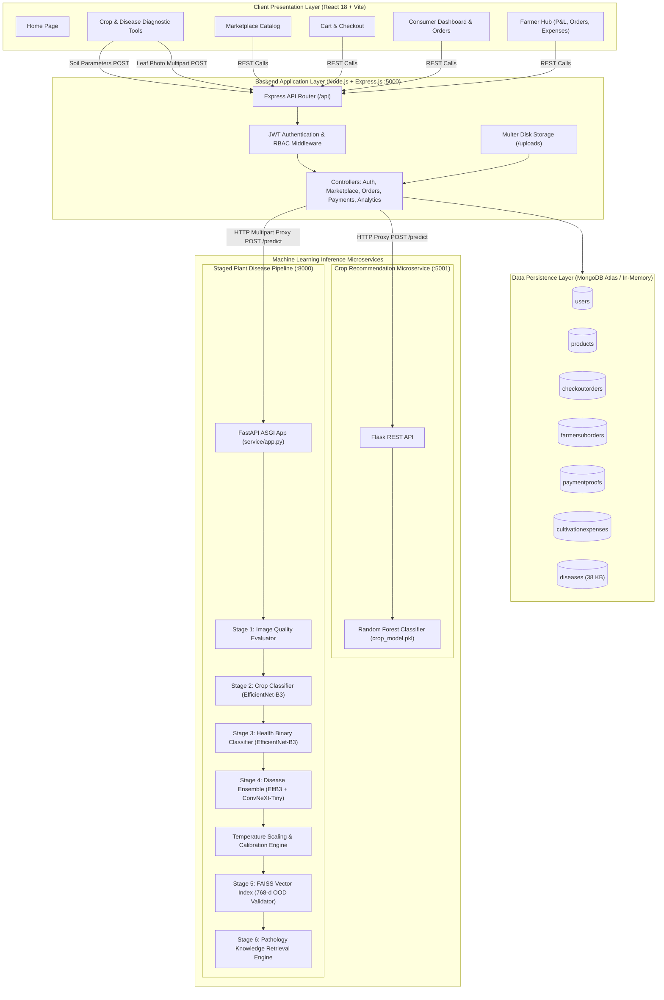
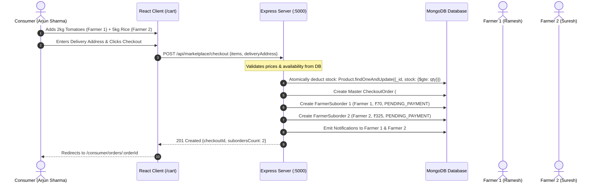
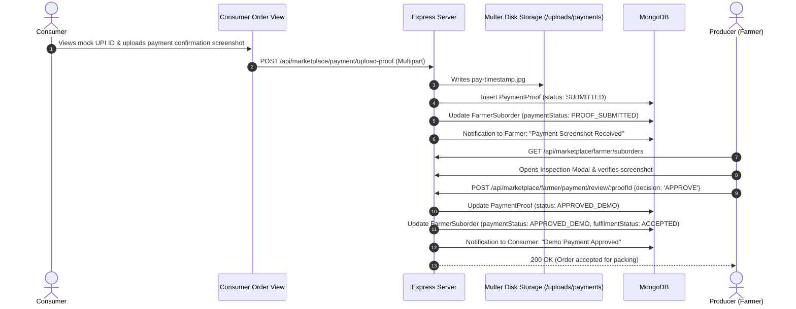

# SMART AGRICULTURE ASSISTANT: COMPLETE TECHNICAL PROJECT REPORT
**An Integrated Machine Learning-Based Platform for Crop Recommendation, Plant Disease Detection, Treatment Guidance, and Direct Farmer-to-Consumer Marketplace**

---

## 1. Executive Summary & Project Identification

### 1.1 Project Overview
The **Smart Agriculture Assistant** is an integrated full-stack agricultural platform designed to bridge the gap between machine learning diagnostics and direct farm-to-table supply chains. The platform integrates:
1. **Soil-Driven Crop Recommendation**: A Random Forest classifier (100 estimators, max depth 10) evaluating 7 agro-climatic and soil parameters ($N, P, K$, temperature, humidity, pH, rainfall) across 22 crop classes.
2. **Multi-Stage Plant Disease Pipeline**: A production-grade inference engine combining Laplacian blur/HSV exposure quality checks, crop classification (EfficientNet-B3, 34 crops), health gating (EfficientNet-B3, diseased vs. healthy), dual-backbone disease ensemble (EfficientNet-B3 + ConvNeXt-Tiny, 116 disease classes), temperature-scaled Platt calibration, and a 768-dimensional FAISS index ($42,652$ reference embeddings) for Out-of-Distribution (OOD) rejection.
3. **Verified Disease Knowledge Base**: 116 plant pathology records specifying symptoms, preventive measures, chemical cures, and organic remedies.
4. **Farmer-to-Consumer Direct Marketplace**: Multi-user MERN stack architecture with atomic stock reservations, multi-farmer checkout splitting, simulated screenshot payment verification, cultivation expense tracking, and real-time Profit & Loss (P&L) accounting.

---

## 2. Technology Stack & Implementation Inventory

### 2.1 Complete Technology Matrix
| Layer | Technology | Version | Purpose & Location |
|---|---|---|---|
| **Frontend Framework** | React.js | 18.2.0 | SPA UI (`client/src/App.jsx`) |
| **Build Tool** | Vite | 5.4.21 | Bundler & Dev Server (`client/vite.config.js`) |
| **CSS System** | Tailwind CSS | 3.4.3 | Responsive Green UI System (`client/tailwind.config.js`, `index.css`) |
| **Icons & Maps** | Lucide React / Leaflet | 0.370.0 / 1.9.4 | UI iconography & GIS visualization (`client/src/pages/NearbyServices.jsx`) |
| **Backend Runtime** | Node.js / Express.js | 18.19.1 / 4.19.2 | RESTful API server (`server/src/app.js`) |
| **Database ODM** | Mongoose | 8.3.1 | Object Data Modeling for MongoDB Atlas (`server/src/config/db.js`) |
| **Authentication** | JWT / Bcryptjs | 9.0.2 / 2.4.3 | Token-based auth & salted password hashing (`server/src/middleware/auth.js`) |
| **Multipart Uploads** | Multer | 1.4.5-lts.1 | Multi-destination file upload handler (`server/src/middleware/marketplaceUpload.js`) |
| **ML Runtime (Crop)** | Scikit-Learn / Joblib | 1.6.1 / 1.4.2 | Model loading & execution (`ml-services/crop-recommendation/app.py`) |
| **ML Microservice (Crop)** | Flask / Python | 3.0.3 / 3.12 | REST endpoint on port 5001 (`ml-services/crop-recommendation/`) |
| **ML Runtime (Disease)** | PyTorch / TIMM | 2.13.0+cpu / 1.0.30 | Deep neural network inference (`ml-services/plant-pipeline/`) |
| **Vector Indexing** | FAISS-CPU | 1.15.1 | 768-d Euclidean similarity & OOD search (`embeddings.faiss`) |
| **Image Processing** | OpenCV / Pillow | 5.0.0.93 / 10.2.0 | Quality checks, Laplacian variance, color conversions |
| **ML Service (Disease)** | FastAPI / Uvicorn | 0.141.1 / 0.54.0 | High-performance ASGI service on port 8000 (`service/app.py`) |

### 2.2 Verified Implementation Inventory
| Module | Implementation Status | Main Files | Verification Evidence |
|---|---|---|---|
| **User Authentication** | Implemented & Verified | `server/src/controllers/authController.js`, `User.js` | JWT 7-day tokens, salted bcrypt hashes, login/register endpoints |
| **Role-Based Guards** | Implemented & Verified | `server/src/middleware/role.js` | Enforces `farmer`, `consumer`, and `admin` permissions; 403 response on violation |
| **Crop Recommendation** | Implemented & Verified | `crop-recommendation/app.py`, `crop_model.pkl` | 7 input features, 22 classes, Flask port 5001 |
| **Plant Quality Gate** | Implemented & Verified | `plant-pipeline/common/quality.py` | Laplacian variance ($\text{blur} \ge 62.29$), brightness clipping ($[30, 248]$), HSV leaf fraction |
| **Crop Classifier** | Implemented & Verified | `plant-pipeline/artifacts/crop_effb3.pt` | 34 classes, EfficientNet-B3, top-1 accuracy $81.48\%$ on validation |
| **Health Gating** | Implemented & Verified | `plant-pipeline/artifacts/health_effb3.pt` | Binary classifier, accuracy $93.94\%$, selective accuracy $95.00\%$ |
| **Disease Ensemble** | Implemented & Verified | `disease_effb3.pt`, `disease_convnext_tiny.pt` | 116 disease classes, ensemble agreement rate $87.05\%$, selective accuracy $94.96\%$ |
| **OOD Similarity** | Implemented & Verified | `embeddings.faiss`, `reference_meta.csv` | 42,652 embeddings, cosine threshold $0.5783$, top-10 neighbor checks |
| **Disease Info KB** | Implemented & Verified | `artifacts/disease_info.json` | 116 classes fully mapped with symptoms, chemical cure, organic remedy |
| **Marketplace Catalog** | Implemented & Verified | `controllers/marketplaceController.js`, `Marketplace.jsx` | Full-text search, category pills, price range, organic filter |
| **Multi-Farmer Orders** | Implemented & Verified | `controllers/orderController.js`, `Cart.jsx` | Splits parent checkout into independent farmer suborders atomically |
| **Simulated Payment** | Implemented & Verified | `controllers/paymentAndFulfilmentController.js` | Screenshot upload, reference tracking, farmer approval/rejection modal |
| **Expense & P&L** | Implemented & Verified | `controllers/analyticsAndExpenseController.js` | 11 expense categories; $\text{Net Profit} = \text{Recognized Revenue} - \text{Expenses}$ |
| **In-App Alerts** | Implemented & Verified | `controllers/notificationController.js`, `Notification.js` | Real-time notifications for order, payment review, and dispatch events |

---

## 3. High-Level System Architecture

---

## 4. End-to-End User Journeys & Workflows

### 4.1 Workflow 1: Multi-Farmer Checkout & Atomic Inventory Reservation

### 4.2 Workflow 2: Simulated Payment Screenshot Verification

---

## 5. Security & Academic Integrity Statement
1. **No External Money Handling**: All financial transactions represent a simulated demonstration environment. The persistent warning banner (`DEMO MARKETPLACE — PAYMENT SCREENSHOTS ARE FOR SIMULATION ONLY`) is enforced across all client pages.
2. **Strict Authorization**: Ownership is verified on every mutation: farmers cannot edit listings, suborders, or expense logs belonging to other farmers (`farmerId: req.user.id`).
3. **Data Integrity**: Passwords are encrypted with 10 rounds of salted bcrypt before database persistence; JWT signatures utilize runtime environment secrets.

