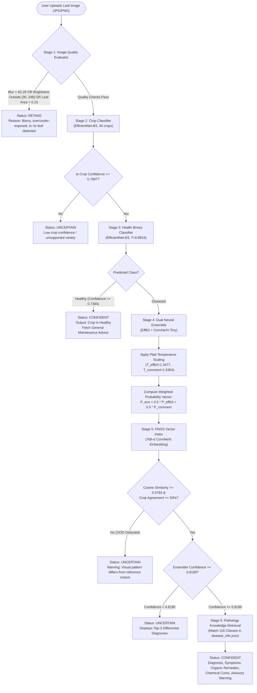

# STAGED PLANT DISEASE DETECTION PIPELINE SPECIFICATION

This document details the multi-stage decision pipeline executed when a leaf image is uploaded to `/api/disease-detection/detect`.

---

## 1. Complete Diagnostic Flowchart

---

## 2. Stage-by-Stage Engineering Breakdown

### Stage 1: Image Quality & Leaf Presence Evaluation
- **Source File**: `ml-services/plant-pipeline/common/quality.py`
- **Blur Estimation**: Evaluates Laplacian operator variance:
  $$\text{Var}(\Delta I) = \frac{1}{HW} \sum_{x,y} \left( \nabla^2 I(x,y) - \mu_{\nabla^2 I} \right)^2$$
  *Rule*: If $\text{Var}(\Delta I) < 62.29$, the image is flagged as blurry.
- **Exposure / Luminance Check**:
  *Rule*: Mean grayscale pixel value must be bounded within $[30, 248]$.
  *Dark/Bright Saturation*: Ratio of clipped black pixels ($< 10$) must not exceed $0.80$; saturated white ($> 250$) must not exceed $0.85$.
- **Leaf Mask Segmentation (HSV Fallback)**:
  Extracts green vegetation mask in HSV color space:
  $$H \in [25, 95], \quad S \in [30, 255], \quad V \in [30, 255]$$
  *Rule*: Green pixel area fraction must be $\ge 0.15$ of total image area.

### Stage 2: Crop Species Identification
- **Model**: `crop_effb3.pt` ($34$ plant classes)
- **Calibrated Temperature**: $T = 0.9618$
- **Confidence Gate**: $\tau_{\text{crop}} = 0.7997$
- **Supported Crops (34 classes)**: `apple`, `banana`, `basil`, `bean`, `bell_pepper`, `blueberry`, `cabbage`, `cantaloupe`, `cassava`, `cherry`, `chickpea`, `citrus`, `coffee`, `corn`, `cotton`, `cucumber`, `eggplant`, `grape`, `mango`, `onion`, `orange`, `peach`, `potato`, `raspberry`, `rice`, `soybean`, `spinach`, `strawberry`, `sugarcane`, `tea`, `tomato`, `watermelon`, `wheat`, `zucchini`.

### Stage 3: Health Binary Classifier
- **Model**: `health_effb3.pt`
- **Output**: `['diseased', 'healthy']`
- **Calibrated Temperature**: $T = 0.8916$
- **Confidence Gate**: $\tau_{\text{health}} = 0.7364$
- **Behavior**: If the top prediction is `healthy` with $p \ge 0.7364$, execution halts early and routes to general plant maintenance tips.

### Stage 4: Dual Neural Ensemble Disease Classification
- **Models**:
  1. `disease_effb3.pt` ($116$ classes, $T = 1.3477$)
  2. `disease_convnext_tiny.pt` ($116$ classes, $T = 1.5364$)
- **Ensemble Fusion**:
  $$\mathbf{p}_{\text{ensemble}} = 0.50 \cdot \text{Softmax}\left(\frac{\mathbf{z}_{\text{effb3}}}{1.3477}\right) + 0.50 \cdot \text{Softmax}\left(\frac{\mathbf{z}_{\text{convnext}}}{1.5364}\right)$$
- **Confidence Gate**: $\tau_{\text{disease}} = 0.8190$ ($94.96\%$ selective accuracy achieved on benchmark).

### Stage 5: Out-of-Distribution & Nearest-Neighbor Validation
- **Engine**: FAISS `IndexFlatIP` search on 768-dimensional ConvNeXt embeddings.
- **Corpus**: $42,652$ reference images from Kaggle dataset `plant-models`.
- **Cosine Metric**:
  $$\cos(\theta) = \frac{\mathbf{e}_{\text{query}} \cdot \mathbf{e}_{\text{ref}}}{\|\mathbf{e}_{\text{query}}\| \|\mathbf{e}_{\text{ref}}\|}$$
- **OOD Threshold**: $\tau_{\text{sim}} = 0.5783$ (95th percentile empirical cut-off).
- If $\cos(\theta)_{\max} < 0.5783$ or top-10 neighbors diverge in crop classification, output transitions to `uncertain`.

### Stage 6: Pathology Knowledge Retrieval
- **Source**: `artifacts/disease_info.json`
- **Matched Fields**:
  - `characteristics`: Detailed visual symptoms on leaf surface.
  - `precautions`: Cultural and preventive farm practices.
  - `cure`: Approved chemical fungicides/bactericides.
  - `organic_remedy`: Bio-pesticides, neem formulations, and organic treatments.
  - `advisory`: Professional guidance cautioning against indiscriminate chemical usage.

