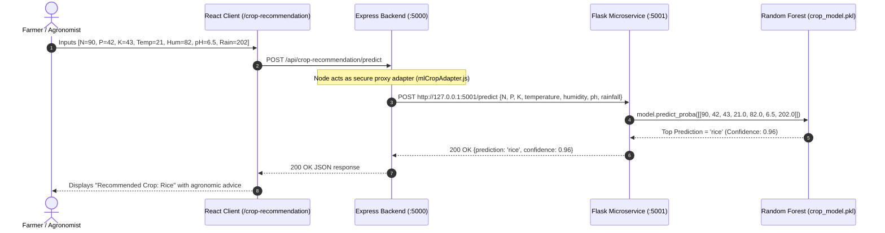

# CROP RECOMMENDATION MODEL TECHNICAL REPORT

This document details the Machine Learning model, input parameter bounds, training methodology, and inference flow for the Soil-Driven Crop Recommendation service.

---

## 1. Algorithmic Overview
- **Goal**: Predict the optimal agricultural crop to sow based on soil chemical composition and regional atmospheric conditions.
- **Algorithm**: Random Forest Classifier (Supervised Bagging Ensemble).
- **Core Library**: Scikit-Learn 1.6.1 (`sklearn.ensemble.RandomForestClassifier`).
- **Persistence Mechanism**: Joblib binary serialization (`ml-services/crop-recommendation/crop_model.pkl`).
- **REST Microservice**: Flask API on port 5001 (`ml-services/crop-recommendation/app.py`).

---

## 2. Feature Specification & Verification Matrix

The model consumes a 7-dimensional real-valued input vector $\mathbf{x} \in \mathbb{R}^7$:

| Index | Feature Name | Variable Name | Unit | Physical Range in Dataset | Measurement Device / Source |
|---|---|---|---|---|---|
| 0 | Nitrogen | `N` | $\text{kg/ha}$ or index | $0 - 140$ | Soil N-P-K Sensor / Chemical Soil Testing Kit |
| 1 | Phosphorus | `P` | $\text{kg/ha}$ or index | $5 - 145$ | Soil Testing Laboratory Analysis |
| 2 | Potassium | `K` | $\text{kg/ha}$ or index | $5 - 205$ | Soil Testing Laboratory Analysis |
| 3 | Temperature | `temperature` | $^{\circ}\text{C}$ | $8.8 - 43.7$ | Regional Weather Station / Sensor Telemetry |
| 4 | Relative Humidity | `humidity` | $\%$ | $14.3 - 99.9$ | Hygrometer / Agricultural Weather API |
| 5 | Soil pH | `ph` | pH unit ($0-14$) | $3.50 - 9.94$ | Digital Soil pH Meter |
| 6 | Rainfall | `rainfall` | $\text{mm}$ | $20.2 - 298.6$ | Rain Gauge / Seasonal Historical Data |

---

## 3. Recommended Crop Classes (22 Target Classes)

The model predicts one of 22 distinct crop varieties:
1. `apple`
2. `banana`
3. `blackgram`
4. `chickpea`
5. `coconut`
6. `coffee`
7. `cotton`
8. `grapes`
9. `jute`
10. `kidneybeans`
11. `lentil`
12. `maize`
13. `mango`
14. `mothbeans`
15. `mungbean`
16. `muskmelon`
17. `orange`
18. `papaya`
19. `pigeonpeas`
20. `pomegranate`
21. `rice`
22. `watermelon`

---

## 4. Hyperparameter Architecture

Inspected via Python deserialization:
- **`n_estimators = 100`**: Aggregation of 100 independent decision trees minimizes prediction variance.
- **`max_depth = 10`**: Constrained tree depth ensures the model avoids memorizing noisy soil outliers while retaining non-linear interaction boundaries.
- **`criterion = 'gini'`**: Measures node purity:
  $$I_G(p) = 1 - \sum_{i=1}^{C} p_i^2$$
- **`bootstrap = True`**: Random sampling with replacement applied across the training split.

---

## 5. End-to-End Inference Workflow

