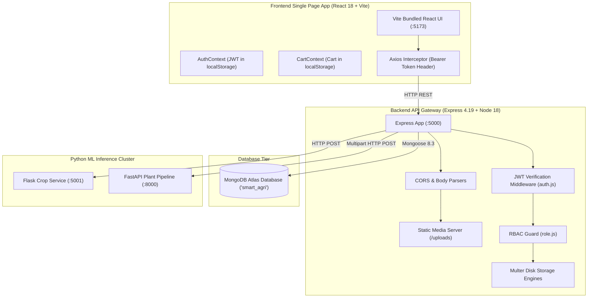

# MERN STACK ARCHITECTURE & API REFERENCE DOCUMENTATION

This document provides complete documentation of the full-stack MERN (MongoDB, Express.js, React.js, Node.js) architecture, middleware, routing layer, and API contracts.

---

## 1. Architectural Layers & Communication Flow

---

## 2. Complete RESTful API Reference

### 2.1 Authentication Endpoints (`/api/auth`)
| Method | Endpoint | Access | Request Body | Successful Response | Error Codes |
|---|---|---|---|---|---|
| `POST` | `/register` | Public | `{ name, email, password, phone, role }` | `201 Created` `{ message, token, user }` | `400` (Duplicate email, missing fields) |
| `POST` | `/login` | Public | `{ email, password }` | `200 OK` `{ message, token, user }` | `400` (Invalid credentials) |
| `GET` | `/me` | Authenticated | None | `200 OK` `{ user }` | `401` (Expired/invalid token) |

### 2.2 Agricultural AI Endpoints
| Method | Endpoint | Access | Payload | Response Payload |
|---|---|---|---|---|
| `POST` | `/api/crop-recommendation/predict` | Optional Auth | `{ N, P, K, temperature, humidity, ph, rainfall }` | `{ status, prediction, confidence, input }` |
| `POST` | `/api/disease-detection/detect` | Optional Auth | `multipart/form-data` (Field: `leafImage`) | `{ status, stage, prediction, confidence, message, top_k, disease_info }` |
| `GET` | `/api/disease-detection/history` | Authenticated | None | `{ history: [ ...past diagnoses... ] }` |
| `DELETE` | `/api/disease-detection/history/:id` | Authenticated | None | `{ message: "Record deleted" }` |
| `GET` | `/api/disease-detection/info` | Public | None | `{ total: 38, diseases: [...] }` |

### 2.3 Direct Marketplace Endpoints (`/api/marketplace`)
| Method | Endpoint | Access / Role | Payload | Description |
|---|---|---|---|---|
| `GET` | `/products` | Public | Query: `search, category, isOrganic, sortBy` | Paginated catalog search |
| `GET` | `/products/:id` | Public | None | Product detail with farmer profile |
| `GET` | `/farmers` | Public | None | Verified farmers directory |
| `GET` | `/farmers/:farmerId` | Public | None | Public farm profile & listings |
| `POST` | `/checkout` | Authenticated | `{ items: [{productId, quantity}], deliveryAddress, deliveryMethod }` | Atomic stock decrement & suborder creation |
| `GET` | `/consumer/orders` | Authenticated | None | Customer order history |
| `GET` | `/consumer/orders/:orderId` | Authenticated | None | Detailed checkout & suborders |
| `POST` | `/consumer/suborders/:id/cancel` | Authenticated | `{ reason }` | Order cancellation & stock restoration |
| `POST` | `/payment/upload-proof` | Authenticated | Multipart (`paymentScreenshot`, `suborderId`) | Submit demo payment screenshot |
| `POST` | `/farmer/payment/review/:proofId`| Farmer Only | `{ decision: 'APPROVE' \| 'REJECT', reviewNote }` | Farmer payment review decision |
| `GET` | `/farmer/suborders` | Farmer Only | Query: `status, paymentStatus` | Incoming customer suborders |
| `PATCH`| `/farmer/suborders/:id/status` | Farmer Only | `{ status, note }` | Update order stage (`ACCEPTED`, `DISPATCHED`, etc.) |
| `GET` | `/farmer/products` | Farmer Only | None | Farmer inventory table |
| `POST` | `/farmer/products` | Farmer Only | Multipart (`images`, product fields) | Publish new produce |
| `PATCH`| `/farmer/products/:id/toggle` | Farmer Only | None | Toggle active/inactive listing status |
| `GET` | `/farmer/expenses` | Farmer Only | Query: `category, startDate, endDate` | List recorded cultivation expenses |
| `POST` | `/farmer/expenses` | Farmer Only | `{ category, amount, cropName, description }` | Log new input expense |
| `GET` | `/farmer/analytics` | Farmer Only | None | Executive financial & P&L metrics |
| `GET` | `/notifications` | Authenticated | None | User notifications & unread badge count |

---

## 3. Frontend Architecture & Page Inventory

| Route Path | Component File | Role Access | Primary Purpose |
|---|---|---|---|
| `/` | `pages/Home.jsx` | Public | Landing page & platform overview |
| `/login` | `pages/Login.jsx` | Public | JWT login with demo credentials hint |
| `/register` | `pages/Register.jsx` | Public | Registration with Farmer vs. Consumer role selector |
| `/dashboard` | `pages/Dashboard.jsx` | Authenticated | Quick launcher for all core diagnostic tools |
| `/crop-recommendation`| `pages/CropRecommendation.jsx` | Authenticated | Soil parameter form & recommendation result |
| `/disease-detection` | `pages/DiseaseDetection.jsx` | Authenticated | Drag-and-drop leaf image diagnosis & treatment cards |
| `/nearby` | `pages/NearbyServices.jsx` | Authenticated | Leaflet map with fertilizer & seed store lookup |
| `/history` | `pages/History.jsx` | Authenticated | Past soil test & leaf prediction logs |
| `/marketplace` | `pages/Marketplace.jsx` | Public | Direct produce marketplace with search & category filters |
| `/marketplace/product/:id` | `pages/ProductDetail.jsx` | Public | Product specifications & Add to Cart button |
| `/marketplace/farmers` | `pages/FarmersDirectory.jsx` | Public | Directory of verified cultivators |
| `/marketplace/farmers/:id` | `pages/FarmerProfileView.jsx` | Public | Public farm profile with all products from that grower |
| `/cart` | `pages/Cart.jsx` | Public / Auth | Grouped multi-farmer cart & checkout form |
| `/consumer/orders` | `pages/ConsumerOrders.jsx` | Consumer | Order history with status tracking |
| `/consumer/orders/:orderId` | `pages/OrderDetails.jsx` | Consumer | Suborder progress & screenshot upload modal |
| `/farmer/dashboard` | `pages/FarmerDashboard.jsx` | Farmer | Executive command center with stock alerts & demo sales |
| `/farmer/products` | `pages/FarmerProducts.jsx` | Farmer | Produce inventory management & status toggles |
| `/farmer/products/new` | `pages/ProductForm.jsx` | Farmer | Create or edit produce listings |
| `/farmer/orders` | `pages/FarmerOrders.jsx` | Farmer | Tabbed order fulfillment & payment review modal |
| `/farmer/expenses` | `pages/CultivationExpenses.jsx` | Farmer | Input expense tracker (seeds, labour, irrigation) |
| `/farmer/profit-loss` | `pages/ProfitAndLoss.jsx` | Farmer | Net profit ledger with CSV report export |
| `/farmer/profile` | `pages/FarmerSettingsProfile.jsx` | Farmer | Farm information & delivery policy editor |

