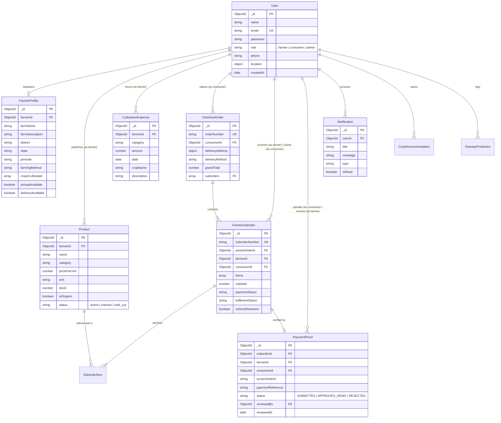

# MONGODB DATABASE DESIGN & ENTITY RELATIONSHIP (ER) DOCUMENTATION

This document details the database architecture, Mongoose schemas, collection relationships, indexes, and concurrency mechanisms implemented in the Smart Agriculture Assistant application.

---

## 1. Entity-Relationship (ER) Diagram



---

## 2. Collection Specifications & Schema Definitions

### 2.1 `users` Collection ([User.js](file:///home/syed-rumanuddin/E4/SEM%201/major%20project/Smart%20Agriculture%20Mangement/server/src/models/User.js))
- **Primary Key**: `_id` (`ObjectId`)
- **Indexes**: `email` (Unique, Lowercase)
- **Pre-Save Middleware**: Automatically hashes passwords with 10 salt rounds of `bcryptjs` if modified.
- **Instance Method**: `comparePassword(candidatePassword)` returns boolean promise.

### 2.2 `farmerprofiles` Collection ([FarmerProfile.js](file:///home/syed-rumanuddin/E4/SEM%201/major%20project/Smart%20Agriculture%20Mangement/server/src/models/FarmerProfile.js))
- **Foreign Key**: `farmerId` $\to$ `User._id` (Unique, Indexed)
- **Fields**: `farmName`, `farmDescription`, `village`, `district`, `state`, `pincode`, `contactPhone`, `cropsCultivated` (Array), `farmingMethod` (`'organic' | 'conventional' | 'natural' | 'mixed'`), `deliveryAreas` (Array), `pickupAvailable` (Boolean), `deliveryAvailable` (Boolean).

### 2.3 `products` Collection ([Product.js](file:///home/syed-rumanuddin/E4/SEM%201/major%20project/Smart%20Agriculture%20Mangement/server/src/models/Product.js))
- **Foreign Key**: `farmerId` $\to$ `User._id` (Indexed)
- **Fields**: `name` (Indexed), `category` (Indexed), `description`, `images` (Array), `pricePerUnit` ($\ge 0.01$), `unit`, `stock` (Indexed), `minOrderQty`, `maxOrderQty`, `isOrganic` (Indexed), `farmingMethod`, `location`, `status` (`'active' | 'inactive' | 'sold_out'`).

### 2.4 `checkoutorders` Collection ([CheckoutOrder.js](file:///home/syed-rumanuddin/E4/SEM%201/major%20project/Smart%20Agriculture%20Mangement/server/src/models/CheckoutOrder.js))
- **Primary Key**: `_id`
- **Unique Identifier**: `orderNumber` (e.g., `ORD-2026-XXXX`)
- **Foreign Keys**: `consumerId` $\to$ `User._id`, `suborders` (Array of `ObjectId` $\to$ `FarmerSuborder._id`).
- **Fields**: `deliveryAddress` (`fullName`, `phone`, `street`, `city`, `district`, `state`, `pincode`), `deliveryMethod`, `grandTotal`.

### 2.5 `farmersuborders` Collection ([FarmerSuborder.js](file:///home/syed-rumanuddin/E4/SEM%201/major%20project/Smart%20Agriculture%20Mangement/server/src/models/FarmerSuborder.js))
- **Foreign Keys**: `parentOrderId` $\to$ `CheckoutOrder`, `farmerId` $\to$ `User`, `consumerId` $\to$ `User`.
- **Embedded Schema**: `items` containing immutable transaction snapshots:
  `{ productId, name, price, unit, quantity, subtotal, imageSnapshot }`
- **State Fields**:
  - `paymentStatus`: `['PENDING_PAYMENT', 'PROOF_SUBMITTED', 'APPROVED_DEMO', 'REJECTED_PROOF', 'CANCELLED']`
  - `fulfilmentStatus`: `['PLACED', 'ACCEPTED', 'PROCESSING', 'READY_FOR_DISPATCH', 'DISPATCHED', 'DELIVERED', 'REJECTED_BY_FARMER', 'CANCELLED']`
  - `statusHistory`: Array of audit events `{ status, timestamp, note, changedBy }`.
  - `isStockRestored`: Boolean idempotency flag preventing duplicate stock rollbacks on repeated cancellation calls.

### 2.6 `paymentproofs` Collection ([PaymentProof.js](file:///home/syed-rumanuddin/E4/SEM%201/major%20project/Smart%20Agriculture%20Mangement/server/src/models/PaymentProof.js))
- **Foreign Keys**: `suborderId` $\to$ `FarmerSuborder`, `farmerId` $\to$ `User`, `consumerId` $\to$ `User`, `reviewedBy` $\to$ `User`.
- **Fields**: `screenshotUrl`, `paymentReference`, `paymentMethod` (default: `'DEMO_UPI'`), `status` (`'SUBMITTED' | 'APPROVED_DEMO' | 'REJECTED'`), `reviewNote`, `reviewedAt`.

### 2.7 `cultivationexpenses` Collection ([CultivationExpense.js](file:///home/syed-rumanuddin/E4/SEM%201/major%20project/Smart%20Agriculture%20Mangement/server/src/models/CultivationExpense.js))
- **Foreign Key**: `farmerId` $\to$ `User` (Indexed).
- **Categories**: `['Seeds', 'Fertilizers', 'Pesticides', 'Organic Treatments', 'Irrigation', 'Labour', 'Equipment', 'Transport', 'Packaging', 'Land Preparation', 'Other']`.
- **Fields**: `amount` (Number $\ge 0$), `date` (Indexed), `cropName`, `description`, `receiptUrl`.

---

## 3. Concurrency Control & Stock Safety

To guarantee database consistency in distributed environments without requiring multi-document replica-set transactions:

```javascript
// Atomic reservation at checkout
const updated = await Product.findOneAndUpdate(
  { _id: item.productId, stock: { $gte: Number(item.quantity) }, status: 'active' },
  { $inc: { stock: -Number(item.quantity) } },
  { new: true }
);

if (!updated) {
  // Compensating rollback for previously decremented items
  throw new Error("Insufficient stock or race condition encountered.");
}
```

Stock is restored automatically if a farmer rejects an order or if the consumer cancels before dispatch:
```javascript
if (!suborder.isStockRestored) {
  for (const item of suborder.items) {
    await Product.findByIdAndUpdate(item.productId, {
      $inc: { stock: item.quantity },
      $set: { status: 'active' }
    });
  }
  suborder.isStockRestored = true;
}
```

